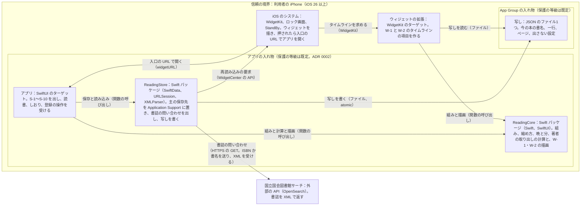

# A 技術設計メモ 001-reading-session：夜の入口、本の出口（v1）

- 書いた役：tech-lead　日付：2026-10-20
- PRD：docs/prd/001-reading-session.md（承認済み、コミット 9f7c5d9）　デザイン：design/001-reading-session.md、tokens.md、screens.md（コミット bb94976）　契約：contracts/（7-2〜7-4 で書く。サーバーはない）
- 状態：下書き（G1 の 7-1。裁定 27）。今回書いたのは 1、2、3、5、6、7、8、9。4、10、末尾の確かめ（A）は 7-4 で仕上げる。分かっている所だけ先に書いた。
- この機能の ADR：docs/adr/0001-ios-foundation.md（iOS の土台）、docs/adr/0002-storage-and-sharing.md（保存と共有）。0003（縦書き、7-3）、0004（書誌、7-2）、0005（テストのつなぎ口、7-4）はこれから。

## 1. 範囲、目標、非目標
- 範囲
  - 芯の AC 85件（裁定 24。PRD の冒頭の進め方 (i)）。章は、登録と最初の本、本棚と本の画面、毎晩の入口のうちウィジェット、読み始める・伏せて読む・数える、しおりを挟む（撮る道を除く）、読み終えた夜（カードと受賞を除く）、設定と保存、速さ。
  - 選択肢の AC 51件（課金、ショートカット、(3)、(4)、(5)、(6)）は、冒頭の (iii) で回す所が決まってから、残す分の行をこの表に足す。今は 2 の表の末尾に、回す順ごとに1行ずつ置いた。
  - AC-87 は 3b が届かなかったときの条件つきの AC。芯の行に入れ、3b の結果で AC-78〜AC-80 と入れ替える（AC-83 は受賞の選択肢）。
- 目標
  - 芯の AC 85件を、サーバーなし、外部のライブラリなし、iOS 26 以上の iPhone で満たす（ADR 0001）。
  - 毎晩の道（W-1、W-2、S-1〜S-5）は通信なしで全部動く（AC-62）。端末の外に出るのは書誌の問い合わせだけ（AC-103）。
  - PRD 12 の速さの線（起動1.0秒、「終える」から0.5秒、本棚1.0秒、ウィジェット0.5秒）を Release の構成で満たす（6）。
- 非目標（この設計でやらないこと）
  - PRD 10 のやらないこと：サーバー、アカウント、友人、同期、表紙の画像、外部の計測（裁定 10）、晩ごとのしおり、iPad 専用の画面、Apple Watch、Mac と Vision Pro への配布。
  - 選択肢の設計：Live Activity、App Intents（H32）、読み終えのカード（H24）、受賞の一覧（H25）、撮る道（H19、H27）、課金（H30）。回す所が決まってから足す。
  - 強制アップデート（ADR 0001。サーバーがない）。

## 2. 受け入れ条件の対応表
- サーバーがないので、operationId の列は「国立国会図書館サーチへの問い合わせ」か「つなぎ口の番号」で代えた。
  - 問い合わせの operationId は `ndlOpenSearch`（仮）。7-2 で contracts/ndl-opensearch.yaml に、GET /api/opensearch の1つとして書く。括弧の中は引数（isbn か title）か、差し替える応答。
  - 端末の中だけで済む AC は「なし（端末のみ）」と書き、AC が使う主なつなぎ口（H 番号）を添えた。H の形は contracts/（7-4）で書く。
- データの列のエンティティは 5 の表のもの：Book（本）、Record（記録）、Session（読書中の1件）、Settings（設定）、Snapshot（App Group の写し）。
- テストの列は PRD の「確かめ方」の写し。「画面」は画面のテスト、「ウィジェット」は H22 で読むウィジェットのテスト。「／」の後ろは G4 の項目。
- 芯の AC が使うつなぎ口は23個（H1、H2、H4〜H10、H12〜H18、H20〜H22、H26、H28、H29、H31）。H23、H24、H25 は、芯の AC の中の選択肢の部分（Live Activity、カード、受賞）だけで使う（G1 のデザインの判定 r1 の D）。

### 登録と最初の本
| AC | 画面（design/） | operationId の代わり | データ（エンティティ） | 確かめるテスト |
|---|---|---|---|---|
| AC-1 | S-1（空） | なし（端末のみ）。H14、H26 | Book 0件、Settings | 画面（H14、H26。端末を消すので、ランダム順の実行と分けて動かす）／G4-5 |
| AC-2 | S-1 → S-8 → S-8a → S-1 | ndlOpenSearch（isbn）。H20、H21、H26 | Book（置き場所 current、ISBN、書誌） | 画面（H1、H13、H20、H21、H26）／G4-10 |
| AC-3 | S-8a | ndlOpenSearch（isbn）。H17、H20、H21 | Book（tsundoku。重なりは ISBN で見る） | 画面（H2、H13、H17、H20、H21、H26）／G4-10 |
| AC-4 | S-8 → S-8b | ndlOpenSearch（title、cnt=50）。H20 | Book | 画面（H1、H13、H20） |
| AC-5 | S-8b（空） | ndlOpenSearch（title。0件の応答）。H20 | なし（保存しない） | 画面（H1、H20） |
| AC-6 | S-8b（オフライン） | ndlOpenSearch（通信なし）。H8 | なし（保存しない） | 画面（H1、H8）／G4-4 |
| AC-7 | S-8 → S-8c | なし（端末のみ）。H2、H13 | Book（書誌の状態 none） | 画面（H2、H13） |
| AC-8 | S-8c（エラー） | なし（端末のみ）。H13 | なし（保存しない） | 画面（H1、H13） |
| AC-9 | S-8a → S-1、S-6、S-7 | ndlOpenSearch（isbn。通信がなければ順番待ちにし、戻ったら問い合わせる）。H8、H20、H21 | Book（書誌の状態 pending） | 画面（H1、H8、H13、H20、H21、H26）／G4-4 |
| AC-10 | S-1、S-7 | ndlOpenSearch（isbn。0件の応答）。H4、H6、H20 | Book（書誌の状態 notFound、前に問い合わせた日時） | 画面（H1、H4、H6、H13、H20、H21、H26） |
| AC-11 | S-1、S-6、S-7 | ndlOpenSearch（HTTP の失敗）。H20 | Book（書誌の状態 pending のまま） | 画面（H1、H13、H20、H21、H26） |
| AC-113 | S-1、S-6、S-7、S-7a | ndlOpenSearch（isbn。前に来たとき、24時間以上たっていれば1回。加えてから45日まで）。H4、H5、H6、H20 | Book（加えた日時、前に問い合わせた日時、手で直した印） | 画面（H2、H4、H5、H6、H13、H20）／G4-10 |
| AC-12 | S-8（権限） | なし（端末のみ）。H26 | なし | 画面（H1、H26）／G4-5 |
| AC-92 | S-7 | ndlOpenSearch（isbn。dc:creator と author の要素）。H20 | Book.author（取り出した形で保存） | 画面（H1、H13、H20、H21、H26）。取り出しの単体テストを添える |

### 本棚と本の画面
| AC | 画面（design/） | operationId の代わり | データ（エンティティ） | 確かめるテスト |
|---|---|---|---|---|
| AC-13 | S-1 → S-6 | なし（端末のみ）。H2、H13 | Book（置き場所、積読に加えた日時） | 画面（H2、H13） |
| AC-14 | S-6 → S-7 → S-1 | なし（端末のみ）。H22 | Book（置き場所、積読に加えた日時、読み終えた日時）、Snapshot | 画面（H2、H13、H22） |
| AC-15 | S-7 → S-7a → S-7 | なし（端末のみ）。H13 | Book（書名、著者、手で直した印） | 画面（H2、H13） |
| AC-16 | S-7 → 確認 → S-6 | なし（端末のみ）。H12、H22 | Book と Record（一緒に消す）、Snapshot | 画面（H2、H12、H13、H22） |
| AC-17 | S-7 | なし（端末のみ）。H2 | Book（書名、著者、出版社、レーベル、出版年） | 画面（H2。H25 は受賞の行だけで、選択肢 (4)） |
| AC-18 | S-7 | なし（端末のみ）。H2 | Book（空の項目の行は出さない） | 画面（H2。H25 は選択肢 (4)） |
| AC-22 | S-7 | なし（端末のみ）。H6 | Record（読み始めの日時、タイムゾーン、分） | 画面（H2、H6、H13） |
| AC-23 | S-7（空） | なし（端末のみ）。H2 | Record 0件 | 画面（H2） |
| AC-24 | S-7 → S-7b | なし（端末のみ）。H13 | Record.minutes | 画面（H2、H13） |
| AC-25 | S-7b（エラー） | なし（端末のみ）。H13 | なし（保存しない） | 画面（H2、H13） |
| AC-26 | S-7b → 確認 → S-7 | なし（端末のみ）。H13 | Record（消す） | 画面（H2、H13） |

### 毎晩の入口（ウィジェット）
| AC | 画面（design/） | operationId の代わり | データ（エンティティ） | 確かめるテスト |
|---|---|---|---|---|
| AC-27 | W-1 | なし（端末のみ）。H22 | Snapshot（書名、一行、ページ） | ウィジェット（H2、H22）とスクリーンショット／G4-1、G4-18 |
| AC-28 | W-1 | なし（端末のみ）。H22（組みの結果） | Snapshot.line | ウィジェット（H2、H22）とスクリーンショット／G4-1 |
| AC-29 | W-1、S-1 | なし（端末のみ）。H22 | Snapshot.line（写しは全文。縮めるのは描くときの ReadingCore） | ウィジェットと画面（H2、H22）／G4-1 |
| AC-30 | W-1 | なし（端末のみ）。H22 | Snapshot.line | ウィジェット（H2、H22） |
| AC-31 | W-1、W-2 | なし（端末のみ）。H22 | Snapshot（一行なし、ページあり／なし） | ウィジェット（H2、H22） |
| AC-32 | W-1、W-2 | なし（端末のみ）。H22 | Snapshot（今の本なし） | ウィジェット（H1、H2、H22） |
| AC-33 | S-3a → S-4 → S-1、W-1 | なし（端末のみ）。H22（再読み込みの要求の回数） | Book（一行、ページ）、Snapshot | ウィジェットと画面（H2、H4、H5、H22）／G4-2 |
| AC-34 | S-10、W-1、W-2、S-1 | なし（端末のみ）。H22（H23 は Live Activity の部分だけで、選択肢 (5)） | Settings.hideOnWidgets、Snapshot | ウィジェットと画面（H2、H4、H5、H6、H22。H23 は (5) を残すときだけ）／G4-1 |
| AC-35 | W-2 | なし（端末のみ）。H22 | Snapshot | ウィジェット（H2、H22）とスクリーンショット／G4-3、G4-18 |
| AC-39 | S-1 | なし（端末のみ）。H9、H17（H23 は選択肢 (5)） | Book、Session なし | 画面（H2、H9、H17。H23 は (5) を残すときだけ） |
| AC-40 | W-1、W-2、S-1 | なし（端末のみ）。H28（入口の URL）、H17（entry）、H22（押したときの URL） | Session.entry → Record.entry | 画面（H2、H4、H5、H17、H22、H28。(3) は選択肢 (5)）／G4-18 |
| AC-96 | S-3a → S-1 → S-5 → S-1 | なし（端末のみ）。H17（notice=widgetGuide） | Settings.widgetGuideShown | 画面（H2、H12、H13、H17） |
| AC-99 | W-1、S-1 | なし（端末のみ）。H22（読み上げのラベルとまとまりの数） | Snapshot.line（ラベルは保存した一行から作る） | ウィジェットと画面（H2、H22）／G4-13 |

### 読み始める、伏せて読む、数える
| AC | 画面（design/） | operationId の代わり | データ（エンティティ） | 確かめるテスト |
|---|---|---|---|---|
| AC-42 | S-1 → S-2 | なし（端末のみ）。H9 | Session | 画面（H2、H9） |
| AC-43 | S-2 | なし（端末のみ）。H9 | Session | 画面（H2、H9）とスクリーンショット |
| AC-44 | S-1 → S-2 | なし（端末のみ）。H15、H16、H17 | Session | 画面（H2、H9、H15、H16、H17）／G4-7、G4-14 |
| AC-45 | S-1 | なし（端末のみ）。H15、H16、H17 | なし（始まらない） | 画面（H2、H9、H15、H16、H17）／G4-14 |
| AC-46 | S-1（空、今の本なし） | なし（端末のみ）。H15、H16、H17 | なし（始まらない） | 画面（H1、H2、H9、H15、H16、H17） |
| AC-47 | S-1 のほかの全画面、シートと知らせが出ている S-1 | なし（端末のみ）。H15、H16、H17（flipMonitoring） | なし（始まらない） | 画面（H2、H9、H15、H16、H17） |
| AC-48 | S-2 | なし（端末のみ）。H4、H5、H15、H16、H17 | Session（1つのまま） | 画面（H2、H4、H5、H9、H15、H16、H17） |
| AC-49 | S-1 → S-2 | なし（端末のみ）。H17（announce） | Session | 画面（H2、H15、H16、H17）／G4-13 |
| AC-50 | S-1 | なし（端末のみ）。H2 | Settings.flipToStart | 画面（H2） |
| AC-51 | S-10 → S-1 | なし（端末のみ）。H17、H18 | Settings.flipToStart | 画面（H1、H2、H9、H15、H16、H17、H18） |
| AC-52 | S-2 | なし（端末のみ）。H4、H5（後ろにいる間に進める） | Session（読み始めの日時との差で数える） | 画面（H2、H4、H5）／G4-8 |
| AC-53 | S-2 | なし（端末のみ）。H4、H9 | Session（保存してあるので、開き直しても続く） | 画面（H2、H4、H9）／G4-9 |
| AC-54 | S-2 | なし（端末のみ）。H17（idleTimerDisabled、proximity） | なし | 画面（H2、H5、H9、H15、H16、H17）と grep |
| AC-55 | S-2 → S-3 | なし（端末のみ）。H10（os_signpost の区間） | Session → Record | 画面（H2、H4、H5、H10）／G4-15 |
| AC-56 | S-2 → S-1、S-3 | なし（端末のみ）。H4、H5、H12 | Session を消す（59秒）、Record（60秒） | 画面（H2、H4、H5、H9、H12） |
| AC-57 | S-2 → S-3 → S-4 | なし（端末のみ）。H4、H5、H12 | Record.minutes（上限1440） | 画面（H2、H4、H5、H12） |
| AC-58 | S-2 → S-1 | なし（端末のみ）。H4、H12 | Session を消す。Record は足さない | 画面（H2、H4、H9、H12） |
| AC-59 | S-1 | なし（端末のみ）。H7（session.start） | Session（保存に失敗したら作らない） | 画面（H2、H7、H9、H12、H15、H16、H17） |
| AC-60 | S-2 | なし（端末のみ）。H7（session.end） | Session を残す。Record は足さない | 画面（H2、H4、H5、H7、H9、H12） |
| AC-61 | S-1、S-2 | なし（端末のみ）。H4、H5 | Session と Record が1つずつ | 画面（H2、H4、H5、H9、H13） |
| AC-62 | W-1 → S-1 → S-2 → S-3 → S-3a → S-4 | なし（端末のみ）。H8、H22、H28 | Session、Record、Book、Snapshot | 画面（H2、H4、H5、H8、H22、H28）／G4-4 |

### しおりを挟む
| AC | 画面（design/） | operationId の代わり | データ（エンティティ） | 確かめるテスト |
|---|---|---|---|---|
| AC-63 | S-3 | なし（端末のみ）。H4、H5 | なし | 画面（H2、H4、H5）。撮る道は選択肢 (6) |
| AC-64 | S-1 → S-3（シート）→ S-3a → S-1 | なし（端末のみ）。H22 | Book（一行、ページ）、Snapshot | 画面（H2、H9、H13、H22） |
| AC-71 | S-3 → S-3a | なし（端末のみ）。H13 | Book（一行、ページ） | 画面（H13） |
| AC-72 | S-3a（エラー） | なし（端末のみ）。H13 | なし（保存しない） | 画面（H13） |
| AC-73 | S-3 → S-3b | なし（端末のみ）。H22 | Book（ページ。前の一行を消す）、Snapshot | 画面（H13、H22） |
| AC-74 | S-3b（エラー） | なし（端末のみ）。H13 | なし（保存しない） | 画面（H13） |
| AC-75 | S-3 → S-4 | なし（端末のみ）。H4、H5 | Record（分）。Book は変えない | 画面（H2、H4、H5、H13） |
| AC-76 | S-4 → S-1 | なし（端末のみ）。H4、H5 | Record、Book.page（前のページは画面の流れの中で持つ） | 画面（H2、H4、H5） |
| AC-95 | S-3a（エラー） | なし（端末のみ）。H7（mark.save） | Book（一行とページは前のまま） | 画面（H2、H4、H5、H7、H12、H13） |

### 読み終えた夜
| AC | 画面（design/） | operationId の代わり | データ（エンティティ） | 確かめるテスト |
|---|---|---|---|---|
| AC-77 | S-1 → S-9 | なし（端末のみ）。H13（H25 は受賞の行だけで、選択肢 (4)） | Book（置き場所 finished、読み終えた日時） | 画面（H2、H13、H25） |
| AC-78 | S-9 | なし（端末のみ）。H2 | Book（tsundoku、積読に加えた日時、著者、レーベル） | 画面（H2、H25）と並べ方の単体テスト |
| AC-79 | S-9 | なし（端末のみ）。H2 | Book | 画面（H2、H25） |
| AC-80 | S-9 | なし（端末のみ）。H2 | Book | 画面（H2、H25） |
| AC-81 | S-9（空） | なし（端末のみ）。H2 | Book（tsundoku 0件） | 画面（H2、H25） |
| AC-82 | S-9 → S-1 | なし（端末のみ）。H22 | Book（置き場所）、Snapshot | 画面（H13、H22） |
| AC-86 | S-1、S-2、S-3、S-3b、S-4 | なし（端末のみ）。H4、H5 | なし | 画面（H2、H4、H5） |
| AC-87 | S-9（3b が届かなかったとき） | なし（端末のみ）。H2 | Book | 画面（H2、H25）。3b の結果で AC-78〜AC-80 と入れ替える |

### 設定と保存
| AC | 画面（design/） | operationId の代わり | データ（エンティティ） | 確かめるテスト |
|---|---|---|---|---|
| AC-88 | S-1 → S-10 | なし（端末のみ）。H31（開いた URL） | なし | 画面（H2、H31） |
| AC-89 | S-1、S-6、S-7、S-10 | なし（端末のみ）。H13 | Book、Record、Settings（入口の時刻は選択肢 (5)） | 画面（H4、H5、H6、H13）／G4-17 |
| AC-90 | S-1（エラー） | なし（端末のみ）。H7（store.load） | ストア全体（消さない） | 画面（H2、H7、H12、H13） |
| AC-91 | S-3a、S-7、S-7a、S-7b、S-8a〜S-8c、S-1 | なし（端末のみ）。H7（book.add、book.update、book.delete、book.status、record.update、record.delete、mark.save） | Book、Record（前のまま） | 画面（H2、H7、H12、H13。7通り） |
| AC-93 | S-1 → S-10 | なし（端末のみ）。H31 | なし（文は ADR 0004 のクレジットの文字列） | 画面（H2、H31）。文が条件に合うかは 7-2 で照らす |
| AC-103 | 全画面（S-8 の説明の1行） | ndlOpenSearch だけ。H29（送った要求の記録）。H24 はカードの部分で選択肢 (3) | なし | 画面（H1、H5、H20、H21、H24、H26、H29）と G2 の grep／G4-20 |

### 速さ
| AC | 画面（design/） | operationId の代わり | データ（エンティティ） | 確かめるテスト |
|---|---|---|---|---|
| AC-100 | S-1 | なし（端末のみ）。H2。Release の構成 | ストア（本3冊、記録10件） | 性能（H2。XCTApplicationLaunchMetric を5回）／G4-15 |
| AC-101 | S-6、S-7 | なし（端末のみ）。H10。Release の構成 | ストア（本500冊、記録5,000件） | 画面（H2、H10）／G4-15 |
| AC-102 | W-1、W-2 | なし（端末のみ）。H22（項目を返すまでの時間）。Release の構成 | Snapshot | ウィジェット（H2、H22） |

### 選択肢（回す所が決まってから、残す分を行ごとに足す）
| 回す順 | AC | 足すときに要るもの |
|---|---|---|
| 選択肢（課金） | AC-104〜AC-111 | StoreKit 2、H30、G1-2 の spike、見た目の id の保存（Settings）、書体のライセンスの ADR（G1-8） |
| 選択肢（ショートカット） | AC-121〜AC-124、AC-133〜AC-135 | App Intents、H32（G1-17）、「どこまで読んだ？」の読み込み（ADR 0002 の等級のまま） |
| 選択肢 (3) | AC-84、AC-85、AC-127〜AC-129 | 共有シート、H24、カードの画像、ふりかえりの文の型 |
| 選択肢 (4) | AC-19〜AC-21、AC-83、AC-112 | 受賞の一覧（アプリに入れるデータ）、H25、名前のそろえ方 |
| 選択肢 (5) | AC-36〜AC-38、AC-41、AC-97、AC-98、AC-114〜AC-120、AC-130〜AC-132、AC-136 | ActivityKit、H23、H32、G1-4 と G1-19 の spike、入口の時刻（Settings） |
| 選択肢 (5) と (ショートカット) | AC-125、AC-126 | 上の2つの両方 |
| 選択肢 (6) | AC-65〜AC-70、AC-94 | VisionKit か Vision の文字の読み取り、H19、H27、一時ファイルを書かない撮り方 |

## 3. 構成図
システムコンテキスト図とコンテナ図を1つにまとめた（サーバーがなく、外の相手は1つだけのため）。矢印はすべて一方向。囲みが信頼の境界。

- テストのつなぎ口（H1〜H31）は、テストの構成でだけアプリに入る。App Store の版には入れない（ADR 0005、7-4）。だから図に入れていない。
- 選択肢を残したときに足す要素：Live Activity とインテント（(5)、ショートカット）、共有シート（(3)）、StoreKit（課金）、カメラの文字の読み取り（(6)）。

## 4. 契約の変更と互換性（7-4 で埋める）
今わかっている所だけを書いた。

| operationId | 足す / 変える | AC | 認証 | 作る POST の Idempotency-Key |
|---|---|---|---|---|
| ndlOpenSearch（仮。国立国会図書館サーチの GET /api/opensearch） | 足す（7-2） | AC-2〜AC-6、AC-9〜AC-11、AC-92、AC-103、AC-113 | 不要 | 対象外（GET だけ） |

- spectral の出力：7-2 と 7-4 で貼る。
- oasdiff breaking の出力：main に契約がないので「新規」の見込み。7-4 で確かめて貼る。
- 互換性を壊す変更：なし（新規）。
- 返す enum：外の API は XML の要素で、こちらの enum はない。端末の中の enum（置き場所、書誌の状態、入口の印）は、知らない値を読んだときの扱いを 5 に書いた。
- エラー：外の API なので problem+json ではない。HTTP の失敗、0件、通信なしを、文言キー `book.pendingInfo`、`book.infoNotFound`、`search.noResults`、`search.offline` に対応させる（7-2）。
- ほかの契約（サーバーのない形の契約）
  - 7-2：contracts/ndl-opensearch.yaml
  - 7-3：contracts/widget-snapshot.schema.json、contracts/entry-urls.md
  - 7-4：contracts/test-hooks.md と hooks/ の JSON Schema、contracts/dependencies.md の行

## 5. データモデルと移行
| エンティティ | 正しいデータの置き場所（端末 / サーバー） | 個人情報か | 保存期間 | 消し方 |
|---|---|---|---|---|
| Book（本） | 端末（SwiftData。Application Support。ADR 0002） | はい（読書の好みが分かる。PRD 12 の扱う個人データ） | 利用者が消すまで | S-7 の「この本を消す」（記録も一緒に消える）。アプリを消す |
| Record（記録） | 端末（同じストア） | はい（読書の日時と分、入口の印） | 利用者が消すまで | S-7b の「この記録を消す」、本を消す、アプリを消す |
| Session（読書中の1件。0件か1件） | 端末（同じストア） | はい（読書の時刻） | 読書が終わるまで | 終えると消える（1分未満、時刻の戻りでも消える）。アプリを消す |
| Settings（設定。1件） | 端末（同じストア） | いいえ［推測。好みの設定だけで、本の中身を含まない］ | アプリを消すまで | アプリを消す |
| Snapshot（写し） | 端末（App Group の JSON。ADR 0002） | はい（書名と一行） | 次に書くまで（上書き） | 上書き。今の本がなくなれば空にする。アプリを消す |
| 書誌の応答（XML） | 端末のメモリだけ（保存しない） | いいえ（公開の書誌） | 読み終えたら捨てる | 保存しないので消すものはない |
| 入口の一時の値（開いた入口と時刻） | 端末のメモリだけ | いいえ | アプリが後ろに回るまで | 保存しないので消すものはない |

- Book の項目
  - id（UUID、一意）、isbn（13桁。手で入れた本は空）、title（1〜100字）、author（0〜100字。書誌の著者は AC-92 の決まりで取り出した形）
  - publisher、label（レーベル）、publishedYear（出版年）。書誌のどの要素から取るかは 7-2 の ADR 0004
  - shelf（置き場所：current、tsundoku、finished）、addedAt（加えた日時）、tsundokuAt（積読に加えた日時。置き場所を tsundoku にした日時を入れる）、finishedAt（読み終えた日時。finished にした日時を入れ、ほかへ移したら消す）
  - line（一行。1〜60字）、page（1〜9999）
  - lookupStatus（書誌の状態：none＝手で入れた、pending＝まだ、found、notFound）、lastLookupAt（前に問い合わせた日時）、manuallyEdited（書名か著者を手で直した印。直したら問い合わせ直さない。AC-113）
  - records（Record の一覧。本を消すと一緒に消える）
- Record の項目：id、startedAt（読み始めの日時）、timeZoneID（読み始めたときのタイムゾーン。晩の日付はこれで出し、あとで変えない。AC-22）、minutes（1〜1440）、entry（入口の印：lock_widget、small_widget、app。選択肢で live_activity、intent_start、intent_open を足す）、book。
- Session の項目：bookID、startedAt、timeZoneID、entry、startedBy（flip か button。H17）。
- Settings の項目：flipToStart（既定はオン）、hideOnWidgets（既定はオフ）、widgetGuideShown（AC-96）。入口の時刻と見た目の id は、選択肢 (5) と課金を残すときに足す。
- Snapshot の項目：版、今の本（書名、一行の全文、ページ）、hideOnWidgets、見た目の id。形は 7-3 で contracts/widget-snapshot.schema.json に書く。
- 計算で出し、保存しないもの：晩の日付（timeZoneID で表した読み始めの時刻が 4:00 より前なら前の日）、何晩、合計の分（ReadingCore）。
- 知らない値の扱い（新しい版のデータを古い版のアプリが読むことは、端末の中では起きない。でも写しは拡張とアプリの版がずれる一瞬がありうる）：置き場所の知らない値は tsundoku、入口の印の知らない値は app として読む［推測。7-3 と 7-4 で verifier と決める］。
- 順番待ちと問い合わせ直し
  - 登録の順番待ちは、lookupStatus が pending の本そのもの。アプリが前に来て通信があるとき、addedAt の古い順に問い合わせる（AC-9、AC-11）。
  - notFound の本は、manuallyEdited でなく、前の問い合わせから24時間以上たち、加えてから1,080時間以内なら、前に来たときに1回問い合わせ直す（AC-10、AC-113）。
- SwiftData の版：SchemaV1（VersionedSchema）と SchemaMigrationPlan（stages は空）から始める。App Store に出す前は V1 を直してよい。出したあとは、変えるたびに SchemaV2 以降と MigrationStage を足す（ADR 0002）。
- 前の版のストアを開けるかのテスト：v1.0 には前の版がない。SchemaV2 を足すときに、V1 のストアの見本を開いて値が残るかのテストを verifier に頼む。
- サーバーの DB：なし。
- 決まっていないこと：今の本を替えたとき（AC-14）、前の今の本は tsundoku に移る（AC-14 の Then）。積読の並び（AC-13 の「加えた日」）に、元の addedAt と、移した日時（tsundokuAt）のどちらを使うかが PRD と仕様に書かれていない。この下書きは tsundokuAt（なければ addedAt）で並べる案にした。指揮役から pdm と designer に確かめてほしい（報告の「未解決」）。

## 6. 非機能の目標
PRD 12 の芯の行を写した。Live Activity と撮る道の行は、選択肢を残すときに足す。

| 項目 | 目標 | 測り方と時期 | 確かめる役 |
|---|---|---|---|
| 起動 | 起動してから S-1 を操作できるまで、5回の平均で1.0秒以内 | AC-100（XCTApplicationLaunchMetric(waitUntilResponsive:)、Release、iPhone 17 と iOS 27 のシミュレーター）を G3。G4-15 で iOS 26 が動くいちばん古い機種 | verifier、Takuma |
| 「終える」から S-3 | 0.5秒以内（5回とも） | AC-55（H10 の os_signpost の区間）を G3。G4-15 | verifier、Takuma |
| 本棚と本の画面（本500冊・記録5,000件） | 開いてから出るまで、5回の平均で1.0秒以内 | AC-101（H10、Release）を G3。G4-15。入れ方は G1-10（7-4 の ADR 0005） | verifier、Takuma |
| ウィジェットの項目を返すまで | 5回の平均で0.5秒以内（2つの種類それぞれ） | AC-102（H22、Release）を G3 | verifier |
| 伏せてから reading まで | 2.0秒以内（伏せの待ち1.0秒を含む） | G3 は AC-44、AC-45 で待ちが1.0秒であること。G4-7 は触覚の音を録った録画 | verifier、Takuma |
| 反応 | 操作から画面の変化まで100ms 未満。250ms 以上の hang は0件 | G3 で Instruments の Hangs（S-1、S-6、S-7 を開く流れ）。公開後は Xcode Organizer の Hangs（Apple が集める値。アプリは送らない） | verifier |
| 画面が変わる動きの間の操作 | 動きの間も、次の画面の主操作が押せる。操作を止める時間は0秒 | G3 で design-reviewer が録画で見る。G2 で reviewer が `allowsHitTesting(false)` と `isUserInteractionEnabled = false` が0件（理由のコメントがある飾りの行を除く）であることを見る | design-reviewer、reviewer |
| 書誌の問い合わせ | 1回の待ちは15秒で打ち切り［推測。7-2 で決める］、失敗は順番待ちに戻す。画面は止めない | G2 でタイムアウトの値をコードで見る。G3 は AC-9、AC-11（H8、H20） | reviewer、verifier |
| オフライン（画面ごと） | W-1、W-2、S-1〜S-7、S-9、S-10 は見られて使える。S-8a は読めた ISBN を残し、戻ったら問い合わせる（貯めて後で送る）。S-8b は使えない（`search.offline`）。ぶつかることはない（データは端末だけ） | AC-62、AC-9、AC-6 の受け入れテスト（H8）を G3。G4-4 の機内モード | verifier |
| 電池 | UIBackgroundModes なし。BGTask なし。向きの監視は S-1 が前面で idle の間だけ。保存1回でウィジェットの再読み込み1回 | G2 で reviewer が `plutil -p` と grep で見る。G3 で AC-47、AC-51（flipMonitoring=off）、AC-33（回数） | reviewer、verifier |
| セキュリティ | ATS の例外なし。送り先は国立国会図書館サーチの HTTPS だけ。トークンと Keychain は使わない。保護の等級は既定（.complete にしない理由は ADR 0002）。App Attest は使わない（こちらのサーバーがない） | G2 で `grep -rn 'NSAllowsArbitraryLoads' ios/` が0件、通信の部品の場所の grep（AC-103）。G3 で AC-103（H29）。G4-20 | reviewer、verifier |
| プライバシー | PrivacyInfo.xcprivacy（アプリと拡張）：トラッキングなし、required reason API 0件。集めるデータの一覧が App Store のプライバシー表記と一致（見込みは「データの収集なし」） | G2 で ADR 0002 の grep。G4 と G5 で照合 | reviewer |
| アクセシビリティ | 文字の大きさ AX5 まで、全画面で切れず、全部の操作ができる | G3 で performAccessibilityAudit（verifier）と、design-reviewer の採点表 | verifier、design-reviewer |

## 7. 脅威モデル
- 何を作るか（守るものと境界）
  - 守るもの：書名、著者、ISBN、一行（本の文）、読書の日時と分、入口の印。
  - 境界1：端末から国立国会図書館サーチへの送信（ISBN か書名）。
  - 境界2：アプリの入れ物から App Group の写しへ。写しはロック中に拡張が読み、ロック画面に出る。
  - 境界3：ロックした端末を手にした人（付記の G1-16 の軽い脅威モデル）。
  - 境界4：入口の URL（ほかのアプリや Safari からも開ける）。
  - 境界5：テストのつなぎ口が App Store の版に残ること。
- それで十分か（受け入れた危険と、その理由）
  - 最初のロック解除のあとの、ロック中のファイルの読み出しは受け入れる。理由は ADR 0002（守るものはロック画面に出るものと同じ程度で、ロック中の読み書きが要る）。見直す条件も ADR 0002。
  - 入口の印のなりすましは受け入れる。印は端末の中だけで、v1.0 は送らない（裁定 10）。
  - 選択肢（インテント、Live Activity、カード、課金）を残すときは、この表に行を足す。

| STRIDE | 起きうること | 対応（減らす / なくす / 移す / 受け入れる） | 確かめるテストか確認 |
|---|---|---|---|
| なりすまし（S） | 国立国会図書館サーチになりすました応答（通信の途中で差し替える）で、偽の書名や著者が保存される | 減らす：HTTPS だけで、ATS の例外を置かない。証明書の確かめは OS の既定のまま。応答は文字として扱い、長さの範囲（書名1〜100字、著者0〜100字）で切る［推測。7-2 で決める］ | G2 の `NSAllowsArbitraryLoads` の grep が0件。7-2 の契約と、長すぎる応答の単体テスト |
| 改ざん（T） | ほかのアプリやページが入口の URL を開き、入口の印を偽る。写しのファイルが書き換えられる | 入口の印は受け入れる（端末の中だけ）。URL では画面を開くだけで、保存を変えない（7-3 の entry-urls.md に書く）。写しは、同じ App Group を持てるのが同じ開発者のアプリだけなので受け入れる | AC-40。7-3 の契約。G2 で reviewer が、URL の処理に保存の呼び出しがないことを見る |
| 否認（R） | 該当なし：アカウント、取引、ほかの人との受け渡しがない | 受け入れる（課金を残すときは Apple の StoreKit が記録する） | なし（理由のとおり） |
| 情報の漏れ（I） | (a) ロック画面と StandBy に一行と書名が見える (b) ロックした端末からファイルを取り出される (c) 問い合わせで送った ISBN と書名が残る、一行が送られる (d) ログに書名や一行が出る | (a) 減らす：出さない設定（AC-34） (b) 受け入れる：ADR 0002 (c) 減らす：送るのは ISBN か書名だけで、一行は送らない（AC-103）。ID を付けない。URLSession の問い合わせはクッキーとキャッシュを残さない構成にする［推測。7-2 で決める］ (d) 減らす：Logger の値は既定の非公開のまま（8） | AC-34、AC-103（H29）、G2 の `grep -rn 'privacy: .public' ios/`、G4-20 |
| サービスの妨害（D） | 国立国会図書館サーチが遅い、止まる、大きすぎる応答を返す。写しが壊れて拡張が落ちる | 減らす：登録は順番待ちで、毎晩の道は通信なしで動く（AC-9、AC-62）。1回の件数は cnt=50 まで、待ちは打ち切る（6）。拡張は写しを読めなければ空の形で描く［推測。7-3 で決める］ | AC-9、AC-11、AC-62。7-3 の写しの壊れた形のテスト |
| 権限の格上げ（E） | テストのつなぎ口（データの投入、保存の失敗、時計の差し替え）が App Store の版に残り、起動の引数や URL で誰でもデータを書き換えられる | なくす：つなぎ口はテストの構成でだけコンパイルし、Release の版に入れない（ADR 0005、7-4） | G2 で reviewer が grep と nm で、App Store の版につなぎ口の記号がないことを見る |

## 8. 観測と KPI イベント
- iOS のログ
  - Logger を使い、subsystem はアプリの bundle id、category は store、lookup、widget、session。
  - 書名、著者、一行、ISBN、検索の文字は既定の非公開のまま。.public にしてよいのは、件数、時間、状態の名前（idle、reading）、エラーの種類、HTTP の状態コードだけ（理由：個人情報を含まない）。
- 主な流れの signpost：H10 の区間（「終える」→ S-3 が最初に出た時、本棚と本の画面の「開く」→ 出た時）。Release の版にも残す（H10）。
- MetricKit：v1.0 は購読しない。受け取っても外に送れない（AC-103、裁定 10）ので、作る手間に見合わない。公開後の起動、hang、クラッシュは Xcode Organizer（Apple が集める値）で見る。
- バックエンド：なし。
- G1-11（App Store Connect の値が出ないときの代わりの出し方）は 7-4 で書く。案は、ダウンロード数と Organizer のクラッシュと起動の値だけで見ること［推測。App Store Connect の数字を出す閾値の文書は未確認］。

| PRD 15 のイベント | 送る場所（アプリ / サーバー） | 使う所（KPI / 撤退基準 / G6 の止める基準） |
|---|---|---|
| Book Info Requested（書誌の問い合わせ） | イベントとしては送らない。アプリから国立国会図書館サーチへの問い合わせそのもの（ISBN か書名。ID なし） | 使わない（書誌を得るためだけ）。「収集」に当たるかは 7-2 の ADR 0004 と G5 |
| In-App Purchase Made（購入。選択肢（課金）） | アプリは送らない。Apple の StoreKit が扱う | 売上（App Store Connect）。PRD 16 の固定費が回るかの判断 |
| Finish Card Shared（読み終えのカード。選択肢 (3)） | アプリは送らない。利用者が共有シートで選んだ相手に画像が行く | 使わない |
| （v1.0 の判定）Day 7 継続率 | アプリは送らない。App Store Connect（Apple が集める値） | KPI と撤退基準（PRD 13、14） |

## 9. 依存ライブラリの変更
- なし。外部のライブラリは足さない（ADR 0001）。
- 使う Apple のフレームワーク：SwiftUI、SwiftData、WidgetKit、Foundation（URLSession、XMLParser）、VisionKit（DataScannerViewController）、AVFoundation（カメラの許可）、UIKit（UIDevice の向き、触覚、openSettingsURLString）、os（Logger、signpost）。
- 外部のパッケージがないので、Package.resolved と解決の出力はない。ローカルのパッケージ2つのビルドの出力は ADR 0001 の spike にある。
- contracts/dependencies.md に「芯は外部のライブラリなし」の1行を足すのは 7-4。

## 10. ADR と未確認（7-4 で仕上げる）
- この機能で書いた ADR：0001（iOS の土台）、0002（保存と共有）。これから：0003（縦書きの組み。7-3）、0004（書誌の問い合わせ。7-2）、0005（テストのつなぎ口。7-4）。
- 未確認の項目、確かめる方法、確かめる役
  - ウィジェットの拡張の TimelineProvider を nonisolated の既定で書けるか、拡張の中で縦書きを描けるか、ロック中に写しを読めるか：7-3 の spike（tech-lead）、G4-1（Takuma）。
  - iOS 26.x のシミュレーターの runtime（G1-3）：7-4（tech-lead）。
  - 積読の並びに使う日時（5 の決まっていないこと）：pdm と designer。
  - 書誌の要素の対応、件数、問い合わせ直しの細かい決まり、クレジットの文、openBD を使うか、「収集」に当たるか、ラテン文字の著者（G1-5、G1-6、G1-12、G1-13）：7-2 の ADR 0004（tech-lead）。
  - 知らない enum の値の読み方：7-3、7-4 で verifier と決める。
- 7-3、7-4 に渡すもの
  - designer から：縦書きの ADR の入るかの式、置き換えの表、帯の幅の実測。`settings.dataSources` の正式な文（7-2）。iOS 26 の色の値（G1-3）。読み終えた日時を H2 と H13 で扱う形（5 の finishedAt）。新しい識別子 `search.clear` と `mark.page.previous` を契約に入れる（7-4）。
  - design-reviewer r2 の「見たが指摘にしないもの」の 2：置き換えの表に〈〉《》【】［］〔〕と「‥」「：」の縦書き用の字形を足すか（ヒラギノ明朝にあるかを 7-3 の spike で確かめる）。6：ダークの S-1 の .bordered の見え方は、G3 のスクリーンショットで design-reviewer が見る（tech-lead の作業はない）。

## 確かめ（A）
7-4 で、全部の節がそろってから印を付ける。今回は付けていない。
- [ ] 2 の表に PRD の全 AC があり、空の欄がない
- [ ] 3 の図のすべての要素に技術と責任が、すべての矢印に用途と通信方式がある
- [ ] 契約のすべての operation に operationId、成功とエラーの例、認証の要否、AC 番号がある。エラーは problem+json
- [ ] 4 に spectral と oasdiff の出力（または「未検査」と理由）がある。互換性を壊すなら ADR と大きな版の上げがある
- [ ] 5 の全エンティティに置き場所、個人情報か、保存期間、消し方がある。モデルを変えたなら MigrationStage がある
- [ ] 6 のすべての行に数字と測り方がある
- [ ] 7 が STRIDE の6行か「新しい境界なし」のどちらか。受け入れた危険に理由がある
- [ ] 8 で、PRD 15 の全イベントに送る場所がある
- [ ] 新しい依存に、解決とビルドの出力があり、dependencies.md の全列が埋まっている
