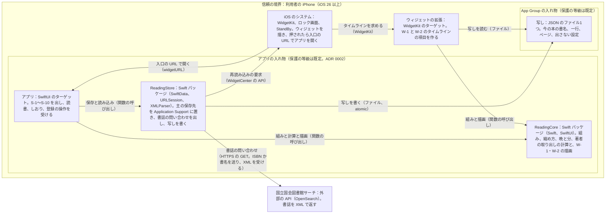

# A 技術設計メモ 001-reading-session：夜の入口、本の出口（v1）

- 書いた役：tech-lead　日付：2026-10-20
- PRD：docs/prd/001-reading-session.md（承認済み、コミット 9f7c5d9）　デザイン：design/001-reading-session.md、tokens.md、screens.md（コミット bb94976）　契約：contracts/ の契約（4 の表。サーバーはない）
- 状態：芯の G1 の仕上げ（G1 の 7-4b。裁定 27、28）。1〜10 と末尾の確かめ（A）を埋めた。reviewer の判定（/feature の 8）に出す。選択肢の行は、回す所が決まってから足す。
- この機能の ADR：0001（iOS の土台）、0002（保存と共有）、0003（縦書きの組み）、0004（書誌の問い合わせ）、0005（テストのつなぎ口）。どれも状態は「提案」。tech-lead が書いて tech-lead が印を付けたので、reviewer の反論を待つ。

## 1. 範囲、目標、非目標
- 範囲
  - 芯の AC 85件（裁定 24。PRD の冒頭の進め方 (i)）。章は、登録と最初の本、本棚と本の画面、毎晩の入口のうちウィジェット、読み始める・伏せて読む・数える、しおりを挟む（撮る道を除く）、読み終えた夜（カードと受賞を除く）、設定と保存、速さ。
  - 選択肢の AC 51件（課金、ショートカット、(3)、(4)、(5)、(6)）は、冒頭の (iii) で回す所が決まってから、残す分の行をこの表に足す。今は 2 の表の末尾に、回す順ごとに1行ずつ置いた。
  - AC-87 は 3b が届かなかったときの条件つきの AC。芯の行に入れ、3b の結果で AC-78〜AC-80 と入れ替える（AC-83 は受賞の選択肢）。
- 目標
  - 芯の AC 85件を、サーバーなし、外部のライブラリなし、iOS 26 以上の iPhone で満たす（ADR 0001）。
  - 毎晩の道（W-1、W-2、S-1〜S-5）は通信なしで全部動く（AC-62）。端末の外に出るのは書誌の問い合わせだけ（AC-103）。
  - PRD 12 の速さの線（起動1.0秒、「終える」から0.5秒、本棚1.0秒、ウィジェット0.5秒）を、Release と同じ最適化で満たす。G3 は Perf の構成、G4 は Release の構成の実機で測る（6。裁定 29）。
- 非目標（この設計でやらないこと）
  - PRD 10 のやらないこと：サーバー、アカウント、友人、同期、表紙の画像、外部の計測（裁定 10）、晩ごとのしおり、iPad 専用の画面、Apple Watch、Mac と Vision Pro への配布。
  - 選択肢の設計：Live Activity、App Intents（H32）、読み終えのカード（H24）、受賞の一覧（H25）、撮る道（H19、H27）、課金（H30）。回す所が決まってから足す。
  - 強制アップデート（ADR 0001。サーバーがない）。

## 2. 受け入れ条件の対応表
- サーバーがないので、operationId の列は「国立国会図書館サーチへの問い合わせ」か「つなぎ口の番号」で代えた。
  - 問い合わせの operationId は `ndlOpenSearch`。contracts/ndl-opensearch.yaml の GET /api/opensearch の1つだけ（ADR 0004）。括弧の中は引数（isbn か title）か、H20 で差し替える応答。
  - 端末の中だけで済む AC は「なし（端末のみ）」と書き、AC が使う主なつなぎ口（H 番号）を添えた。H の形は contracts/test-hooks.md と contracts/hooks/ の JSON Schema（ADR 0005）。
- データの列のエンティティは 5 の表のもの：Book（本）、Record（記録）、Session（読書中の1件）、Settings（設定）、Snapshot（App Group の写し）。
- テストの列は PRD の「確かめ方」の写し。「画面」は画面のテスト、「ウィジェット」は H22 で読むウィジェットのテスト。「／」の後ろは G4 の項目。
- 芯の AC が使うつなぎ口は23個（H1、H2、H4〜H10、H12〜H18、H20〜H22、H26、H28、H29、H31）。H23、H24、H25 は、芯の AC の中の選択肢の部分（Live Activity、カード、受賞）だけで使う（G1 のデザインの判定 r1 の D）。
- H29（送った要求の記録）は、AC-103 のほか、問い合わせの順と回数を読むために AC-4、AC-9〜AC-11、AC-113 でも使う（test-hooks.md の H29）。

### 登録と最初の本
| AC | 画面（design/） | operationId の代わり | データ（エンティティ） | 確かめるテスト |
|---|---|---|---|---|
| AC-1 | S-1（空） | なし（端末のみ）。H14、H26 | Book 0件、Settings | 画面（H14、H26。端末を消すので、ランダム順の実行と分けて動かす）／G4-5 |
| AC-2 | S-1 → S-8 → S-8a → S-1 | ndlOpenSearch（isbn。読み取ったときに1回送り、結果を加えた本に引き継ぐ。加えた直後は送らない。ADR 0004 の決まり (1)〜(3)）。H20、H21、H26 | Book（置き場所 current、ISBN、書誌） | 画面（H1、H13、H20、H21、H26）／G4-10 |
| AC-3 | S-8a | ndlOpenSearch（isbn）。H17、H20、H21 | Book（tsundoku。重なりは ISBN で見る） | 画面（H2、H13、H17、H20、H21、H26）／G4-10 |
| AC-4 | S-8 → S-8b | ndlOpenSearch（title、cnt=200 で1回。ページ送りなし。端末で、ISBN のない item と重なった ISBN を除き、書名の完全一致 → 前方一致 → ほかの順に並べ直す。ADR 0004）。H20、H29 | Book | 画面（H1、H13、H20）。並べ直しは単体テスト（AC にするかは 10 の未決） |
| AC-5 | S-8b（空） | ndlOpenSearch（title。0件の応答）。H20 | なし（保存しない） | 画面（H1、H20） |
| AC-6 | S-8b（オフライン） | ndlOpenSearch（通信なし）。H8 | なし（保存しない） | 画面（H1、H8）／G4-4 |
| AC-7 | S-8 → S-8c | なし（端末のみ）。H2、H13 | Book（書誌の状態 none） | 画面（H2、H13） |
| AC-8 | S-8c（エラー） | なし（端末のみ）。H13 | なし（保存しない） | 画面（H1、H13） |
| AC-9 | S-8a → S-1、S-6、S-7 | ndlOpenSearch（isbn。通信がない間は読み取りでも送らず pending で加え、通信が戻ったときの回で addedAt の順に1回ずつ送る。ADR 0004 の決まり (4) と回数の表）。H8、H20、H21、H29 | Book（書誌の状態 pending。書名なし） | 画面（H1、H8、H13、H20、H21、H26）／G4-4 |
| AC-10 | S-1、S-7 | ndlOpenSearch（isbn。読み取ったときの1回だけ。0件を加えた本に引き継ぎ、24時間たつまで送らない）。H4、H6、H20、H29 | Book（書誌の状態 notFound、前に問い合わせた日時。書名なし） | 画面（H1、H4、H6、H13、H20、H21、H26） |
| AC-11 | S-1、S-6、S-7 | ndlOpenSearch（HTTP の失敗。読み取ったときに1回、前に戻すたびに1回で、合わせて3回。加えた直後は送らない。ADR 0004 の回数の表）。H20、H29 | Book（書誌の状態 pending のまま。書名なし） | 画面（H1、H13、H20、H21、H26） |
| AC-113 | S-1、S-6、S-7、S-7a | ndlOpenSearch（isbn。前に来たとき、24時間以上たっていれば1回。加えてから45日まで）。H4、H5、H6、H20、H29。H2 で始めるので、加えたときの1回は H2 の lastLookupAt で表し、H29 には残らない。H29 で数える数は PRD の「合わせて」より1つ少ない (1) 45件 (2) 2件 (3) 0件（test-hooks.md の H29） | Book（加えた日時、前に問い合わせた日時、手で直した印。書名なし） | 画面（H2、H4、H5、H6、H13、H20）／G4-10 |
| AC-12 | S-8（権限） | なし（端末のみ）。H26 | なし | 画面（H1、H26）／G4-5 |
| AC-92 | S-7 | ndlOpenSearch（isbn。dc:creator と author の要素）。H20 | Book.author（取り出した形で保存） | 画面（H1、H13、H20、H21、H26）。取り出しの単体テストを添える |

### 本棚と本の画面
| AC | 画面（design/） | operationId の代わり | データ（エンティティ） | 確かめるテスト |
|---|---|---|---|---|
| AC-13 | S-1 → S-6 | なし（端末のみ）。H2、H13 | Book（置き場所、積読に加えた日時） | 画面（H2、H13） |
| AC-14 | S-6 → S-7 → S-1 | なし（端末のみ）。H22 | Book（置き場所、積読に加えた日時、読み終えた日時）、Snapshot | 画面（H2、H13、H22） |
| AC-15 | S-7 → S-7a → S-7 | なし（端末のみ）。H13 | Book（書名、著者、手で直した印） | 画面（H2、H13） |
| AC-16 | S-7 → 確認 → S-6 | なし（端末のみ）。H12、H22 | Book と Record（一緒に消す）、Snapshot | 画面（H2、H12、H13、H22） |
| AC-17 | S-7 | なし（端末のみ）。H2 | Book（書名、著者、出版社、レーベル、出版年） | 画面（H2。H25 は受賞の行だけで、選択肢 (4)） |
| AC-18 | S-7 | なし（端末のみ）。H2 | Book（空の項目の行は出さない） | 画面（H2。H25 は選択肢 (4)） |
| AC-22 | S-7 | なし（端末のみ）。H6 | Record（読み始めの日時、タイムゾーン、分） | 画面（H2、H6、H13） |
| AC-23 | S-7（空） | なし（端末のみ）。H2 | Record 0件 | 画面（H2） |
| AC-24 | S-7 → S-7b | なし（端末のみ）。H13 | Record.minutes | 画面（H2、H13） |
| AC-25 | S-7b（エラー） | なし（端末のみ）。H13 | なし（保存しない） | 画面（H2、H13） |
| AC-26 | S-7b → 確認 → S-7 | なし（端末のみ）。H13 | Record（消す） | 画面（H2、H13） |

### 毎晩の入口（ウィジェット）
| AC | 画面（design/） | operationId の代わり | データ（エンティティ） | 確かめるテスト |
|---|---|---|---|---|
| AC-27 | W-1 | なし（端末のみ）。H22 | Snapshot（書名、一行、ページ） | ウィジェット（H2、H22）とスクリーンショット／G4-1、G4-18 |
| AC-28 | W-1 | なし（端末のみ）。H22（組みの結果） | Snapshot.line | ウィジェット（H2、H22）とスクリーンショット／G4-1 |
| AC-29 | W-1、S-1 | なし（端末のみ）。H22 | Snapshot.line（写しは全文。縮めるのは描くときの ReadingCore） | ウィジェットと画面（H2、H22）／G4-1 |
| AC-30 | W-1 | なし（端末のみ）。H22 | Snapshot.line | ウィジェット（H2、H22） |
| AC-31 | W-1、W-2 | なし（端末のみ）。H22 | Snapshot（一行なし、ページあり／なし） | ウィジェット（H2、H22） |
| AC-32 | W-1、W-2 | なし（端末のみ）。H22 | Snapshot（今の本なし） | ウィジェット（H1、H2、H22） |
| AC-33 | S-3a → S-4 → S-1、W-1 | なし（端末のみ）。H22（再読み込みの要求の回数） | Book（一行、ページ）、Snapshot | ウィジェットと画面（H2、H4、H5、H22）／G4-2 |
| AC-34 | S-10、W-1、W-2、S-1 | なし（端末のみ）。H22（H23 は Live Activity の部分だけで、選択肢 (5)） | Settings.hideOnWidgets、Snapshot | ウィジェットと画面（H2、H4、H5、H6、H22。H23 は (5) を残すときだけ）／G4-1 |
| AC-35 | W-2 | なし（端末のみ）。H22 | Snapshot | ウィジェット（H2、H22）とスクリーンショット／G4-3、G4-18 |
| AC-39 | S-1 | なし（端末のみ）。H9、H17（H23 は選択肢 (5)） | Book、Session なし | 画面（H2、H9、H17。H23 は (5) を残すときだけ） |
| AC-40 | W-1、W-2、S-1 | なし（端末のみ）。H28（入口の URL）、H17（entry）、H22（押したときの URL） | Session.entry → Record.entry | 画面（H2、H4、H5、H17、H22、H28。(3) は選択肢 (5)）／G4-18 |
| AC-96 | S-3a → S-1 → S-5 → S-1 | なし（端末のみ）。H17（notice=widgetGuide） | Settings.widgetGuideShown | 画面（H2、H12、H13、H17） |
| AC-99 | W-1、S-1 | なし（端末のみ）。H22（読み上げのラベルとまとまりの数） | Snapshot.line（ラベルは保存した一行から作る） | ウィジェットと画面（H2、H22）／G4-13 |

### 読み始める、伏せて読む、数える
| AC | 画面（design/） | operationId の代わり | データ（エンティティ） | 確かめるテスト |
|---|---|---|---|---|
| AC-42 | S-1 → S-2 | なし（端末のみ）。H9 | Session | 画面（H2、H9） |
| AC-43 | S-2 | なし（端末のみ）。H9 | Session | 画面（H2、H9）とスクリーンショット |
| AC-44 | S-1 → S-2 | なし（端末のみ）。H15、H16、H17 | Session | 画面（H2、H9、H15、H16、H17）／G4-7、G4-14 |
| AC-45 | S-1 | なし（端末のみ）。H15、H16、H17 | なし（始まらない） | 画面（H2、H9、H15、H16、H17）／G4-14 |
| AC-46 | S-1（空、今の本なし） | なし（端末のみ）。H15、H16、H17 | なし（始まらない） | 画面（H1、H2、H9、H15、H16、H17） |
| AC-47 | S-1 のほかの全画面、シートと知らせが出ている S-1 | なし（端末のみ）。H15、H16、H17（flipMonitoring） | なし（始まらない） | 画面（H2、H9、H15、H16、H17） |
| AC-48 | S-2 | なし（端末のみ）。H4、H5、H15、H16、H17 | Session（1つのまま） | 画面（H2、H4、H5、H9、H15、H16、H17） |
| AC-49 | S-1 → S-2 | なし（端末のみ）。H17（announce） | Session | 画面（H2、H15、H16、H17）／G4-13 |
| AC-50 | S-1 | なし（端末のみ）。H2 | Settings.flipToStart | 画面（H2） |
| AC-51 | S-10 → S-1 | なし（端末のみ）。H17、H18 | Settings.flipToStart | 画面（H1、H2、H9、H15、H16、H17、H18） |
| AC-52 | S-2 | なし（端末のみ）。H4、H5（後ろにいる間に進める） | Session（読み始めの日時との差で数える） | 画面（H2、H4、H5）／G4-8 |
| AC-53 | S-2 | なし（端末のみ）。H4、H9 | Session（保存してあるので、開き直しても続く） | 画面（H2、H4、H9）／G4-9 |
| AC-54 | S-2 | なし（端末のみ）。H17（idleTimerDisabled、proximity） | なし | 画面（H2、H5、H9、H15、H16、H17）と grep |
| AC-55 | S-2 → S-3 | なし（端末のみ）。H10（os_signpost の区間） | Session → Record | 画面（H2、H4、H5、H10）／G4-15 |
| AC-56 | S-2 → S-1、S-3 | なし（端末のみ）。H4、H5、H12 | Session を消す（59秒）、Record（60秒） | 画面（H2、H4、H5、H9、H12） |
| AC-57 | S-2 → S-3 → S-4 | なし（端末のみ）。H4、H5、H12 | Record.minutes（上限1440） | 画面（H2、H4、H5、H12） |
| AC-58 | S-2 → S-1 | なし（端末のみ）。H4、H12 | Session を消す。Record は足さない | 画面（H2、H4、H9、H12） |
| AC-59 | S-1 | なし（端末のみ）。H7（session.start） | Session（保存に失敗したら作らない） | 画面（H2、H7、H9、H12、H15、H16、H17） |
| AC-60 | S-2 | なし（端末のみ）。H7（session.end） | Session を残す。Record は足さない | 画面（H2、H4、H5、H7、H9、H12） |
| AC-61 | S-1、S-2 | なし（端末のみ）。H4、H5 | Session と Record が1つずつ | 画面（H2、H4、H5、H9、H13） |
| AC-62 | W-1 → S-1 → S-2 → S-3 → S-3a → S-4 | なし（端末のみ）。H8、H22、H28 | Session、Record、Book、Snapshot | 画面（H2、H4、H5、H8、H22、H28）／G4-4 |

### しおりを挟む
| AC | 画面（design/） | operationId の代わり | データ（エンティティ） | 確かめるテスト |
|---|---|---|---|---|
| AC-63 | S-3 | なし（端末のみ）。H4、H5 | なし | 画面（H2、H4、H5）。撮る道は選択肢 (6) |
| AC-64 | S-1 → S-3（シート）→ S-3a → S-1 | なし（端末のみ）。H22 | Book（一行、ページ）、Snapshot | 画面（H2、H9、H13、H22） |
| AC-71 | S-3 → S-3a | なし（端末のみ）。H13 | Book（一行、ページ） | 画面（H13） |
| AC-72 | S-3a（エラー） | なし（端末のみ）。H13 | なし（保存しない） | 画面（H13） |
| AC-73 | S-3 → S-3b | なし（端末のみ）。H22 | Book（ページ。前の一行を消す）、Snapshot | 画面（H13、H22） |
| AC-74 | S-3b（エラー） | なし（端末のみ）。H13 | なし（保存しない） | 画面（H13） |
| AC-75 | S-3 → S-4 | なし（端末のみ）。H4、H5 | Record（分）。Book は変えない | 画面（H2、H4、H5、H13） |
| AC-76 | S-4 → S-1 | なし（端末のみ）。H4、H5 | Record、Book.page（前のページは画面の流れの中で持つ） | 画面（H2、H4、H5） |
| AC-95 | S-3a（エラー） | なし（端末のみ）。H7（mark.save） | Book（一行とページは前のまま） | 画面（H2、H4、H5、H7、H12、H13） |

### 読み終えた夜
| AC | 画面（design/） | operationId の代わり | データ（エンティティ） | 確かめるテスト |
|---|---|---|---|---|
| AC-77 | S-1 → S-9 | なし（端末のみ）。H13（H25 は受賞の行だけで、選択肢 (4)） | Book（置き場所 finished、読み終えた日時） | 画面（H2、H13、H25） |
| AC-78 | S-9 | なし（端末のみ）。H2 | Book（tsundoku、積読に加えた日時、著者、レーベル） | 画面（H2、H25）と並べ方の単体テスト |
| AC-79 | S-9 | なし（端末のみ）。H2 | Book | 画面（H2、H25） |
| AC-80 | S-9 | なし（端末のみ）。H2 | Book | 画面（H2、H25） |
| AC-81 | S-9（空） | なし（端末のみ）。H2 | Book（tsundoku 0件） | 画面（H2、H25） |
| AC-82 | S-9 → S-1 | なし（端末のみ）。H22 | Book（置き場所）、Snapshot | 画面（H13、H22） |
| AC-86 | S-1、S-2、S-3、S-3b、S-4 | なし（端末のみ）。H4、H5 | なし | 画面（H2、H4、H5） |
| AC-87 | S-9（3b が届かなかったとき） | なし（端末のみ）。H2 | Book | 画面（H2、H25）。3b の結果で AC-78〜AC-80 と入れ替える |

### 設定と保存
| AC | 画面（design/） | operationId の代わり | データ（エンティティ） | 確かめるテスト |
|---|---|---|---|---|
| AC-88 | S-1 → S-10 | なし（端末のみ）。H31（開いた URL） | なし | 画面（H2、H31） |
| AC-89 | S-1、S-6、S-7、S-10 | なし（端末のみ）。H13 | Book、Record、Settings（入口の時刻は選択肢 (5)） | 画面（H4、H5、H6、H13）／G4-17 |
| AC-90 | S-1（エラー） | なし（端末のみ）。H7（store.load） | ストア全体（消さない） | 画面（H2、H7、H12、H13） |
| AC-91 | S-3a、S-7、S-7a、S-7b、S-8a〜S-8c、S-1 | なし（端末のみ）。H7（book.add、book.update、book.delete、book.status、record.update、record.delete、mark.save） | Book、Record（前のまま） | 画面（H2、H7、H12、H13。7通り） |
| AC-93 | S-1 → S-10 | なし（端末のみ）。H31 | なし（文は ADR 0004 のクレジットの文字列。G1-5） | 画面（H2、H31） |
| AC-103 | 全画面（S-8 の説明の1行） | ndlOpenSearch だけ。H29（送った要求の記録）。H24 はカードの部分で選択肢 (3) | なし | 画面（H1、H5、H20、H21、H24、H26、H29）と G2 の grep／G4-20 |

### 速さ
| AC | 画面（design/） | operationId の代わり | データ（エンティティ） | 確かめるテスト |
|---|---|---|---|---|
| AC-100 | S-1 | なし（端末のみ）。H2。G3 は Perf の構成、G4 は Release（裁定 29） | ストア（本3冊、記録10件） | 性能（H2。XCTApplicationLaunchMetric を5回）／G4-15 |
| AC-101 | S-6、S-7 | なし（端末のみ）。H10。G3 は Perf の構成、G4 は Release（裁定 29） | ストア（本500冊、記録5,000件。本 A に1,000件、400冊に10件ずつ、99冊は0件。H2 の perf500） | 画面（H2、H10）／G4-15 |
| AC-102 | W-1、W-2 | なし（端末のみ）。H22（項目を返すまでの時間）。G3 は Perf の構成、G4 は Release（裁定 29） | Snapshot | ウィジェット（H2、H22） |

### 選択肢（回す所が決まってから、残す分を行ごとに足す）
| 回す順 | AC | 足すときに要るもの |
|---|---|---|
| 選択肢（課金） | AC-104〜AC-111 | StoreKit 2、H30、G1-2 の spike、見た目の id の保存（Settings）、書体のライセンスの ADR（G1-8） |
| 選択肢（ショートカット） | AC-121〜AC-124、AC-133〜AC-135 | App Intents、H32（G1-17）、「どこまで読んだ？」の読み込み（ADR 0002 の等級のまま） |
| 選択肢 (3) | AC-84、AC-85、AC-127〜AC-129 | 共有シート、H24、カードの画像、ふりかえりの文の型 |
| 選択肢 (4) | AC-19〜AC-21、AC-83、AC-112 | 受賞の一覧（アプリに入れるデータ）、H25、名前のそろえ方 |
| 選択肢 (5) | AC-36〜AC-38、AC-41、AC-97、AC-98、AC-114〜AC-120、AC-130〜AC-132、AC-136 | ActivityKit、H23、H32、G1-4 と G1-19 の spike、入口の時刻（Settings） |
| 選択肢 (5) と (ショートカット) | AC-125、AC-126 | 上の2つの両方 |
| 選択肢 (6) | AC-65〜AC-70、AC-94 | VisionKit か Vision の文字の読み取り、H19、H27、一時ファイルを書かない撮り方 |

## 3. 構成図
システムコンテキスト図とコンテナ図を1つにまとめた（サーバーがなく、外の相手は1つだけのため）。矢印はすべて一方向。囲みが信頼の境界。



- 矢印の中身の契約：Store → NDL は contracts/ndl-opensearch.yaml、Store → Snap と Ext → Snap は contracts/widget-snapshot.schema.json、Sys → App は contracts/entry-urls.md。
- ビルドの構成は3つ：Debug、Perf（Release を写し、コンパイルの条件 `UITEST_HOOKS` だけを足す）、Release（TestFlight と App Store）。ADR 0001、0005。
- テストのつなぎ口（芯の23個）は、Debug と Perf の構成でだけアプリのターゲットの `UITestHooks/` に入り、Release には入らない。だから図に入れていない。形は contracts/test-hooks.md と contracts/hooks/、決めた理由と G2 での確かめ方は ADR 0005。
- 選択肢を残したときに足す要素：Live Activity とインテント（(5)、ショートカット）、共有シート（(3)）、StoreKit（課金）、カメラの文字の読み取り（(6)）。

## 4. 契約の変更と互換性
サーバーがないので、こちらの API は持たない。契約は、外の API の呼び方と、アプリの中の境目（拡張との写し、入口の URL、テストのつなぎ口）。どれも新規で、main の contracts/ にあるのは .gitkeep と dependencies.md だけ（`git ls-tree --name-only origin/main contracts/`）。

| 契約 | 形式 | 中身 | 主な AC | 版 | 確かめ |
|---|---|---|---|---|---|
| contracts/ndl-opensearch.yaml | OpenAPI 3.1.0 | 国立国会図書館サーチの GET /api/opensearch。引数 dpid、isbn、title、cnt。応答の例3つ（見つかった、0件、引数の誤り）と要素の対応表 | AC-2〜AC-6、AC-9〜AC-11、AC-92、AC-103、AC-113 | info.version 1.0.0 | spectral、oasdiff（下） |
| contracts/widget-snapshot.schema.json | JSON Schema 2020-12 | App Group の写し。書く側と読む側の決まり、読めないときの widget.unavailable | AC-27〜AC-35、AC-99、AC-102 | 大きな版 1 | jsonschema（下）、7-3 の spike |
| contracts/entry-urls.md | 文書 | 入口の URL `yomuma://open?entry=…`、受ける側の読み方、URL で保存を変えないこと、AC-40 の印の決まり | AC-40、AC-62 | 大きな版 1 | 7-3 の spike（entry-urls.md の 6） |
| contracts/test-hooks.md | 文書 | 芯のつなぎ口23個の目的、使う AC、動かし方、入力、出力、失敗。選択肢の7個は名前だけ | 芯の85件（2 の表の H 番号） | テストの構成だけ（下） | 7-4a の spike 1、2 |
| contracts/hooks/ の7つ | JSON Schema 2020-12 | h02-seed（H2）、h13-store（H13）、h17-state（H9、H10、H17）、h20-ndl-stub（H20）、h22-widget（H22）、h29-outbound（H29、H31）、hook-config（設定のファイル） | 同上 | $id の末尾 `:1` | jsonschema（下） |

| operationId | 足す / 変える | AC | 誰が呼べるか（認証） | 持ち主の確かめ | 返す項目（アプリが読むもの） | 回数の上限 | 作る POST の Idempotency-Key |
|---|---|---|---|---|---|---|---|
| ndlOpenSearch（国立国会図書館サーチの GET /api/opensearch） | 足す（7-2） | AC-2〜AC-6、AC-9〜AC-11、AC-92、AC-103、AC-113 | 誰でも呼べる相手の公開 API（`security: []`）。クッキー、キャッシュ、利用者や端末の ID を送らない | 該当なし。相手は利用者のデータを持たず、返すのは公開の書誌（ADR 0004 の表の 9） | 契約の 200 の応答の対応表にある要素だけ。ほかは読まない | 同時に1件で、利用者の操作を先に送る（ADR 0004 の表の 6）。isbn は、読み取りで ISBN ごとに1回と、回（前に来たとき、通信が戻ったとき）で1冊に1回。notFound は24時間に1回で45日まで。title は操作1回につき cnt=200 で1回（続けて押したら前の要求を取り消してから、最後の語を送る）。待ちは30秒、応答は 2 MB まで | 対象外（GET だけ） |

- spectral（v6.17.0。GitHub の公式リリースの spectral-macos-arm64、sha256 の頭 cb7e1bd31d85a992。node がないので npx でなく配布ファイルで動かした）
  ```
  $ spectral lint contracts/ndl-opensearch.yaml --ruleset contracts/.spectral.yaml
  No results with a severity of 'error' found!          （exit 0）
  $ spectral lint contracts/ndl-opensearch.yaml --ruleset contracts/.spectral.yaml --fail-severity hint
  No results with a severity of 'hint' or higher found! （exit 0）
  ```
  - どちらも、ほかに出たのは道具の知らせ `[DEP0040] DeprecationWarning: The punycode module is deprecated` だけ。
- oasdiff（v1.34.0。GitHub の公式リリースの oasdiff_1.34.0_darwin_all.tar.gz。sha256 34f5713d…7952 が checksums.txt と一致）
  - main に契約がない（`git show origin/main:contracts/ndl-opensearch.yaml` は exit 128）ので「新規」。中身が `openapi: 3.1.0`、`paths: {}` だけの空の基準と比べた。
  ```
  $ oasdiff breaking --fail-on ERR base-empty.yaml contracts/ndl-opensearch.yaml
  No breaking changes to report, but the specs are different.   （exit 0）
  $ oasdiff changelog base-empty.yaml contracts/ndl-opensearch.yaml
  1 changes: 0 error, 0 warning, 1 info
  info  [endpoint-added] at contracts/ndl-opensearch.yaml  in API GET /api/opensearch  endpoint added
  ```
  - 道具が空振りしていないことの確かめ：逆向き（契約 → 空）では `1 changes: 1 error … [api-path-removed-without-deprecation]` で exit 1。同じ契約どうしでは `No changes detected`。
- JSON Schema（jsonschema 4.25.1。リポジトリの外の venv。コマンドは CLAUDE.md）
  ```
  schemas 8 examples 16 OK          （exit 0。hooks の7つと widget-snapshot）
  ```
  - 7-4a の検査のスクリプト（scratchpad の g1-7-4a/gen/check.py）を同じ8つに動かし直した：metaschema の検査 8/8 OK、例 16/16 OK、わざと契約に合わなくした17通りは17通りとも弾かれた（NG 0件）。
  - G1 の直し（reviewer r1 のあと。2026-10-20）：同じ check.py で metaschema 8/8 OK、例 19/19 OK（足した例3つ：h02 の書名のない notFound の本、h13 の書名のない pending の本と写し、写しの書名のない一行）、17通りは17通りとも弾かれた。足した22通り（書名を省ける本と省けない本、小文字の id、写しの書名なし、prevLat、latency.json）は22通りとも期待どおり（受ける9、弾く13）。
  - 直した契約：h02、h13、widget-snapshot（書名のない本。5）、h02 の id を大文字だけに（P3）、h17 の `prevLat.*` と `$defs/latencyFile`（P4）、h22 の例の `widget.unavailable` の文。main に出す前の版 1 の下書きの直しなので、版は上げない。
  - G1 の直し2（仕様の決定 66 を写した。2026-10-20）：同じ check.py で metaschema 8/8 OK、例 20/20 OK（足した例1つ：h22 の書名のない今の本で一行なし・ページあり）、17通りは17通りとも弾かれた。check_new.py の22通りは22通りとも期待どおり。足した8通り（check_fix2.py）は8通りとも期待どおり（受ける4：h22 の noLine と noLineNoPage で書名の所が「今の本」、写しの書名も一行もない本、写しの title に「今の本」。弾く4：noLine に組み、知らない状態 noTitle、texts の ISBN、noLine に読めない理由）。写しの title に「今の本」を入れることは形では弾けないので、写しの [出し方] に書く側の決まりとして書いた。変えたのは widget-snapshot の description、h22 の例、test-hooks.md の H22 だけで、enum、形、版は変えていない。openapi.yaml は変えていない。
  - 道具が空振りしていないことの確かめ：required の項目がない例を持つスキーマを渡すと、ValidationError で落ちた。
- 互換性を壊す変更：なし（新規。oasdiff の breaking は0件）。ADR と大きな版の上げは要らない。
- 互換の決まり：同じ大きな版の中では足すだけ。
  - 写し：version 1 の中で項目を足すだけ。知らない項目は無視して読み、読めない版は widget.unavailable で描く（widget-snapshot.schema.json）。
  - 入口の URL：値を足すだけ。知らない値は `app` として読む（entry-urls.md の 2）。
  - 外の API：相手が変えるもので、こちらは決められない。要素が欠けても落ちずに空として読む（対応表）。
  - つなぎ口：テストの構成にしか入らず、App Store の版の互換は関わらない。形を変えるときは、受け入れテストと同じ PR で変える（G2 で tech-lead と reviewer が見る）。
- 返す enum：外の API は XML の要素で、こちらの enum はない。端末の中の enum の知らない値の扱いは 5。
- エラー：外の API なので problem+json ではない（相手の形は変えられない）。HTTP の失敗、0件、通信なしを、文言キー `book.pendingInfo`、`book.infoNotFound`、`search.noResults`、`search.offline` に対応させる（ADR 0004）。
  - 引数の誤りも HTTP 200 の0件で返るので、URL の形は単体テストで固定する。
  - HTTP 200 のほかの応答は形が分からない（未確認）ので例がなく、`default` に読み方（本文を読まずに失敗とする）だけを書いた。

## 5. データモデルと移行
| エンティティ | 正しいデータの置き場所（端末 / サーバー） | 個人情報か | 保存期間 | 消し方 |
|---|---|---|---|---|
| Book（本） | 端末（SwiftData。Application Support。ADR 0002） | はい（読書の好みが分かる。PRD 12 の扱う個人データ） | 利用者が消すまで | S-7 の「この本を消す」（記録も一緒に消える）。アプリを消す |
| Record（記録） | 端末（同じストア） | はい（読書の日時と分、入口の印） | 利用者が消すまで | S-7b の「この記録を消す」、本を消す、アプリを消す |
| Session（読書中の1件。0件か1件） | 端末（同じストア） | はい（読書の時刻） | 読書が終わるまで | 終えると消える（1分未満、時刻の戻りでも消える）。アプリを消す |
| Settings（設定。1件） | 端末（同じストア） | いいえ（好みの設定だけで、本の中身を含まない） | アプリを消すまで | アプリを消す |
| Snapshot（写し） | 端末（App Group の JSON。ADR 0002。形は contracts/widget-snapshot.schema.json） | はい（書名と一行） | 次に書くまで（上書き） | 上書き。今の本がなくなれば currentBook を書かない。アプリを消す |
| 書誌の応答（XML） | 端末のメモリだけ（保存しない。URLSession は ephemeral で、キャッシュもクッキーも置かない。ADR 0004） | いいえ（公開の書誌） | 読み終えたら捨てる | 保存しないので消すものはない |
| 入口の一時の値（開いた入口と時刻） | 端末のメモリだけ | いいえ | アプリが後ろに回るまで | 保存しないので消すものはない |

- Book の項目
  - id（UUID、一意。文字にするときは大文字の形で、H2、H13、識別子 `shelf.row.<id>` で同じ。reviewer r1 の P3）、isbn（13桁。手で入れた本は空）、title（1〜100字。書名のない本は下）、author（0〜100字。書誌の著者は AC-92 の決まりで取り出した形）
  - publisher、label（レーベル）、publishedYear（出版年）
  - 書誌のどの要素から取るかは、contracts/ndl-opensearch.yaml の 200 の応答の要素の対応表を正とする（ADR 0004）。書名は dc:title に dcndl:volume を足し、書名と著者は100字で切る。ISBN は10桁なら13桁に直す。
  - shelf（置き場所：current、tsundoku、finished）、addedAt（加えた日時）、tsundokuAt（積読に加えた日時。置き場所を tsundoku にした日時を入れる）、finishedAt（読み終えた日時。finished にした日時を入れ、ほかへ移したら消す。H2 と H13 の `books[].finishedAt`）
  - line（一行。1〜60字）、page（1〜9999）
  - lookupStatus（書誌の状態：none＝手で入れた、pending＝まだ、found、notFound）、lastLookupAt（前に問い合わせた日時。HTTP 200 のときだけ書く）、manuallyEdited（書名か著者を手で直した印。直したら問い合わせ直さない。AC-113）
  - records（Record の一覧。本を消すと一緒に消える）
  - 書名のない本（reviewer r1 の要修正2）
    - title を持たない（nil）のは、isbn があり、lookupStatus が pending か notFound で、manuallyEdited が偽の本だけ。ISBN だけで加え、書誌がまだないか見つからなかった本（AC-9、AC-10、AC-11、AC-113）。found、none、手で直した本には必ず title がある。
    - 書誌が見つかったら dc:title から入れる。手で直すとき（S-7a）は、書名が1〜100字で要る（手で入れるときと同じ確かめ）。
    - 契約：h02 と h13 は、この条件のときだけ title を省ける（JSON Schema の if/else）。写し（widget-snapshot）は visibleBook の title を省ける。
    - 見せ方：アプリの画面は仕様で決まっている（書名の所に文言キー `book.isbnAsTitle`「ISBN %@」。S-1 は下に `book.pendingInfo` か `book.infoNotFound`、S-7 は奥付の1行目）。写しには ISBN を置かない（PRD 12）ので、ウィジェットでは「ISBN %@」を出せない。ウィジェット（W-1、W-2）は仕様の決定 66 のとおり：一行があれば書名のある本と同じ（一行とページ。書名はもともと見えない）。一行がなければ、書名の所に文言キー `widget.currentBookAsTitle`「今の本」を出し、ページがあれば「p.120」を添える。読み上げのラベルは書名の所を同じ文にし、順と書式は書名のある本と同じ（`widget.spoken`、`widget.spoken.noPage`、`widget.spoken.noLine`。例「今の本、120ページ」）。写しは書誌の状態を持たない（PRD 12）ので、待っているか見つからなかったかは出し分けない。H22 の状態は増やさない（normal、noLine、noLineNoPage）。写した所：contracts/widget-snapshot.schema.json の [出し方] と [読み上げのラベル]、contracts/test-hooks.md の H22、h22 の例の2つ目。
- Record の項目：id、startedAt（読み始めの日時）、timeZoneID（読み始めたときのタイムゾーン。晩の日付はこれで出し、あとで変えない。AC-22）、minutes（1〜1440）、entry（入口の印：lock_widget、small_widget、app。選択肢で live_activity、intent_start、intent_open を足す）、book。
- Session の項目：bookID、startedAt、timeZoneID、entry、startedBy（flip か button。H17）。
- Settings の項目：flipToStart（既定はオン）、hideOnWidgets（既定はオフ）、widgetGuideShown（AC-96）。入口の時刻と見た目の id は、選択肢 (5) と課金を残すときに足す。
- Snapshot の項目は contracts/widget-snapshot.schema.json（大きな版 1）を正とする。
  - ISBN は入れない（PRD 12 が App Group に置くものを、書名、一行、ページ、出さない設定に限っている）。
  - 出さない設定のときは、書名と一行を書かず、ページだけを書く。今の本がないときは currentBook を書かない。見た目の id は省ける（課金を残すときに使う）。書名のない今の本は title を書かない（上の「書名のない本」）。
- 計算で出し、保存しないもの：晩の日付（timeZoneID で表した読み始めの時刻が 4:00 より前なら前の日）、何晩、合計の分（ReadingCore）。
- 知らない値の扱い（写しと URL は、拡張とアプリの版がずれる一瞬や、ほかのアプリから来ることがある）
  - 入口の印：知らない値は `app` として読む（contracts/entry-urls.md の 2 と 4）。
  - 写しの見た目の id：知らない値は default として読む（contracts/widget-snapshot.schema.json）。
  - 置き場所と書誌の状態：主の保存先を読み書きするのはアプリだけで、拡張は読まない（ADR 0001、0002）。同じ版のアプリが書いた値だけを読むので、知らない値は起きない。値を足すのは SchemaV2 以降で、そのときに MigrationStage と一緒に扱いを決める。
- 順番待ちと問い合わせ直し（ADR 0004）
  - 登録の順番待ちは、lookupStatus が pending の本そのもの（別の待ち行列を保存しない）。
  - 送る時は ADR 0004 の「問い合わせ直しの決まり」の (1)〜(4)：読み取ったときに ISBN ごとに1回送り、結果を加えた本に引き継ぎ、加えた直後には送らない。回（pending と期限の来た notFound を addedAt の古い順に1件ずつ送る流れ）は、前に来たときと通信が戻ったときに始め、同時に1つだけ。失敗したら、その回は残りを送らない（AC-2、AC-9、AC-11）。
  - notFound の本は、manuallyEdited でなく、前の問い合わせから24時間以上たち、加えてから1,080時間以内なら、回のときに1回問い合わせ直す（AC-10、AC-113）。found の本は問い合わせ直さない。
- SwiftData の版：SchemaV1（VersionedSchema）と SchemaMigrationPlan（stages は空）から始める。App Store に出す前は V1 を直してよい。出したあとは、変えるたびに SchemaV2 以降と MigrationStage を足す（ADR 0002）。
- 前の版のストアを開けるかのテスト：v1.0 には前の版がない。SchemaV2 を足すときに、V1 のストアの見本を開いて値が残るかのテストを verifier に頼む。
- サーバーの DB：なし。
- 決まっていないこと：今の本を替えたとき（AC-14）、前の今の本は tsundoku に移る。積読の並び（AC-13 の「加えた日」）に、元の addedAt と、移した日時（tsundokuAt）のどちらを使うかが PRD と仕様に書かれていない。この設計は tsundokuAt（なければ addedAt）で並べる案にした（H2 と H13 の tsundokuAt は、省いたら addedAt と同じ値）。pdm と designer の確かめを待つ（10）。

## 6. 非機能の目標
PRD 12 の芯の行を写した。Live Activity と撮る道の行は、選択肢を残すときに足す。速さの行は、G3 では Perf の構成（Release と同じ最適化に `UITEST_HOOKS` だけを足したもの）で、G4 では Release の構成の実機で測る（裁定 29、ADR 0005）。

| 項目 | 目標 | 測り方と時期 | 確かめる役 |
|---|---|---|---|
| 起動 | 起動してから S-1 を操作できるまで、5回の平均で1.0秒以内 | AC-100（XCTApplicationLaunchMetric(waitUntilResponsive:)）を G3 で Perf の構成、iPhone 17 と iOS 27 のシミュレーターで測る。G4-15 で Release の構成を、iOS 26 が動くいちばん古い機種で測る | verifier（G3）、Takuma（G4） |
| 「終える」から S-3 | 0.5秒以内（5回とも） | AC-55（H10 の os_signpost の区間）を G3 で Perf の構成。G4-15 で Release の実機 | verifier（G3）、Takuma（G4） |
| 本棚と本の画面（本500冊・記録5,000件） | 開いてから出るまで、5回の平均で1.0秒以内 | AC-101（H10）を G3 で Perf の構成（投入は H2 の `-uitest-seed-preset perf500`。中身は AC-101 の Given の分け方：本 A＝1冊目、id `00000000-0000-4000-8000-000000000001`、current に1,000件、2〜401冊目に10件ずつ、402〜500冊目は0件。本の画面は A を開く。値は readouts を off にした起動のあと `prevLat.*` で読む。test-hooks.md の H2 と H10）。G4-15 で Release の実機。実機への入れ方は G1-10（ADR 0005：Perf を入れて投入し、消さずに Release を上から入れる） | verifier（G3）、Takuma（G4） |
| ウィジェットの項目を返すまで | 5回の平均で0.5秒以内（2つの種類それぞれ） | AC-102（H22）を G3 で Perf の構成。G4 で Release の実機 | verifier（G3）、Takuma（G4） |
| 伏せてから reading まで | 2.0秒以内（伏せの待ち1.0秒を含む） | G3 は AC-44、AC-45 で待ちが1.0秒であること。G4-7 は触覚の音を録った録画 | verifier、Takuma |
| 反応 | 操作から画面の変化まで100ms 未満。250ms 以上の hang は0件 | G3 で Instruments の Hangs（S-1、S-6、S-7 を開く流れ）。公開後は Xcode Organizer の Hangs（Apple が集める値。アプリは送らない） | verifier |
| 画面が変わる動きの間の操作 | 動きの間も、次の画面の主操作が押せる。操作を止める時間は0秒 | G3 で design-reviewer が録画で見る。G2 で reviewer が `allowsHitTesting(false)` と `isUserInteractionEnabled = false` が0件（理由のコメントがある飾りの行を除く）であることを見る | design-reviewer、reviewer |
| 書誌の問い合わせ | 1回の待ちは30秒で打ち切る（7-2 の実測で p90 7.18秒、最大14.83秒）。応答は 2 MB まで（書名で探す cnt=200 は 5.70秒、635,702 バイトだった）。同時に送るのは1件。失敗は順番待ちに戻し、画面は止めない | G2 で reviewer が打ち切りの値と上限をコードで見る（ADR 0004）。G3 は AC-9、AC-11（H8、H20） | reviewer、verifier |
| オフライン（画面ごと） | 通信なしで、W-1、W-2、S-1〜S-7、S-9、S-10 のうち使えない画面は0。S-8a は読めた ISBN を残し、戻ったら問い合わせる（貯めて後で送る）。S-8b だけは使えない（`search.offline`）。ぶつかることはない（データは端末だけ） | AC-62、AC-9、AC-6 の受け入れテスト（H8）を G3。G4-4 の機内モード | verifier |
| 電池 | UIBackgroundModes は0個。BGTask は0個。向きの監視は S-1 が前面で idle の間だけ。保存1回でウィジェットの再読み込み1回（`reloadAllTimelines()` を1回） | G2 で reviewer が `plutil -p` と grep で見る。G3 で AC-47、AC-51（flipMonitoring=off）、AC-33（H22 の `mark.save` の差が1） | reviewer、verifier |
| セキュリティ | ATS の例外は0件。送り先は国立国会図書館サーチの HTTPS の1つだけ。トークンと Keychain は使わない。保護の等級は既定（.complete にしない理由は ADR 0002）。App Attest は使わない（こちらのサーバーがない） | G2 で `grep -rn 'NSAllowsArbitraryLoads' ios/` が0件、通信の部品の場所の grep（AC-103）。G3 で AC-103（H29）。G4-20 | reviewer、verifier |
| プライバシー | PrivacyInfo.xcprivacy（アプリと拡張）：トラッキングなし、収集の型は0個、required reason API は0件。App Store のプライバシー表記は「データの収集なし」（ADR 0004 の G1-12） | G2 で ADR 0002 の grep。G4 と G5 で照合 | reviewer |
| アクセシビリティ | 文字の大きさ AX5 まで、切れる画面は0、できない操作は0 | G3 で performAccessibilityAudit（verifier）と、design-reviewer の採点表 | verifier、design-reviewer |

- perf500 の数え直し（G1 の直し、2026-10-20。test-hooks.md の H2 の表のとおりに作って数えた。出力は報告）：記録 5,000件。本 A は1,000件、10件の本は400冊（2〜401冊目）、0件の本は99冊（402〜500冊目）で、AC-101 の Given と同じ。G4-15 も同じ中身（ADR 0005 の G1-10）。

## 7. 脅威モデル
- 何を作るか（守るものと境界）
  - 守るもの：書名、著者、ISBN、一行（本の文）、読書の日時と分、入口の印。
  - 境界1：端末から国立国会図書館サーチへの送信（ISBN か書名）。
  - 境界2：アプリの入れ物から App Group の写しへ。写しはロック中に拡張が読み、ロック画面に出る。
  - 境界3：ロックした端末を手にした人（付記の G1-16 の軽い脅威モデル）。
  - 境界4：入口の URL（ほかのアプリや Safari からも開ける）。
  - 境界5：テストのつなぎ口が App Store の版に残ること。
- それで十分か（受け入れた危険と、その理由）
  - 最初のロック解除のあとの、ロック中のファイルの読み出しは受け入れる。理由は ADR 0002（守るものはロック画面に出るものと同じ程度で、ロック中の読み書きが要る）。見直す条件も ADR 0002。
  - 入口の印のなりすましは受け入れる。印は端末の中だけで、v1.0 は送らない（裁定 10）。
  - 書誌の問い合わせでは、読み取った ISBN と利用者が入れた書名を、端末から国立国会図書館サーチへ送る。送る情報、送り先（ndlsearch.ndl.go.jp）、目的（書誌を得るため）を、プライバシーポリシーに書く（G5 で pdm。ADR 0004 の表の 18）。電気通信事業法の外部送信規律に当たるかは、指揮役が Takuma に確かめる（reviewer r1 の K1）。
  - 選択肢（インテント、Live Activity、カード、課金）を残すときは、この表に行を足す。

| STRIDE | 起きうること | 対応（減らす / なくす / 移す / 受け入れる） | 確かめるテストか確認 |
|---|---|---|---|
| なりすまし（S） | 国立国会図書館サーチになりすました応答（通信の途中で差し替える）で、偽の書名や著者が保存される | 減らす：HTTPS だけで、ATS の例外を置かない。証明書の確かめは OS の既定のまま。応答は文字として扱い、書名と著者は100字で切る（101字目から後ろを捨てる。ADR 0004、contracts/ndl-opensearch.yaml の対応表） | G2 の `NSAllowsArbitraryLoads` の grep が0件。長すぎる応答の単体テスト（H20 で101字の書名を返す形も使える） |
| 改ざん（T） | ほかのアプリやページが入口の URL を開き、入口の印を偽る。写しのファイルが書き換えられる | 入口の印は受け入れる（端末の中だけ）。URL では画面を開くだけで、保存、写し、再読み込み、通信を起こさない（contracts/entry-urls.md の 3 と 5）。写しは、同じ App Group を持てるのが同じ開発者のアプリだけなので受け入れる | AC-40。G2 で reviewer が、URL を受ける処理に保存の呼び出しがないことを見る。G3 で、URL で起動する前とあとで H13 が同じ、H29 が0件、H22 の再読み込みは `launch` のほかの出どころが0（entry-urls.md の 5） |
| 否認（R） | 該当なし：アカウント、取引、ほかの人との受け渡しがない | 受け入れる（課金を残すときは Apple の StoreKit が記録する） | なし（理由のとおり） |
| 情報の漏れ（I） | (a) ロック画面と StandBy に一行と書名が見える (b) ロックした端末からファイルを取り出される (c) 問い合わせで送った ISBN と書名が残る、一行が送られる (d) ログに書名や一行が出る (e) ほかのアプリが canOpenURL で、このアプリが入っているか（読書アプリを使っていること）を調べる | (a) 減らす：出さない設定（AC-34）。そのときは写しに書名と一行を書かない (b) 受け入れる：ADR 0002 (c) 減らす：送るのは ISBN か書名だけで、一行は送らない（AC-103）。ID を付けない。URLSession は ephemeral に、urlCache なしとクッキーなしを足す（応答に `Cache-Control: public` が付き、既定の構成ではディスクに残るため。ADR 0004） (d) 減らす：Logger の値は既定の非公開のまま（8） (e) 受け入れる：分かるのは入っていることだけで、書名、一行、記録は出ない。スキームは widgetURL で開くために登録する（contracts/entry-urls.md の 1 と 5。reviewer r1 の P6） | AC-34、AC-103（H29）、G2 の `grep -rn 'privacy: .public' ios/`、G4-20 |
| サービスの妨害（D） | 国立国会図書館サーチが遅い、止まる、大きすぎる応答や外の実体を含む XML を返す。写しが壊れて拡張が落ちる | 減らす：登録は順番待ちで、毎晩の道は通信なしで動く（AC-9、AC-62）。書名で探すのは cnt=200 の1回だけ、待ちは30秒で打ち切り、応答は 2 MB まで（ADR 0004）。XMLParser は `shouldResolveExternalEntities=false` を明示する。拡張は写しを読めなければ（ない、JSON でない、知らない版、契約に合わない）widget.unavailable で描く（contracts/widget-snapshot.schema.json） | AC-9、AC-11、AC-62。写しの壊れた形のテスト（7-3 の表の形と JSON Schema の検査） |
| 権限の格上げ（E） | テストのつなぎ口（データの投入、保存の失敗、時計の差し替え）が App Store の版に残り、起動の引数や URL で誰でもデータを書き換えられる | なくす：つなぎ口はアプリのターゲットの `UITestHooks/` の下だけに書き、`#if UITEST_HOOKS` で包む。この条件は Debug と Perf だけにあり、Release（TestFlight、App Store）には入らない（ADR 0005） | G2 で reviewer が ADR 0005 の「G2 で reviewer が確かめる手順」（Release の build settings に `UITEST_HOOKS` がない、包まれていない置き場所の grep、Release の2進のファイルで nm と strings が0件、同じ確かめを Perf で動かすと1件以上）を動かす |

## 8. 観測と KPI イベント
- iOS のログ
  - Logger を使い、subsystem はアプリの bundle id、category は store、lookup、widget、session。
  - 書名、著者、一行、ISBN、検索の文字は既定の非公開のまま。.public にしてよいのは、件数、時間、状態の名前（idle、reading）、エラーの種類、HTTP の状態コードだけ（理由：個人情報を含まない）。
- 主な流れの signpost：H10 の区間（「終える」→ S-3 が最初に出た時、本棚と本の画面の「開く」→ 出た時）。Release の版にも残す（H10）。
- MetricKit：v1.0 は購読しない。受け取っても外に送れない（AC-103、裁定 10）ので、作る手間に見合わない。公開後の起動、hang、クラッシュは Xcode Organizer（Apple が集める値）で見る。
- バックエンド：なし。

| PRD 15 のイベント | 送る場所（アプリ / サーバー） | 使う所（KPI / 撤退基準 / G6 の止める基準） |
|---|---|---|
| Book Info Requested（書誌の問い合わせ） | イベントとしては送らない。アプリから国立国会図書館サーチへの問い合わせそのもの（ISBN か書名。ID なし） | 使わない（書誌を得るためだけ）。「収集」に当たらないとした（ADR 0004 の G1-12。最後に決めるのは G5 の reviewer） |
| In-App Purchase Made（購入。選択肢（課金）） | アプリは送らない。Apple の StoreKit が扱う | 売上（App Store Connect）。PRD 16 の固定費が回るかの判断 |
| Finish Card Shared（読み終えのカード。選択肢 (3)） | アプリは送らない。利用者が共有シートで選んだ相手に画像が行く | 使わない |
| （v1.0 の判定）Day 7 継続率 | アプリは送らない。App Store Connect（Apple が集める値） | KPI と撤退基準（PRD 13、14） |

- G1-11（App Store Connect の値が出ないときの代わりの出し方）。端末からは何も送らない（AC-103、裁定 10）ので、代わりも Apple が集める値から選ぶ。
  - 準備：公開の前に、App Store Connect API の Analytics Report Request（続けて作る形）を作っておく。Apple は要求を作るまでレポートを作らず、作ったレポートは35日で消える（過去の分をまとめて取る要求は月に1回）。鍵の役割は ADMIN、SALES_AND_REPORTS、FINANCE のどれか［公開情報 https://developer.apple.com/documentation/analytics-reports 。2026-10-20 に JSON で読んだ］。アカウントの操作なので Takuma が行う（G5 の前に指揮役が頼む）。
  - 少ない人数の値を出さない線（5人未満や5台未満を出さない、など）は、Apple の文書で確かめていない（フォーラムの引用だけ）。未確認。

| 指標（PRD 13、14） | 出ないとき | 代わりの出し方 | 撤退の判定に使うか |
|---|---|---|---|
| Day 7 継続率、Day 1 継続率 | App Store Connect の継続率が出ない（群が小さい） | 13 の注のとおり判定日を28日ずつ延ばす（2回まで）。並べて見る値として、Analytics Reports のアプリの使用のレポートから、週ごとに「使った端末の数 ÷ その週までの最初のダウンロードの数」を出す［推測。レポートの名前と列は、要求を作ってから確かめる］ | 使わない。継続率とは別の値なので、Takuma に出す材料にだけする |
| R-1 Download to Paid Conversion | 同業比較の値が出ない | 売上とトレンドの「購入の件数 ÷ 最初のダウンロードの数」（PRD 13 の注の例）。数える期間は R-1 と同じ（公開から28日のダウンロードと、その35日後までの購入）。同じ人の買い直しと復元は数えない［推測。課金の形は選択肢（課金）で決める］ | 使わない。Takuma に出す材料にだけする（売上の数が分析の共有の同意に左右されないかを、Apple の文書で確かめていないため。確かめられたら「使う」に戻す。reviewer r1 の P5） |
| G-2 クラッシュ率 | 週の値が出ない | Analytics Reports のクラッシュとセッションのレポートから「クラッシュ数 ÷ セッション数」を出す。それも出なければ、Xcode Organizer のクラッシュの件数を版ごとに見る［推測。レポートの名前と列は、要求を作ってから確かめる］ | 前の形は使う。件数だけのときは Takuma に出す材料にだけする |
| R-2 手取り | 売上の値なので、出ない場面は見込んでいない | 売上とトレンド、支払いと財務 | 使う |
| G-3、G-4、R-G | App Store Connect の値を使わない | レビューと問い合わせを数える（13 の注） | 使う |

## 9. 依存ライブラリの変更
- なし。アプリ（ios/）に外部のライブラリは足さない（ADR 0001）。contracts/dependencies.md に「芯は外部のライブラリなし」と書いた（7-4b）。
- 使う Apple のフレームワーク：SwiftUI、SwiftData、WidgetKit、Foundation（URLSession、XMLParser）、Network（NWPathMonitor。ADR 0004）、Core Text（小さい仮名のずらし。ADR 0003）、VisionKit（DataScannerViewController）、AVFoundation（カメラの許可）、UIKit（UIDevice の向き、触覚、openSettingsURLString）、os（Logger、signpost）。テストの構成だけで notify（Darwin の通知。ADR 0005）。
- 外部のパッケージがないので、Package.resolved と解決の出力はない。ローカルのパッケージ2つのビルドの出力は ADR 0001 の spike にある。
- 契約の検査の道具（spectral、oasdiff、jsonschema）は、アプリに入らない。dependencies.md の「検査の道具」の表に、版と入れ方を書いた。

## 10. ADR と未確認
| ADR | 決めたこと | 未確認のまま置いたもの | 確かめる段と役 |
|---|---|---|---|
| 0001 iOS の土台 | 最低 iOS 26.0、Swift 6（警告0件）、ローカルのパッケージ2つ、構成3つ、v1 は強制アップデートなし | (1) iOS 26 が動く端末と、動かない端末の利用者の割合 (2) iOS 26.x のシミュレーター（G1-3。下） (3) Perf の構成で、ローカルのパッケージが -O で組まれるか（0005 と同じ） | (1) 公開後の問い合わせ（見直す条件） (2) 入れるかは Takuma。入れなければ G4 の実機だけ (3) ios/ を作る最初の PR（ios-engineer がビルドのログを貼り、G2 で reviewer が見る） |
| 0002 保存と共有 | 主の保存先は App Group の外の SwiftData、拡張とは App Group の JSON の写しで分け合う。保護の等級は既定 | (1) ロック中に拡張が写しを読めるか (2) 既定の設定のときのストアの場所 (3) required reason API の分類（今は使わない） (4) アプリを消したときに App Group の入れ物も消えるか | (1) G4-1（Takuma。シミュレーターでは保護の等級が効かない） (2) ios/ を作る最初の PR の単体テスト (3) G2（reviewer の grep）と G5 (4) G4-17 |
| 0003 縦書きの組み | 1字ずつの升目を ReadingCore で計算し、Text を置いて描く。W-1、W-2、S-1、S-5、H22 で同じ組み | (1) システムが描いたときの見え方と vibrant（ロック画面、ホーム画面、StandBy） (2) 字ごとのずらしで描いたときのずれ (3) 拡張のターゲットで Core Text を呼ぶビルド (4) iOS 26.x での見え方 (5) ヒラギノで Core Text が「，」「．」（FF0C、FF0E）の縦書きの位置を返すか（designer の申し送り） | (1) G4-1、G4-3（Takuma）。前に見るなら ios-engineer が Xcode のプレビューで (2) ios-engineer の単体テストと G3 のスクリーンショット (3) ios/ を作る最初の PR (4) G1-3 で入れれば G3、入れなければ G4 (5) ios/ を作る最初の PR（返さなければ立てたまま。tokens.md のとおり） |
| 0004 書誌の問い合わせ | NDL サーチの OpenSearch に、CC BY の書誌2つだけで問い合わせる。cnt=200、30秒、2 MB、ephemeral。openBD は使わない | (1) HTTP 200 のほかの応答の形 (2) dpid で絞ったとき、ほかの提供元の値が item に混ざらないか (3) 相手が「+」を空白と読むか（`%2B` にして避ける） (4) Swift での作り（ephemeral、XMLParser、NWPathMonitor） (5) 案 D（SRU）の並べ替え | (1)(2) G4-10（Takuma の実機の登録）と公開後の問い合わせ (3) URL の形の単体テスト（ios/ を作る最初の PR） (4) G2 の前に ios-engineer の単体テスト (5) 見直す条件に当たったとき |
| 0005 テストのつなぎ口 | つなぎ口は Debug と Perf だけに入れ、起動の引数、設定のファイル、Darwin の通知で動かし、つなぎ口の窓の要素で読む | (1) Perf でパッケージが -O で組まれるか (2) nm で Swift の型の名前が見えるか (3) TestFlight を上から入れて入れ物が残るか（G1-10 の 2） (4) 画面の外の窓で、まとまりの数を数えられるか (5) 起動の環境変数の大きさの上限（H2 の 200,000 バイト） (6) 実機で `XCUIApplication.open(_:)` が確認なしに届くか。ほかに 7-4a の報告の2つ：登録する者がいないとき通知の状態が残るか、H10 の「最初に出た時」に CATransaction の確定の時を使えるか | (1)(2) ios/ を作る最初の PR（ADR 0005 の G2 の手順で1以上になること） (3) G4-15 の前（Takuma） (4)(5) と通知、CATransaction：G2 で verifier が受け入れテストを書くときと、ios-engineer の最初の実装。結果は G3 の証拠 (6) G3 はシミュレーターだけで使う。実機は G4 |

- G1-3（iOS 26.x のシミュレーター）：ダウンロードはしていない（容量のため。指示書）。入れるかは、指揮役が Takuma に聞く。
  - いま：`xcrun simctl list runtimes` は iOS 27.0（24A434）と visionOS 27.0 だけ。iOS 27.0 の runtime はディスクで 8.07 GB（`xcrun simctl runtime list -j` の sizeBytes 8067000161）。空きは 322 GiB（`df -h`）。
  - 手順（Apple の文書 https://developer.apple.com/documentation/xcode/downloading-and-installing-additional-xcode-components 。2026-10-20 に JSON で読んだ）
    1. `xcodebuild -downloadPlatform iOS -buildVersion 26.5`（文書の例は `-buildVersion 18.0`。Apple silicon の Mac では「Xcode downloads an Apple silicon variant to save disk space」）。
    2. 落とすのと入れるのを分けるときは、`-exportPath <外のフォルダ>` で dmg を落とし、`xcodebuild -importPlatform <dmg>` で入れる。
    3. `xcrun simctl list runtimes` に iOS 26.5 が出ることを見て、CLAUDE.md の「未確認」を外す。
    4. 要らなくなったら `xcrun simctl runtime delete <id>`（この機械の `xcrun simctl runtime` の使い方に delete がある）。
  - 大きさ（Apple の配布の一覧 https://devimages-cdn.apple.com/downloads/xcode/simulators/index2.dvtdownloadableindex の fileSize。2026-10-20 に取得）
    - 26.5（23F77）：Apple silicon 用 8.52 GB（universal は 10.60 GB）。
    - 26.0（23A343）：Apple silicon 用 7.99 GB（universal は 10.07 GB）。
    - 26.x の正式版は、Apple silicon 用で 7.99〜8.52 GB。入れたあとのディスクもほぼ同じ（iOS 27.0 は一覧で 8.05 GB、入れて 8.07 GB）。
  - 推奨：26.5 の1つ。iOS 27 に上げられない端末の人は、26 の最後の版にいる見込みが高い［推測］。API が 26.0 で使えるかは、最低の対応 OS の設定でコンパイルが見る。
  - いちばん強い反論：最低の対応 OS は 26.0 なので、26.0〜26.4 だけにある OS の不具合を見落とす。26.0 も入れると、約 8 GB 増える。
  - 未確認：Xcode 27.1 が 26.x の runtime を受け付けるか（一覧の hostRequirements は空）、iPhone 17 の端末の型を 26.x で作れるか。
- 設計のあとに残る、ほかの役への申し送り（指揮役から回す）
  - pdm と designer：積読の並びに使う日時（5 の決まっていないこと）。G1-13（ラテン文字の著者。7-2 の推奨は案 C）。
  - pdm と verifier：書名で探す結果の並べ直し（AC-4 の行）を AC にするか。PRD 12 に裁定 29 の読み方を書き足すこと。
  - designer：7-3 と 7-2 の申し送りは、仕様の直し（bbc61cb。決定 62〜65）で済み、ADR 0003、contracts/entry-urls.md の 3、H22 の例に写した（G1 の直し）。書名のない今の本（5）のウィジェットの見せ方と読み上げのラベルも、仕様の決定 66（3055436）で済み、5、contracts/widget-snapshot.schema.json、contracts/test-hooks.md の H22、h22 の例に写した（G1 の直し2）。この行で残っているものはない。
  - 指揮役：ios/ を作る最初の PR で CLAUDE.md の `<>` の名前を決め、app.json の commands への反映を Takuma に頼む（P8。G2 の関門）。K1（外部送信規律）を Takuma に聞く。
  - verifier：7-3 と 7-4a の申し送り（docs/reviews/001-reading-session-G1-7-3-tech-lead.md、001-reading-session-G1-7-4a-tech-lead.md）。書名のない今の本のウィジェット（決定 66。仕様 10 の verifier への申し送り）は、H2 で書名のない今の本を入れ、H22 の `texts` の `widget.title` と読み上げのラベルで見られる（h22 の例の2つ目）。どの AC のテストで見るかは verifier が決める。

## 確かめ（A）
印は、7-4b と G1 の直し（reviewer r1 のあと）で自分で確かめた所だけに付けた。tech-lead の自己確認で、合格の判定ではない（reviewer が判定する）。
- [x] 2 の表に PRD の全 AC があり、空の欄がない
  - 芯の85件は1行ずつで、空の欄はない。選択肢の51件は、裁定 24 により回す順ごとの行に置いた（残すと決めたら1行ずつ足す）。85＋51＝136 は、PRD の `grep -cE '^- AC-[0-9]+：'` の136と同じ。番号の組も一致した（報告のコマンド）。
- [x] 3 の図のすべての要素に技術と責任が、すべての矢印に用途と通信方式がある（要素8つ、矢印9本）
- [x] 契約のすべての operation に operationId、成功とエラーの例、認証の要否、AC 番号がある。エラーは problem+json
  - operation は ndlOpenSearch の1つ。成功の例1つ、0件と引数の誤りの例2つ、`security: []`、AC 番号がある。problem+json は対象外（外の API の形は変えられない）。HTTP 200 のほかの応答は形が分からないので、例はなく読み方だけ（4）。
- [x] 4 に spectral と oasdiff の出力（または「未検査」と理由）がある。互換性を壊すなら ADR と大きな版の上げがある（新規で、breaking は0件）
- [x] 5 の全エンティティに置き場所、個人情報か、保存期間、消し方がある。モデルを変えたなら MigrationStage がある（v1.0 は SchemaV1 から。変えた版はまだない）
- [x] 6 のすべての行に数字と測り方がある
- [x] 7 が STRIDE の6行か「新しい境界なし」のどちらか。受け入れた危険に理由がある
- [x] 8 で、PRD 15 の全イベントに送る場所がある（3つと、v1.0 の判定の Day 7 継続率）
- [x] 新しい依存に、解決とビルドの出力があり、dependencies.md の全列が埋まっている（新しい依存はない。dependencies.md に「芯は外部のライブラリなし」）
