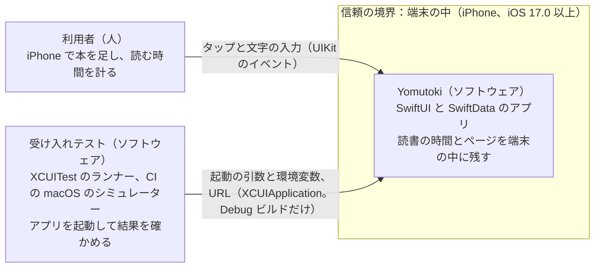
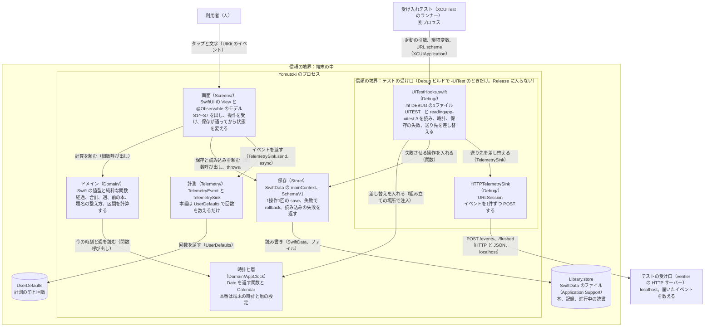

# A 技術設計メモ 001-reading-session：読んだ時間とページを残して、続きから読む

- 書いた役：tech-lead　日付：2026-10-21
- PRD：docs/prd/001-reading-session.md（AC-1〜AC-67。10、12、15。18 の 6 は指揮役が A に決めた）　デザイン：design/001-reading-session.md（1、3、6、10、D-57〜D-60）、design/tokens.md
- 契約：HTTP の契約（contracts/openapi.yaml）はない。端末の中の契約は contracts/data-model.md、contracts/test-hooks.md、contracts/telemetry.md と JSON Schema（contracts/README.md の一覧）
- ADR：0001（SwiftData、端末だけ）、0002（iOS 17.0、Xcode 26、Swift 6）、0003（計測の SDK なし）、0004（XcodeGen）、0005（テストのつなぎ口は Debug だけ）
- API の証拠の番号 A1〜A108 は docs/reviews/001-reading-session-G1-tech-lead-r1.md、-r2.md、docs/adr/ の「確かめたこと」の番号

## 1. 範囲、目標、非目標
- 範囲：iPhone のアプリ1つ（ターゲット3つ：アプリ、単体テスト、受け入れテスト）。画面 S1〜S7、保存（SwiftData の Book、ReadingSession、ActiveReading）、計測のイベントの型と端末の中で数える送り先、Debug だけのテストのつなぎ口 T1〜T21。
- 目標：PRD の AC-1〜AC-67 を、サーバーも外部ライブラリもなしで満たす。保存の失敗と強制終了で読書を失わない（1操作1回の save、失敗で rollback、時刻から経過を計算）。受け入れテストが時計と保存の失敗と送り先を差し替えて、sleep なしで決まった結果を確かめられる。
- 非目標：サーバー、アカウント、iCloud の同期、計測の第三者の SDK（003 で決め直す）、通知、ウィジェット、Live Activity、バックグラウンドの処理、iPad、ローカルの Swift パッケージ、MetricKit の購読（8）。

## 2. 受け入れ条件の対応表
operationId はすべて「なし（端末のみ）」（HTTP の API がない）。画面の ID は design/ の 1、データは contracts/data-model.md。「UI」は ios/AcceptanceTests/ の XCUITest（名前は verifier が G2 のテスト計画で決め、AC 番号を名前に入れる）。T の番号は contracts/test-hooks.md。全行で T1 か T2 を使ってデータを決めてから起動する。
| AC | 画面（design/） | operationId | データ（エンティティ） | 確かめるテスト |
|---|---|---|---|---|
| AC-1 | S1（本0冊） | なし（端末のみ） | Book 0件 | UI（T1）とスクリーンショット |
| AC-2 | S2 → S3、S1 | なし（端末のみ） | Book（title、totalPages nil、lastPage 0） | UI（T1） |
| AC-3 | S2 | なし（端末のみ） | Book.title の整え方（data-model） | UI（T1） |
| AC-4 | S1 → S2 → S3 → S4 | なし（端末のみ） | Book、ActiveReading | UI（T1。タップを数える） |
| AC-5 | S1 → S4 | なし（端末のみ） | ActiveReading.startedAt、前の本 | UI（T2、T3、T20） |
| AC-6 | S4 → S5 → S3 | なし（端末のみ） | ActiveReading（pausedAt、pausedTotalSeconds）、ReadingSession.durationSeconds | UI（T2、T3、T16） |
| AC-7 | S4 | なし（端末のみ） | ActiveReading（経過は計算） | UI（T2、T3、T16） |
| AC-8 | 起動 → S4 | なし（端末のみ） | ActiveReading（reading） | UI（T2、T3。終了して起動し直す） |
| AC-9 | S4 → S5 → S3 | なし（端末のみ） | ReadingSession（endPage、pagesRead）、Book.lastPage | UI（T2） |
| AC-10 | S5 → S3 | なし（端末のみ） | ReadingSession（endPage nil） | UI（T2） |
| AC-11 | S5 | なし（端末のみ） | ActiveReading（finishing）、Book.totalPages | UI（T2、T17） |
| AC-12 | S5 → S3 | なし（端末のみ） | ReadingSession.durationSeconds（分×60） | UI（T2、T17） |
| AC-13 | S4 → S3 | なし（端末のみ） | ActiveReading を消す（session_discard） | UI（T2、T3） |
| AC-14 | S3 | なし（端末のみ） | Book、ReadingSession（計算する値） | UI（T2） |
| AC-15 | S1 | なし（端末のみ） | ReadingSession.startedAt（今週） | UI（T2、T3、T4、T15） |
| AC-16 | S3 → S6 → S3 | なし（端末のみ） | ReadingSession を消す。Book.lastPage は変えない | UI（T2） |
| AC-17 | S4 → S1 → S3 | なし（端末のみ） | ActiveReading（0件か1件） | UI（T2、T17） |
| AC-18 | 起動 → S1、S3 | なし（端末のみ） | Book、ReadingSession（ストアのファイル） | UI の2段（T2、T11。ac18-reboot.sh） |
| AC-19 | S5 | なし（端末のみ） | ActiveReading.finishedAt、終える入力の下書き | UI（T2、T5 session_finish:*、T17） |
| AC-20 | S2 → S3 → S4 → S5 → S3 | なし（端末のみ） | 全部（計測の送り先だけ失敗） | UI（T1、T6、T7、T13、T19） |
| AC-21 | 全画面 | なし（端末のみ） | なし | UI（T1、T12） |
| AC-22 | S2 → S3、S1 | なし（端末のみ） | Book 21冊 | UI（T2） |
| AC-23 | S2、S4、S5 | なし（端末のみ） | TelemetryEvent（区間と真偽だけ） | UI（T1、T6、T13） |
| AC-24 | S4、S5 | なし（端末のみ） | 計測の印 telemetry.weekReachedWeekStart | UI（T2、T3、T4、T6、T13） |
| AC-25 | S1 → S4 | なし（端末のみ） | ReadingSession.savedAt（前の本） | UI（T2、T3、T17） |
| AC-26 | S1 → S4 | なし（端末のみ） | Book.addedAt（前の本） | UI（T2、T17） |
| AC-27 | S1 | なし（端末のみ） | ActiveReading | UI（T2） |
| AC-28 | S3 | なし（端末のみ） | Book.totalPages nil | UI（T2） |
| AC-29 | S5 → S3 | なし（端末のみ） | ReadingSession.pagesRead 0、Book.lastPage | UI（T2） |
| AC-30 | S5 | なし（端末のみ） | 分の範囲（finishedAt から計算） | UI（T2、T17） |
| AC-31 | S2 | なし（端末のみ） | Book.totalPages | UI（T1） |
| AC-32 | S5 → S3 | なし（端末のみ） | ReadingSession.endPage（9,999 まで） | UI（T2、T17） |
| AC-33 | 起動 → S4 | なし（端末のみ） | ActiveReading（paused、pausedAt） | UI（T2、T3、T17） |
| AC-34 | 起動 → S4 ＋ S5 | なし（端末のみ） | ActiveReading（finishing、finishedAt）、下書きを新しく作る | UI（T2、T3、T17） |
| AC-35 | S5 → S3 | なし（端末のみ） | ReadingSession 1件 | UI（T2、T5 session_finish:1） |
| AC-36 | S1 | なし（端末のみ） | 今週の合計（計算） | UI（T2、T3、T4） |
| AC-37 | S3 | なし（端末のみ） | Book（記録0件） | UI（T2） |
| AC-38 | S3 → S6 → S3 | なし（端末のみ） | ReadingSession（変えない） | UI（T2） |
| AC-39 | 全画面（7 の文言） | なし（端末のみ） | String Catalog | 文言の表の検査（T14。Linux） |
| AC-40 | S4 | なし（端末のみ） | 経過の秒（計算） | UI（T2、T3 で止める、T4 で ja と en） |
| AC-41 | S4 | なし（端末のみ） | 経過＝max(0, …) | UI（T2、T3、T16 の set） |
| AC-42 | S2 | なし（端末のみ） | Book（足さない） | UI（T2、T5 book_add） |
| AC-43 | S3 → S6 → S7 | なし（端末のみ） | ReadingSession（残す） | UI（T2、T5 session_delete） |
| AC-44 | S1 | なし（端末のみ） | ReadingSession.startedAt の週 | UI（T2、T3、T4、T15） |
| AC-45 | S4 → S5 → S3 | なし（端末のみ） | ActiveReading.finishedAt | UI（T2、T3、T16） |
| AC-46 | S5 → S4 → S5 | なし（端末のみ） | pausedTotalSeconds、下書きを消す | UI（T2、T3、T16） |
| AC-47 | S4 → S5 → S4 → S5 | なし（端末のみ） | 下書きを消す、分の初めの値 | UI（T2、T3、T16） |
| AC-48 | S5 → S4 | なし（端末のみ） | session_cancel_finish（下へのスワイプ） | UI（T2、T3、T16。swipeDown） |
| AC-49 | S2 → S3 | なし（端末のみ） | Book | UI（T2） |
| AC-50 | S1 → S4 → S5 → S3 | なし（端末のみ） | ReadingSession | UI（T2、T3） |
| AC-51 | S1 → S4 → S3 | なし（端末のみ） | ActiveReading を消す | UI（T2、T3） |
| AC-52 | S3 | なし（端末のみ） | ActiveReading | UI（T2、T17） |
| AC-53 | S2 → S1 | なし（端末のみ） | Book（足さない） | UI（T2） |
| AC-54 | 起動 → S1（読み込みの失敗） | なし（端末のみ） | 読み込み（load） | UI（T2、T5 load:*） |
| AC-55 | S1 → S1 → S3 | なし（端末のみ） | 読み込み（load）。ストアを消さない | UI（T2、T5 load:1） |
| AC-56 | S1、S3 | なし（端末のみ） | ActiveReading を足さない（session_start） | UI（T2、T5 session_start:1） |
| AC-57 | S1 → S4、S3 → S4 | なし（端末のみ） | ActiveReading.startedAt＝再試行の時刻 | UI（T2、T3、T5、T16） |
| AC-58 | S4 | なし（端末のみ） | ActiveReading（reading のまま。session_pause） | UI（T2、T3、T5 session_pause:1、T16） |
| AC-59 | S4 | なし（端末のみ） | ActiveReading.pausedAt＝再試行の時刻 | UI（T2、T3、T5、T16） |
| AC-60 | S4 | なし（端末のみ） | ActiveReading（paused のまま。session_resume） | UI（T2、T3、T5 session_resume:1、T16） |
| AC-61 | S4 | なし（端末のみ） | pausedTotalSeconds＋（再試行の時刻 − pausedAt） | UI（T2、T3、T5、T16） |
| AC-62 | S4 | なし（端末のみ） | ActiveReading（reading か paused のまま。session_begin_finish） | UI（T2、T3、T5 session_begin_finish:1、T16、T17） |
| AC-63 | S4 → S5 | なし（端末のみ） | finishedAt＝再試行の時刻、下書きを作る | UI（T2、T3、T5、T16、T17） |
| AC-64 | S5 | なし（端末のみ） | finishing のまま（session_cancel_finish）。下書きを残す | UI（T2、T3、T5 session_cancel_finish:1、T16） |
| AC-65 | S5 → S4 | なし（端末のみ） | pausedTotalSeconds＋（再試行の時刻 − finishedAt）、下書きを消す | UI（T2、T3、T5、T16） |
| AC-66 | S4 | なし（端末のみ） | ActiveReading を残す（session_discard） | UI（T2、T3、T5 session_discard:1、T16） |
| AC-67 | S4 → S3 | なし（端末のみ） | ActiveReading を消す（再試行の時点で経過60秒未満） | UI（T2、T3、T5、T16） |

## 3. 構成図
システムコンテキスト図（外とのつながりは、利用者と、CI の受け入れテストだけ。本番のアプリはネットワークに出ない。ADR 0003）

コンテナ図（1つのアプリのプロセスの中。ローカルの Swift パッケージは作らないので、コンテナはアプリのターゲットの中のフォルダ）

- protocol は TelemetrySink の1つだけ（実装が本番と Debug の2つあるため）。時計は protocol にせず、`now: () -> Date` を持つ値（名前は AppClock。Swift 標準の Clock とぶつけない）。保存の失敗の差し替えは、保存の層の save の直前に呼ぶ関数（既定は何もしない）で入れ、protocol を作らない。

## 4. 契約の変更と互換性
HTTP の契約はない（サーバーがない。ADR 0001、0003）。契約は contracts/ の Markdown と JSON Schema。
| operationId | 足す / 変える | AC | 認証 | 作る POST の Idempotency-Key |
|---|---|---|---|---|
| なし（HTTP の operation は0件） | － | AC-1〜AC-67 は端末のみ | 不要（アカウントなし） | 対象外 |

この作業で変えた契約（すべて足すだけ）：
| ファイル | 変えたこと | AC |
|---|---|---|
| contracts/data-model.md | 保存の操作の表の3行（終える60秒以上、60秒未満、やめる）に T5 の名前と失敗したときを入れた。時刻の決まり、終える入力の下書き、前の本（記録を消したとき）、state の知らない値の扱いを足した | AC-13、AC-46〜AC-48、AC-62〜AC-67 |
| contracts/test-hooks.md | T5 の操作に session_begin_finish、session_cancel_finish、session_discard。T2、T3、T5、T8、T16 の使う AC に AC-62〜AC-67 | AC-62〜AC-67 |
| contracts/telemetry.md、telemetry-events.schema.json | Save Failed の operation に同じ3つ。SaveOperation の case。Discarded は再試行で通ったときも出す | AC-62〜AC-67、PRD 15 |
| contracts/examples/telemetry-save-failed-session-discard.json | 例を1つ足した | 同上 |

- spectral の出力：対象外（OpenAPI がない）。代わりに contracts/README.md の1の ajv を動かした（`make contracts-check`）。結果：seed.example.json、seed-ac15.json、seed-ac33.json、telemetry の例10件、flushed.json がすべて valid、終了コード0。綴りの違う operation（"session_finishing"）は終了コード1で拒まれた。
- oasdiff breaking の出力：新規（origin/main の contracts/ は .gitkeep と dependencies.md だけで、openapi.yaml はない）。代わりの互換の確かめ（contracts/README.md の2）：`git diff origin/main -- contracts/ | grep -cE '^-[^-]'` は 0（dependencies.md の表の行は消さずに足した）。
- 互換性を壊す変更：なし。
- 返す enum に足した値：Save Failed の operation に3つ。読むのはテストの受け口だけで、古いアプリが読む値ではない。保存する値で enum にあたるのは ActiveReading.state（文字）で、知らない値は読み込みの失敗にして保存先を消さない（data-model.md）。単体テストを ios-engineer に頼む：state が "unknown" のストアを開くと AC-54 の表示になり、ファイルが残る。
- エラーの type と文言（design/ の 7。problem+json は使わない。失敗は端末の中の保存と読み込みだけ）：
  | 失敗（T5 の名前） | 出す所と文言のキー |
  |---|---|
  | load | S1：error.loadFailed.title、error.loadFailed.message、error.loadFailed.retry |
  | book_add | S2：error.saveFailed、error.saveFailed.book、error.retry |
  | session_start | S1 か S3：error.saveFailed、error.saveFailed.start、error.retry（文 error.retry.start） |
  | session_pause、session_resume | S4：error.saveFailed.pause か .resume、error.retry（文 error.retry.pause か .resume） |
  | session_begin_finish、session_discard | S4：error.saveFailed、error.saveFailed.finish、error.retry（文 error.retry.finish。D-58） |
  | session_cancel_finish | S5：error.saveFailed、error.saveFailed.cancel、error.retry（文 error.retry.cancel。D-60） |
  | session_finish | S5：error.saveFailed、error.saveFailed.session、error.retry |
  | session_delete | S7（alert）：error.saveFailed、error.saveFailed.delete |

## 5. データモデルと移行
| エンティティ | 正しいデータの置き場所（端末 / サーバー） | 個人情報か | 保存期間 | 消し方 |
|---|---|---|---|---|
| Book | 端末（SwiftData。バックアップに入る） | 利用者が入れた内容（題名から好みがわかる）。外に出さない、ログに出さない | アプリを消すまで | アプリを消す |
| ReadingSession | 端末（SwiftData。バックアップに入る） | 行動の記録（時刻、長さ、ページ） | 利用者が消すまで | S3 の削除（AC-16）、アプリを消す |
| ActiveReading | 端末（SwiftData。バックアップに入る） | 同上 | 記録を保存するか60秒未満で終えるまで | 終える、アプリを消す |
| 計測の印 | 端末（UserDefaults） | いいえ（時刻、真偽、回数だけ） | アプリを消すまで | アプリを消す |
| 終える入力の下書き | 端末のメモリだけ（保存しない） | ページと分（外に出さない） | S5 を閉じるか、プロセスが終わるまで | 保存かやめるが通る、強制終了 |

- SwiftData の版：SchemaV1（1.0.0）。MigrationStage は0件（最初の版）。形は contracts/data-model.md。この作業で項目は変えていない。
- 前の版のストアを開けるかのテスト：001 は最初の版なので対象なし。001 の版から次の版へ上げても記録が残ることは 002 の AC（PRD 12）。
- サーバーの DB の変更：なし。
- 題名の上限は形B（保存のときに先頭の100字に切る。PRD 10 が許す形）に決めた。理由：形A は UITextField を UIViewRepresentable で包む独自の部品になり、Dynamic Type と VoiceOver と焦点を作り直す範囲が増え、変換中の動きはこの環境（Mac なし）で確かめられない（裁定の (f)）。形B は標準の TextField のままで、Character の数（A95、A96）と prefix(100)（A97）で作れる。見せ方は D-57 の形B（整えたあとの字数が100を超えている間 book.add.titleLimit に book.add.titleLimit.onSave を出す。String Catalog に book.add.titleLimit を入れない）。
- design 10 の 8（下へのスワイプでやめる保存に失敗したら、シートを同じ値で開き直す）：作れる見込み。作り方は contracts/data-model.md の「終える入力の下書き」。入れかけの値をシートの外（S4 の @Observable のモデル。A10）に持ち、シートを出す Bool も state と別に持つ。下へのスワイプで閉じた後の sheet(isPresented:onDismiss:content:) の onDismiss で、やめる保存を呼ぶ（A109：iOS 13.0。onDismiss の本文「The closure to execute when dismissing the sheet.」 https://developer.apple.com/documentation/swiftui/view/sheet(ispresented:ondismiss:content:) 。2026-10-21 にドキュメントの JSON を取得、200）。失敗したら Bool を true に戻して開き直す。成功するふだんのスワイプは止めないので、AC-48 の見え方は変わらない。未確認：onDismiss の中で true に戻すと開き直るか（ios-engineer が最初の CI で確かめる）。代わりの案：(1) 次の MainActor の順番（`Task { @MainActor in … }`）で true に戻す。(2) それでも開かなければ、スワイプで閉じる前に保存する形（interactiveDismissDisabled（A60）と自前の確認）になり、AC-48 の見え方が変わるので designer と pdm に戻す（design 10 の 8 のとおり）。

## 6. 非機能の目標
表の中のコマンドの `\|` は Markdown の表のための書き方で、動かすときは `|` にする。
基準の機種：P-11 の答えで決める。暫定は「最低対応 OS（iOS 17.0）が動くいちばん遅い機種」（A12 の iPhone XS と XR の見込み。iOS 17 の対応機種の一覧は開いていないので未確認）。
| 項目 | 目標 | 測り方と時期 | 確かめる役 |
|---|---|---|---|
| 起動 | 起動から S1 で操作できるまで 2.0秒以内（5回の中央値、Release） | XCTApplicationLaunchMetric(waitUntilResponsive: true)、基準の機種の実機で G4（Takuma の Mac。P-14）。CI のシミュレーターの値は参考（G3）。公開後は Xcode Organizer の起動時間の p90（A52） | verifier |
| 読み始めの反応 | home.startReading か book.startReading から reading.elapsed の最初の表示まで 0.5秒以内 | XCTOSSignpostMetric（T20、A50）で G3（CI のシミュレーター）。実機は G4 | verifier |
| 大きなデータ | 本500冊、記録10,000件で、S1 と S3 が 1.0秒以内に出る | T21（UITEST_SEED_BULK）と XCTClockMetric、G3（CI のシミュレーター） | verifier |
| 反応（全体） | 操作から画面の変化まで 100ms 未満。250ms 以上の hang は0件 | Instruments の Hangs（G4、Takuma の Mac。なければ「未計測」と書く）。公開後は Xcode Organizer の Hangs（A52） | verifier |
| API | なし（サーバーがない）。本番のアプリが通信する箇所は0件 | `grep -rln 'URLSession' ios/Yomutoki --include='*.swift' \| grep -v '^ios/Yomutoki/Debug/' \| wc -l` が 0（G2） | reviewer |
| オフライン（画面ごと） | S1〜S7 はすべて機内モードで使える。計測の送信の失敗は捨て、画面に何も出さない。ぶつかる相手はない（端末だけ） | AC-20（T6、T7、G3）。実機の機内モードは G4 で Takuma | verifier |
| 電池 | バックグラウンドの処理0件。自動ロックを止めない。毎秒の書き直しは S4 が出ている間の TimelineView だけ | `grep -rnE 'BGTaskScheduler\|beginBackgroundTask\|isIdleTimerDisabled\|UIBackgroundModes' ios/` が 0件（G2） | reviewer |
| セキュリティ | ATS の例外0件。トークンなし（アカウントなし）。ファイルの保護は OS の既定（ADR 0001 で .complete にしない理由を書いた）。App Attest は使わない（守る API がない）。つなぎ口が Release に0件 | `grep -rn 'NSAllowsArbitraryLoads' ios/` が 0件（G2）。contracts/README.md の4（Release の strings が0件、CFBundleURLTypes がない。G2 の CI） | reviewer |
| プライバシー | 001 の本番は端末の外にデータを送らない。PrivacyInfo.xcprivacy は NSPrivacyTracking false、NSPrivacyCollectedDataTypes は空、UserDefaults の理由を1つ書く（理由の番号は A33 の一覧で ios-engineer が確かめる）。App Store の表記は「データの収集なし」（SDK を入れる 003 で直す） | plutil -lint と照合（G2、G4）、G5 で tech-lead が表記の下書きと照合 | reviewer |
| アクセシビリティ | AX5 で経過とすべての操作が切れない。コントラスト 4.5:1（大きい文字は 3:1）。押せる範囲 44×44pt。経過の読み上げは AC-40 の形 | G3 のスクリーンショット（ライト、ダーク、AX5、英語）を design-reviewer が測る。AC-40 は UI テスト | design-reviewer、verifier |
| 言語 | ja と en のそろっていないキー0件 | T14（`untranslated_keys=0`）、Linux で G2 と G3 | verifier |
| ビルドの警告 | 警告0件（Swift 6、並行性の検査は完全） | ios_build のログで `grep -c ' warning: '` が 0（G2。ADR 0002） | reviewer |
| 前の版からの更新 | 001 は最初の版なので対象なし。SchemaV1 から始める | 002 の AC（PRD 12） | verifier |

## 7. 脅威モデル
- 何を作るか（守るものと境界）：守るのは利用者が入れた題名と読書の記録（個人の内容）。境界は2つ：端末の中（外への送信は本番で0件）と、テストの受け口（Debug ビルドで -UITest のときだけ。UITEST_ の環境変数、readingapp-uitest:// の URL、localhost への HTTP）。認証、課金、外部のサービスはない。
- それで十分か：端末を手にした人とバックアップから読まれる危険は受け入れる（OS の画面のロックとバックアップの暗号化に任せる。ADR 0001）。Release につなぎ口が入らないことを機械で確かめるのが一番の対策。

| STRIDE | 起きうること | 対応（減らす / なくす / 移す / 受け入れる） | 確かめるテストか確認 |
|---|---|---|---|
| なりすまし（S） | ほかのアプリが readingapp-uitest://clock を開き、時計を動かして記録の時間を変える | なくす：URL scheme は Debug の Info.plist にだけあり、受けるコードは #if DEBUG（ADR 0005） | contracts/README.md の4：Release の Info.plist に CFBundleURLTypes がない、strings で readingapp-uitest が0件（G2 の CI） |
| 改ざん（T） | ストアのファイルや UITEST_SEED を書き換えて、変な値（負のページ、1万字の題名）を入れる | 減らす：seed は Debug だけで、合わなければ起動で止める（T2）。本番は自分の端末の自分のデータなので、読むときに範囲の外の値で落ちないようにする（経過は max(0, …)、% は totalPages nil で出さない） | 単体テスト（範囲の外の値で落ちない）、AC-41 |
| 否認（R） | 「消していない記録が消えた」と利用者が思う | 受け入れる：アカウントも監査の記録もない（個人の端末だけのため）。消す前に S6 で確かめる | AC-16、AC-38、AC-43 |
| 情報の漏れ（I） | 題名やページが計測、ログ、クラッシュの報告から外に出る | なくす：TelemetryEvent に String と Int を持たせない、本番は送らない（ADR 0003）。Logger は既定の非公開、`privacy: .public` は操作と状態の名前だけ | AC-23。`grep -rn 'privacy: .public' ios/` の行ごとに理由（G2、reviewer） |
| サービスの妨害（D） | 長い題名の貼り付け、とても長い数字、壊れたストアで落ちるか起動できなくなる | 減らす：題名は保存のときに100字に切る（形B）。数字の欄は桁が多くても落ちない（Int に変換できなければ範囲の外の誤り）。読み込みの失敗はストアを消さず再試行を出す（AC-54、AC-55） | 単体テスト（10万字の題名、20桁の数字）、AC-54、AC-55 |
| 権限の格上げ（E） | Release で -UITest を付けて起動し、保存の失敗や時計の差し替えを動かす | なくす：つなぎ口のコードが Release の実行ファイルに入らない（#if DEBUG の1ファイル） | contracts/README.md の4（strings で UITEST_ と -UITest が0件。G2 の CI） |

## 8. 観測と KPI イベント
- iOS のログ：Logger（subsystem はバンドル ID、category は store、telemetry、ui）。.public にするのは保存の操作の名前（SaveOperation の rawValue）と状態の名前だけ（題名とページを含まないため）。題名とページは既定の非公開のまま。
- signpost：T20 の FirstElapsedShown（subsystem "yomutoki"、category "perf"）。Release にも残す。
- MetricKit：001 は購読しない（受け取っても送る先がなく、ADR 0003 で本番は通信しない）。公開後の起動、hang、クラッシュは Xcode Organizer と App Store Connect で見る（A52。TestFlight の版で出るかは未確認）。003 で送り先を入れて購読するときは、iOS 26 以下は MXAppLaunchMetric（A51：iOS 13.0〜27.2）、iOS 27 以上は TimeToFirstDrawMetric（A51：iOS 27.0+）を #available で分ける。
- バックエンド：なし。
- 001 の本番では、イベントは端末の中で数えるだけ（UserDefaults の telemetry.localCounts）。KPI を集めて見られるのは、送り先を決め直す 003 を含む v1.0 から（PRD 13 の判定日は v1.0 の公開から数える）。PRD 14 の1行目（Takuma の7日間の読書の回数）は S3 の記録の数で数える。

| PRD 15 のイベント | 送る場所（アプリ / サーバー） | 使う所（KPI / 撤退基準 / G6 の止める基準） |
|---|---|---|
| App First Opened | アプリ | KPI：I-1 の分母。撤退基準：初日の読書（20%未満、10%未満） |
| Book Added | アプリ | KPI の補い（初日の流れのどこで止まるか）。AC-23 |
| Reading Session Started | アプリ | ガードレール：読書の完了率の分母。撤退基準：完了率60%未満 |
| Reading Session Finished | アプリ | KPI：I-1 の分子（is_first_5min、since_first_open）。完了率の分子、保存の失敗の分母。撤退基準：初日の読書、完了率 |
| Reading Session Restored | アプリ | 診断（強制終了から戻った数。完了率が下がったときの切り分け） |
| Reading Session Discarded | アプリ | 診断（60秒未満でやめた数。完了率の切り分け） |
| Reading Week Reached | アプリ | KPI：North Star（週の読書者数） |
| Save Failed | アプリ | ガードレール：保存の失敗（1,000回あたり1回未満）。G6 の止める基準の候補 |
| Load Failed | アプリ | 診断（目標と撤退の線を持たない。PRD 15） |

## 9. 依存ライブラリの変更
- ランタイムのライブラリ：なし（0件）。Package.resolved はない。
- ビルドの道具：XcodeGen を足した（contracts/dependencies.md の1行と詳しい列。ADR 0004）。解決とビルドの出力：未確認（この環境は Linux で brew が動かない）。最初の CI の ios_build のログ（`xcodegen --version`、`xcodegen generate`、`xcodebuild -version`、ビルドの結果）を ios-engineer が報告に貼る。
- 後で Swift パッケージを足すときの注意：XcodeGen の作るプロジェクトの中にできる Package.resolved は .gitignore で無視されるので、置き場所（例：ios/ の直下に写してコミットし、CI で比べる）を、その ADR で決める。

## 10. ADR と未確認
- この機能で書いた ADR：0001〜0005（7a で書いた。この作業で新しい ADR はない。題名の上限の形B は PRD 10 が許した2つの形の片方で、元に戻すのは小さいので ADR にせずこのメモの 5 に書いた）。
- 未確認の項目、確かめる方法、確かめる役（ios-engineer は実装の最初の push の後の CI で確かめ、出た / 出ない、使った代わりの案を報告に書く。裁定の3）：
  | 項目 | 確かめ方 | 代わりの案 |
  |---|---|---|
  | 裁定の (a)〜(g)（session.state.* が見えるか、システムの部品の識別子、.contain の「削除」、S5 の swipeDown、alert の「キャンセル」、題名の上限（形B にしたので変換中の動きは対象外）、AC-49 の push と AC-54 の読み込みの失敗） | CI のスクリーンショットと UI テストの結果 | design 6 の (a)〜(g)、docs/reviews/001-reading-session-G1-ruling.md |
  | D-46（ツールバーの .borderedProminent の色）、D-48（secondaryLabel を Color の値で替えられるか）、D-53（数字のキーボードの上のツールバー） | CI のスクリーンショット（ライト、ダーク、コントラストを上げる設定） | 裁定の追記の2段の案、Text の並び、safeAreaInset か D-53 をやめる |
  | D-60 の開き直し（5） | UI テストで swipeDown と UITEST_FAIL=session_cancel_finish:1 | 5 の (1)(2) |
  | シミュレーターの名前「iPhone 16」 | ios_test のログの `xcrun simctl list devices available` | 一覧の iOS 26 の iPhone に替え、CLAUDE.md と Makefile と app.json をそろえる |
  | xctestplan を手で書いて xcodebuild の -testPlan で動くか（中の target の identifier を XcodeGen の作る値に合わせる必要があるか） | CI。identifier は `grep -n 'YomutokiAcceptanceTests' ios/Yomutoki.xcodeproj/project.pbxproj` で見る | -testPlan をやめ、`-only-testing:YomutokiTests` と `-only-testing:YomutokiAcceptanceTests` にする |
  | CODE_SIGNING_ALLOWED=NO で UI テストのランナーが動くか | CI | テストの行だけ `CODE_SIGN_IDENTITY=- CODE_SIGNING_REQUIRED=NO` に替える |
  | macos-latest の Xcode が 26 か | ios_build のログの `xcodebuild -version` | CI で Xcode を選ぶ手順（.github/ は Takuma） |
  | 環境変数の長さ（T2）、XCUIApplication.open の確認のダイアログ（T16）、-AppleLocale の効き方（T4）、OSSignposter と XCTOSSignpostMetric（T20） | CI | contracts/test-hooks.md の各行の備考 |
  | 基準の機種（6） | P-11 の Takuma の答え | 暫定のまま G4 で CI の値を参考にする（P-14） |
  | PrivacyInfo.xcprivacy の UserDefaults の理由の番号 | A33 の一覧を ios-engineer が開く | － |
  | ビルドの設定の名前（SWIFT_DEFAULT_ACTOR_ISOLATION、SWIFT_TREAT_WARNINGS_AS_ERRORS） | ios_build のログ | ADR 0002 の表のとおり、CI のログの warning を数える |

## 11. 実装の決まり（ios-engineer へ）
1. 色は Color の値で渡す（tech-lead r2 の提案1）。トークンは Asset Catalog の Color Set（design/tokens.md 1）か Color.primary などの Color の値にし、`.foregroundStyle(.primary)` のような階層の形（HierarchicalShapeStyle）を文字の色に使わない（A90）。確かめ：`grep -rnE 'foregroundStyle\(\.(primary|secondary|tertiary)' ios/Yomutoki` が 0件。
2. 自動保存を切る：ModelContainer を作った直後に `mainContext.autosaveEnabled = false`（A4）。1つの操作は1回の save（A3）、失敗したら rollback（A5）。確かめ：`grep -rn 'autosaveEnabled = false' ios/Yomutoki` が1件。
3. 保存が通ってから画面とメモリの状態を変える（tech-lead r2 の提案3）。操作の時刻は保存が通った回の時刻（再試行ならその時刻。PRD 10）。失敗した回の値を残さない。
4. 題名は形B（5）。単体テスト：100字と101字、結合した絵文字、CRLF と U+2028、前後の全角空白、10万字の貼り付け。
5. 60秒未満で終える保存の再試行は、押した時点の経過で session_discard か session_begin_finish に分ける（D-59、PRD 18 の 6 の A）。T5 の数は、その回に試した操作の数を使う。
6. 終える入力の下書きとシートの Bool は S4 のモデルに持つ（5、contracts/data-model.md）。
7. 時計は AppClock（`now: () -> Date`）と Calendar を組み立ての場所で入れる。Date() をほかで直接呼ばない（つなぎ口が効かなくなるため）。確かめ：`grep -rn 'Date()' ios/Yomutoki --include='*.swift'` の行が AppClock と Debug/ の中だけ。
8. 計測の型は contracts/telemetry.md のとおり。関連値に String と Int を持たせない。
9. 最初の CI で、裁定の (a)〜(g) と D-46、D-48、D-53、D-60 と 10 の表の未確認を確かめ、結果と使った代わりの案を報告に書く（裁定の3）。G3 まで残れば G3 は通らない。

雛形の作り方（ios-engineer が ios/ に作る。tech-lead はコードを書かない）：
- ios/project.yml（XcodeGen。ADR 0004）：name Yomutoki。options の deploymentTarget は iOS 17.0、disabledValidations に missingTestPlans（受け入れテストの xctestplan を verifier が書く前でも generate できる。XcodeGen の ProjectSpec に「Disable checking if test plan paths exist. This can be useful if your test plans haven't been created yet.」とある。https://raw.githubusercontent.com/yonaskolb/XcodeGen/master/Docs/ProjectSpec.md を 2026-10-21 に取得）。
- 設定：SWIFT_VERSION 6.0、TARGETED_DEVICE_FAMILY 1、アプリのターゲットの既定の actor 分離は MainActor（ADR 0002）、警告をエラーにする設定（名前は未確認）。Info.plist は Debug と Release で分ける（ADR 0004）。
- ターゲット：Yomutoki（application、ios/Yomutoki/）、YomutokiTests（bundle.unit-test、ios/YomutokiTests/）、YomutokiAcceptanceTests（bundle.ui-testing、ios/AcceptanceTests/）。
- スキーム Yomutoki の test の testPlans：YomutokiTests/Unit.xctestplan（defaultPlan、ios-engineer が書く。中身は YomutokiTests だけ）と AcceptanceTests/Acceptance.xctestplan（verifier が書く。中身は YomutokiAcceptanceTests だけで、AC-18 の2つのテストは skippedTests に入れる）。XcodeGen は xctestplan を作らないので手で書く（ProjectSpec の Test Plan の節）。
- AC-18 の2段は verifier の ios/AcceptanceTests/ac18-reboot.sh（引数はシミュレーターの名前。データを作るテストだけ → `xcrun simctl shutdown` と `boot` → 確かめるテストだけ。どれも -retry-tests-on-failure なし）。
- 順番：ios-engineer の雛形（project.yml、空のアプリ、Unit.xctestplan）→ verifier の Acceptance.xctestplan、ac18-reboot.sh、受け入れテスト（red）→ 実装。Acceptance.xctestplan と ac18-reboot.sh がないうちは ios_test が落ちる。

## 確かめ（A）
- [x] 2 の表に PRD の全 AC があり、空の欄がない（AC-1〜AC-67 の67行。`grep -cE '^\| AC-[0-9]+ \|'` で 67）
- [x] 3 の図のすべての要素に技術と責任が、すべての矢印に用途と通信方式がある
- [x] 契約のすべての operation に operationId、成功とエラーの例、認証の要否、AC 番号がある。エラーは problem+json（対象外：HTTP の operation は0件。端末の中の失敗と文言は 4 の表）
- [x] 4 に spectral と oasdiff の出力（または「未検査」と理由）がある。互換性を壊すなら ADR と大きな版の上げがある（spectral は対象外で代わりに ajv の出力、oasdiff は新規。壊す変更なし）
- [x] 5 の全エンティティに置き場所、個人情報か、保存期間、消し方がある。モデルを変えたなら MigrationStage がある（項目は変えていない。SchemaV1 のまま）
- [x] 6 のすべての行に数字と測り方がある
- [x] 7 が STRIDE の6行か「新しい境界なし」のどちらか。受け入れた危険に理由がある
- [x] 8 で、PRD 15 の全イベントに送る場所がある（9イベント、すべてアプリ）
- [ ] 新しい依存に、解決とビルドの出力があり、dependencies.md の全列が埋まっている（未解決：XcodeGen は列を埋めたが、解決とビルドの出力はこの環境で取れない。最初の CI の ios_build のログで確かめる）
