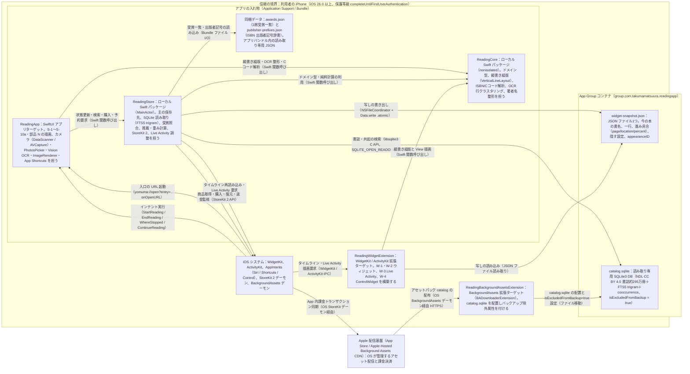

# A 技術設計メモ 001-reading-session：夜の入口、本の出口（v1）

- 書いた役：tech-lead　日付：2026-10-25
- PRD：docs/prd/001-reading-session.md（AC-1〜AC-149、全149件）　デザイン：design/001-reading-session.md、design/001-reading-session/tokens.md、design/001-reading-session/screens.md　契約：contracts/（widget-snapshot.schema.json、entry-urls.md、test-hooks.md、hooks/*.schema.json、dependencies.md）
- 状態：G1 ステップ7の仕上げ（全149 AC の v1.0 一括対応、外部 HTTP 通信0件化、Apple-Hosted Background Assets 書誌・共起 SQLite DB 化）。
- この機能の ADR：0001（iOS の土台）、0002（保存と共有）、0003（縦書き組版・4つの見た目・カード・Vision OCR）、0004（端末内書誌・共起データベースと推薦）、0005（テストのつなぎ口 H1〜H32）。

## 1. 範囲、目標、非目標
- 範囲
  - PRD（`docs/prd/001-reading-session.md`）の**全 149 件の受け入れ条件（AC-1〜AC-149）すべてを v1.0 の対象**とする（2026-10-20〜10-25 の Takuma の決定 `docs/approvals/001-reading-session-G1-decisions.md` により、旧「v1.1 に回す候補（選択肢）」および条件つき分岐を全面廃止）。
  - 含まれる機能群：
    1. 登録と最初の本（バーコード連続読み取り＋2段目 `192` Cコード補完、端末内書誌 DB 約295万冊からの 0.3秒検索、手入力と FTS5 `trigram` 候補補完、表紙・背表紙撮影／スクリーンショット OCR、本棚・平積み1枚からの複数背表紙 OCR 登録、「あとで」名無しの `今の本` での即時読み始め、奥付撮影による補完）。
    2. 本棚と本の画面（3区分、奥付最大5行、同梱受賞作リスト3賞の正規化照合、4:00 境目の晩ごとの記録一覧と編集・削除）。
    3. 毎晩の入口（ロック画面ウィジェット W-1、StandBy/ホーム小ウィジェット W-2、夜の入口の予約 Live Activity と読書中 Live Activity W-3、コントロール W-4、Siri / App Shortcuts 3種 W-5）。
    4. 読み始める・伏せて読む・数える（1タップ開始、1.0秒伏せて開始、バックグラウンド・強制終了復帰計測、電子書籍 `page` / `location` / `percent` 単位対応）。
    5. しおりを挟む（ページ撮影 OCR、スクリーンショット選択 OCR、手入力、数字のみ入力、あとで挟む、結果画面、初回ウィジェット案内）。
    6. 読み終えた夜と推薦（奥付、ふりかえりの1行（文の型・AI 不使用）、1080×1350 PNG 読み終えカード共有、3箇所の推薦「次の1冊」「この本のあとに最大5冊」「今の本0冊時の積読候補」、端末内の選好重み付け `score = chosen * 2 - skipped`、共起テーブル `count >= 10` かつ文学 NDC `9` の受け皿）。
    7. 買い切り課金「よむま＋」（StoreKit 2 非消耗型 `jp.yomuma.plus`、4つの見た目 `default` / `kinari` / `sumi` / `shu`、購入・復元・返金）。
- 目標
  - 全 149 AC を、独自サーバーなし、サードパーティ外部ライブラリなし、iOS 26.0 以上の iPhone で満たす（ADR 0001）。
  - **アプリのプロセスから外部への HTTP/HTTPS 通信を 0 件（AC-103）**にする。書誌・共起データベース（`catalog.sqlite`、NDL CC BY 4.0 書誌約295万冊）は Apple-Hosted Background Assets で配信し、端末内の読み取り専用 SQLite（FTS5 `trigram`）で 0.3秒以内（AC-149）に引く（ADR 0004）。
  - PRD 12 のすべての速度目標（起動 1.0秒以内、「終える」から S-3 まで 0.5秒以内、本500冊・記録5,000件での本棚・本の画面 1.0秒以内、ウィジェット 0.5秒以内、書誌 DB 検索 0.3秒以内、インテント開始要求 0.5秒以内）を満たす。
- 非目標（この設計でやらないこと）
  - PRD 10 のやらないこと：独自サーバー、アカウント、ソーシャル機能、表紙の書影画像、外部解析 SDK、生成 AI（Foundation Models 等）による文生成、「AI」「機械学習」の表記、iPad / Apple Watch / Mac / Vision Pro 配布。
  - 同意した利用者から読了ペアを収集するサーバーと同意画面（別 PRD `002`、v1.1 に分離。v1.0 は共起テーブルを表示する器のみ搭載）。
  - 強制アップデート機構（ADR 0001：通信する自前サーバーを持たないため）。

## 2. 受け入れ条件の対応表
PRD の全 149 AC（AC-1〜AC-149）を1行ずつ漏れなく記載する。外部 HTTP API は持たないため、`operationId` の列には端末内の操作・App Intent・SQLite クエリ・StoreKit 操作と、検証に使うテストのつなぎ口（H1〜H32、`contracts/test-hooks.md`）を記載する。

### 登録と最初の本（AC-1〜AC-12、AC-92、AC-113、AC-137〜AC-140）
| AC | 画面（design/） | operationId / 処理・Intent・Hook | データ（SwiftData / SQLite / Snapshot） | 確かめるテスト |
|---|---|---|---|---|
| AC-1 | S-1（空） | なし（端末のみ：初回起動表示）。H14、H26 | Book 0件、Settings（既定） | 画面（H14、H26。`FirstLaunchTests` で単独実行）／G4-5 |
| AC-2 | S-1、S-8、S-8a | なし（端末のみ：`CatalogDatabase.lookupISBN`）。H1、H13、H20、H21、H26、H29 | SQLite `books`（ISBN 主キー）、Book（`current`）、Snapshot | 画面（H1、H13、H20、H21、H26、H29）／G4-10 |
| AC-3 | S-8a | なし（端末のみ：`CatalogDatabase.lookupISBN`＋2段目 `192` Cコード判型補完＋重複・非書籍除外）。H2、H13、H17、H20、H21、H26 | SQLite `books`、Book（`tsundoku`） | 画面（H2、H13、H17、H20、H21、H26）／G4-10 |
| AC-4 | S-8、S-8c | なし（端末のみ：`CatalogDatabase.searchTitle` FTS5 `trigram`）。H1、H13、H20 | SQLite `books_fts` / `books`、Book（`current`） | 画面（H1、H13、H20） |
| AC-5 | S-8c | なし（端末のみ：`CatalogDatabase.searchTitle` 0件時の手入力保存）。H1、H13、H20 | SQLite `books_fts`（0件）、Book（`current`） | 画面（H1、H13、H20） |
| AC-6 | S-8a、S-8c | なし（端末のみ：オフライン時 `CatalogDatabase.lookupISBN` / `searchTitle`）。H1、H8、H13、H20、H21、H26、H29 | SQLite `books`、Book（`current`） | 画面（H1、H8、H13、H20、H21、H26、H29）／G4-4 |
| AC-7 | S-8c | なし（端末のみ：手入力の前後空白除去と保存）。H2、H13 | Book（`tsundoku`、書名・著者トリム済み） | 画面（H2、H13） |
| AC-8 | S-8c | なし（端末のみ：書名1〜100字・著者0〜100字の書記素バリデーション）。H1、H13 | Book（エラー時は保存しない、正常時は `current`） | 画面（H1、H13） |
| AC-9 | S-8a | なし（端末のみ：Background Assets 未取得 `notDownloaded` 時の行内書名入力保存）。H1、H13、H20、H21、H26、H29 | Book（`current`、ISBN＋手入力書名） | 画面（H1、H13、H20、H21、H26、H29） |
| AC-10 | S-8a | なし（端末のみ：SQLite 未収録 ISBN の `scan.notFound` と行内書名入力保存）。H1、H13、H20、H21、H26、H29 | SQLite `books`（0件）、Book（`current`、ISBN＋手入力書名） | 画面（H1、H13、H20、H21、H26、H29） |
| AC-11 | S-8a | なし（端末のみ：ISBN 出版者記号辞書 `publisher-prefixes.json`＋2段目 `192` Cコードによる出版社・文庫補完）。H1、H13、H20、H21、H26 | 同梱 `publisher-prefixes.json`、Book（`current`、出版社・レーベル補完） | 画面（H1、H13、H20、H21、H26） |
| AC-12 | S-8 | なし（端末のみ：カメラ拒否時の `camera.denied` とスクショ・手入力導線表示）。H1、H26 | なし（保存しない） | 画面（H1、H26）／G4-5 |
| AC-92 | S-8a、S-8c、S-7 | なし（端末のみ：`AuthorNameFormatter` による `dc:creator` / `author` 整形）。H1、H13、H20、H21、H26 | SQLite `books`、Book.author（生没年・役割語・空白除去済み） | 画面（H1、H13、H20、H21、H26）＋単体テスト |
| AC-113 | S-7、S-9、S-7c | なし（端末のみ：`OCRPipeline.recognizeColophon` Vision OCR による奥付抽出・更新）。H2、H13、H19、H26、H27 | Book（author、publisher、label、publishedYear、isbn 更新）、メモリ画像（即時破棄） | 画面（H2、H13、H19、H26、H27）／G4-10 |
| AC-137 | S-8、S-8b | なし（端末のみ：`OCRPipeline.recognizeCover` カメラ・PhotosPicker 表紙2タップ選択）。H1、H13、H19、H26、H27 | Book（`current`、title・author）、メモリ画像（即時破棄） | 画面（H1、H13、H19、H26、H27）／G4-10 |
| AC-138 | S-8、S-8d | なし（端末のみ：`OCRPipeline.recognizeBookshelf` `minimumTextHeightFraction = 0.005`＋`CatalogDatabase` 完全一致1件補完）。H2、H13、H19、H20、H26、H27 | SQLite `books`、Book 複数冊（`tsundoku`）、メモリ画像（即時破棄） | 画面（H2、H13、H19、H20、H26、H27）／G4-10 |
| AC-139 | S-8、S-2、S-1、W-1、W-3 | なし（端末のみ：`register.later` による名無しの今の本 `isTitlePending = true` 作成と即時読書開始）。H1、H4、H5、H6、H9、H13、H22、H23 | Book（`current`、`isTitlePending = true`）、Session、Record、Snapshot | 画面（H1、H4、H5、H6、H9、H13、H22、H23） |
| AC-140 | S-1、S-8、S-8a〜S-8c | なし（端末のみ：`bookmark.setBookTitle` による既存 `current` 本の書誌上書き更新）。H2、H13、H20、H21、H22、H26 | SQLite `books`、Book（同一 id のまま `isTitlePending = false` に更新）、Snapshot | 画面（H2、H13、H20、H21、H22、H26） |

### 本棚と本の画面（AC-13〜AC-26、AC-112）
| AC | 画面（design/） | operationId / 処理・Intent・Hook | データ（SwiftData / SQLite / Snapshot） | 確かめるテスト |
|---|---|---|---|---|
| AC-13 | S-1、S-6 | なし（端末のみ：本棚3区分と積読日時降順ソート）。H2、H13 | Book（`current`、`tsundoku`、`finished`、`tsundokuAt`） | 画面（H2、H13） |
| AC-14 | S-6、S-7、S-1、W-1 | なし（端末のみ：`book.readThis` による今の本の切り替え）。H2、H13、H22 | Book（新 `current`、旧 `current` はしおり保持のまま `tsundoku`）、Snapshot | 画面（H2、H13、H22） |
| AC-15 | S-7、S-7a | なし（端末のみ：`book.edit` 書名・著者の編集保存）。H2、H13 | Book（title、author、manuallyEdited）、Record（不変） | 画面（H2、H13） |
| AC-16 | S-7、S-1、W-1 | なし（端末のみ：`book.delete` 本と紐づく記録の一括削除）。H2、H12、H13、H22 | Book、Record（カスケード削除）、Snapshot（`widget.empty`） | 画面（H2、H12、H13、H22） |
| AC-17 | S-7 | なし（端末のみ：奥付5行表示と `AwardsCatalog` 照合）。H2、H25 | Book、同梱 `awards.json` | 画面（H2、H25） |
| AC-18 | S-7 | なし（端末のみ：奥付の空項目行の非表示）。H2、H25 | Book（空フィールド）、同梱 `awards.json` | 画面（H2、H25） |
| AC-19 | S-7、S-9 | なし（端末のみ：`AwardsCatalog.match` 正規化した題名＋著者の両方一致）。H2、H25 | Book、同梱 `awards.json` | 画面（H2、H25）＋単体テスト |
| AC-20 | S-7、S-9 | なし（端末のみ：片方のみ一致・上下巻・派生書の受賞非表示）。H2、H25 | Book、同梱 `awards.json` | 画面（H2、H25） |
| AC-21 | S-7、S-9 | なし（端末のみ：NFKC・句読点・括弧内レーベル除去による受賞照合）。H2、H25 | Book、同梱 `awards.json` | 画面（H2、H25）＋単体テスト |
| AC-22 | S-7 | なし（端末のみ：記録時の `timeZoneID` と 4:00 境目による晩の日付・晩数計算）。H2、H6、H13 | Record（`startedAt`、`timeZoneID`、`minutes`） | 画面（H2、H6、H13） |
| AC-23 | S-7 | なし（端末のみ：記録0件時の `book.records.empty` 表示）。H2 | Record（0件） | 画面（H2） |
| AC-24 | S-7、S-7b | なし（端末のみ：`record.save` 記録の分数変更と合計再計算）。H2、H13 | Record.minutes | 画面（H2、H13） |
| AC-25 | S-7b | なし（端末のみ：記録分数 1〜1440・全角数字変換・小数拒否バリデーション）。H2、H13 | Record.minutes（エラー時は不変） | 画面（H2、H13） |
| AC-26 | S-7b | なし（端末のみ：`record.delete` 記録1件の削除と合計・晩数更新）。H2、H13 | Record（1件削除） | 画面（H2、H13） |
| AC-112 | S-7、S-9 | なし（端末のみ：同梱 `awards.json` と `docs/prd/001-reading-session-awards.md` の全行一致検証）。H25 | 同梱 `awards.json` | 受け入れテスト（H25） |

### 毎晩の入口：ウィジェットと Live Activity（AC-27〜AC-41、AC-96〜AC-99、AC-130）
| AC | 画面（design/） | operationId / 処理・Intent・Hook | データ（SwiftData / SQLite / Snapshot） | 確かめるテスト |
|---|---|---|---|---|
| AC-27 | W-1 | なし（端末のみ：`VerticalLineLayout` `.accessoryRectangular` 組版）。H2、H22 | Snapshot（title、line、page、`widgetURL`） | ウィジェット（H2、H22）＋スクリーンショット／G4-1、G4-18 |
| AC-28 | W-1、W-2 | なし（端末のみ：縦書き用句読点・括弧 U+FE11〜FE42 変換、長音90度回転、行頭禁則）。H2、H22 | Snapshot.line | ウィジェット（H2、H22）＋スクリーンショット／G4-1 |
| AC-29 | W-1、W-2、S-1 | なし（端末のみ：26字以上の一行の句読点または24字＋`…` 短縮、S-1 は全文）。H2、H22 | Snapshot.line、Book.line | ウィジェット・画面（H2、H22）／G4-1 |
| AC-30 | W-1、W-2、S-1 | なし（端末のみ：かな・漢字を含まない欧文一行の横書きフォールバック）。H2、H22 | Snapshot.line | ウィジェット（H2、H22） |
| AC-31 | W-1、W-2 | なし（端末のみ：一行なしのときの書名＋ページ横書き表示）。H2、H22 | Snapshot（line なし、page あり／なし） | ウィジェット（H2、H22） |
| AC-32 | W-1、W-2 | なし（端末のみ：今の本がないときの `widget.empty` 表示）。H1、H2、H22 | Snapshot（`currentBook` なし） | ウィジェット（H1、H2、H22） |
| AC-33 | S-3a〜S-3c、W-1、W-2 | なし（端末のみ：しおり保存時の `WidgetCenter.shared.reloadAllTimelines()` 1回呼び出し）。H2、H4、H5、H22 | Book（line、page）、Snapshot | ウィジェット・画面（H2、H4、H5、H22）／G4-2 |
| AC-34 | S-10、W-1、W-2、W-3、S-1 | なし（端末のみ：`settings.hideOnWidgets` オン時の書名・一行マスクと `widget.hidden` 表示）。H2、H4、H5、H6、H22、H23 | Settings.hideOnWidgets、Snapshot、Live Activity ContentState | ウィジェット・画面（H2、H4、H5、H6、H22、H23）／G4-1 |
| AC-35 | W-2 | なし（端末のみ：`VerticalLineLayout` `.systemSmall` StandBy/ホーム組版）。H2、H22 | Snapshot（title、line、page、`widgetURL`） | ウィジェット（H2、H22）＋スクリーンショット／G4-3、G4-18 |
| AC-36 | W-3、S-3a〜S-3c | なし（端末のみ：`LiveActivityCoordinator` `Activity.request(...start:)` による翌晩の予約）。H2、H4、H5、H6、H23 | Settings.entryTime、Book、Live Activity（scheduled） | 画面（H2、H4、H5、H6、H23）／G4-6 |
| AC-37 | W-3、S-10 | なし（端末のみ：`areActivitiesEnabled == false` 時の予約スキップと `settings.liveActivity.off` 表示）。H2、H22、H23 | Settings、Snapshot | 画面（H2、H22、H23）／G4-6 |
| AC-38 | S-10、W-3 | なし（端末のみ：`settings.entryTime` 15分刻み変更と予約 Live Activity 再スケジュール）。H2、H4、H5、H6、H23 | Settings.entryTime、Live Activity（scheduled） | 画面（H2、H4、H5、H6、H23） |
| AC-39 | S-1 | なし（端末のみ：予約 Live Activity がない晩の通常起動と `flipMonitoring=on`）。H2、H9、H17、H23 | Book、Session（なし） | 画面（H2、H9、H17、H23） |
| AC-40 | W-1、W-2、W-3、S-1 | なし（端末のみ：`onOpenURL` `yomuma://open?entry=...` 300秒・前面維持による `entry` 記録）。H2、H4、H5、H17、H22、H23、H28 | メモリ `entryCandidate` → Session.entry → Record.entry | 画面（H2、H4、H5、H17、H22、H23、H28）／G4-18 |
| AC-41 | W-3、S-1、S-2、S-3b | なし（端末のみ：表示中の予約 Live Activity を `reading` 状態へ更新し、終了時に結果を出して終了）。H2、H4、H5、H23 | Session、Record、Live Activity（`waiting` → `reading` → `ended`） | 画面（H2、H4、H5、H23）／G4-6 |
| AC-96 | S-5、S-1 | なし（端末のみ：初回の一行保存直後に1回だけ `widgetGuide` シート表示）。H2、H12、H13、H17 | Settings.widgetGuideShown | 画面（H2、H12、H13、H17） |
| AC-97 | W-3、S-4 | なし（端末のみ：予約 Live Activity 要求失敗時のサイレント無視と次回前面復帰時リトライ）。H2、H4、H5、H6、H22、H23 | Book、Snapshot、Live Activity | 画面（H2、H4、H5、H6、H22、H23） |
| AC-98 | W-3 | なし（端末のみ：予約の `staleDate` 翌 4:00 設定と、未読のまま翌朝前面復帰した際の終了・再予約）。H2、H4、H5、H6、H23 | Live Activity（`staleDate`、end 要求、新予約） | 画面（H2、H4、H5、H6、H23）／G4-6 |
| AC-99 | W-1、W-2、S-1 | なし（端末のみ：ウィジェット全体の単一 VoiceOver ラベル生成・縦書き字形除外）。H2、H22 | Snapshot.line、Book.line | ウィジェット・画面（H2、H22）／G4-13 |
| AC-130 | S-1、W-3 | なし（端末のみ：入口時刻前の読書開始による今夜の予約取消、読書中の見直し抑止、終了時の再予約）。H2、H4、H5、H6、H9、H13、H17、H23 | Session、Record、Live Activity（cancel / request） | 画面（H2、H4、H5、H6、H9、H13、H17、H23） |

### 読み始める、伏せて読む、数える（AC-42〜AC-62）
| AC | 画面（design/） | operationId / 処理・Intent・Hook | データ（SwiftData / SQLite / Snapshot） | 確かめるテスト |
|---|---|---|---|---|
| AC-42 | S-1、S-2 | なし（端末のみ：`bookmark.start` 1タップで `reading` へ遷移）。H2、H9 | Session（作成） | 画面（H2、H9） |
| AC-43 | S-2 | なし（端末のみ：読書中画面の要素制限・押せる要素 `reading.end` 1つのみ）。H2、H9 | Session | 画面（H2、H9）＋スクリーンショット |
| AC-44 | S-1、S-2 | なし（端末のみ：`UIDevice.orientation == .faceDown` 1.0秒継続で触覚1回＋`reading` 開始）。H2、H9、H15、H16、H17 | Session（`startedBy = .flip`） | 画面（H2、H9、H15、H16、H17）／G4-7、G4-14 |
| AC-45 | S-1 | なし（端末のみ：伏せて 0.9秒で起こしたときのデバウンス取消）。H2、H9、H15、H16、H17 | Session なし（`idle` 維持） | 画面（H2、H9、H15、H16、H17）／G4-14 |
| AC-46 | S-1 | なし（端末のみ：今の本がないときの `flipMonitoring = off`）。H1、H2、H9、H15、H16、H17 | Book（`current` なし）、Session なし | 画面（H1、H2、H9、H15、H16、H17） |
| AC-47 | S-2〜S-10a、部品 N | なし（端末のみ：S-1 以外の全画面・シート・知らせ表示中・起動前伏せ時の `flipMonitoring = off`）。H2、H9、H15、H16、H17 | Session なし | 画面（H2、H9、H15、H16、H17） |
| AC-48 | S-2 | なし（端末のみ：読書中に起こしても止まらず、再度の伏せで二重開始しない）。H2、H4、H5、H9、H15、H16、H17 | Session（1件維持）→ Record（10分） | 画面（H2、H4、H5、H9、H15、H16、H17） |
| AC-49 | S-1、S-2 | なし（端末のみ：伏せ開始時の `UIAccessibility.post` `session.flipStarted.announcement` 1回）。H2、H15、H16、H17 | Session | 画面（H2、H15、H16、H17）／G4-13 |
| AC-50 | S-1 | なし（端末のみ：`bookmark.flipHint` の表示）。H2 | Settings.flipToStart（true） | 画面（H2） |
| AC-51 | S-1、S-10 | なし（端末のみ：`settings.flipToStart` オフ時および伏せ非対応環境 H18 での `flipMonitoring = off`）。H1、H2、H9、H15、H16、H17、H18 | Settings.flipToStart（false） | 画面（H1、H2、H9、H15、H16、H17、H18） |
| AC-52 | S-2 | なし（端末のみ：バックグラウンド経過時間の `startedAt` 差分計算）。H2、H4、H5 | Session.startedAt → Record.minutes | 画面（H2、H4、H5）／G4-8 |
| AC-53 | S-2 | なし（端末のみ：強制終了後の再起動での `Session` 復元と継続計測）。H2、H4、H9 | Session（永続化済み）→ Record.minutes | 画面（H2、H4、H9）／G4-9 |
| AC-54 | S-2 | なし（端末のみ：`isIdleTimerDisabled == false` かつ `isProximityMonitoringEnabled == false` 維持）。H2、H5、H9、H15、H16、H17 | なし | 画面（H2、H5、H9、H15、H16、H17）＋G2 grep／G4-11 |
| AC-55 | S-2、S-3 | なし（端末のみ：`reading.end` 1タップから 500ms 以内に S-3 表示）。H2、H4、H5、H10 | Session → Record | 画面（H2、H4、H5、H10 `endToMark`）／G4-15 |
| AC-56 | S-2、S-1、S-3、部品 N | なし（端末のみ：59秒以下は破棄して `session.tooShort`、60秒以上は1分以上の Record 作成）。H2、H4、H5、H9、H12 | Session（削除）、Record（60秒以上のみ） | 画面（H2、H4、H5、H9、H12） |
| AC-57 | S-2、S-3、S-4、部品 N | なし（端末のみ：経過 86,460秒以上で 1440分上限クリップと `session.capped` 表示）。H2、H4、H5、H12 | Record.minutes（上限 1440） | 画面（H2、H4、H5、H12） |
| AC-58 | S-2、S-1、部品 N | なし（端末のみ：端末時刻逆行時のセッション破棄と `session.invalidTime` 表示）。H2、H4、H9、H12 | Session（削除）、Record（追加しない） | 画面（H2、H4、H9、H12） |
| AC-59 | S-1、部品 N | なし（端末のみ：開始保存失敗 H7 `session.start` 時のロールバックと `session.start.error`）。H2、H7、H9、H12、H15、H16、H17 | Session（作成しない） | 画面（H2、H7、H9、H12、H15、H16、H17） |
| AC-60 | S-2、部品 N | なし（端末のみ：終了保存失敗 H7 `session.end` 時の `reading` 維持と `session.save.error` 再試行）。H2、H4、H5、H7、H9、H12 | Session（維持）→ 再試行成功時に Record | 画面（H2、H4、H5、H7、H9、H12） |
| AC-61 | S-1、S-2 | なし（端末のみ：`bookmark.start` / `reading.end` 0.3秒以内の二度押し防止）。H2、H4、H5、H9、H13 | Session（1件）、Record（1件） | 画面（H2、H4、H5、H9、H13） |
| AC-62 | W-1、S-1〜S-4 | なし（端末のみ：通信遮断 H8 下でのウィジェット起動→読書→しおり保存→Snapshot 更新完走）。H2、H4、H5、H8、H22、H28 | Session、Record、Book、Snapshot | 画面（H2、H4、H5、H8、H22、H28）／G4-4 |

### アプリの外から：App Intents・Control・Siri（AC-114〜AC-126、AC-131〜AC-136、AC-143）
| AC | 画面（design/） | operationId / 処理・Intent・Hook | データ（SwiftData / SQLite / Snapshot） | 確かめるテスト |
|---|---|---|---|---|
| AC-114 | W-4、W-5、W-3、S-2 | `StartReadingIntent.perform()`（LiveActivityIntent、500ms 以内に Live Activity 起動、`entry = intent_start`）。H2、H4、H5、H6、H9、H10、H13、H17、H22、H23、H32 | Session（`entry = intent_start`）、Record、Live Activity | 画面（H2、H4、H5、H6、H9、H10、H13、H17、H22、H23、H32）／G4-21 |
| AC-115 | W-4、W-5、W-3、S-1、S-2 | `StartReadingIntent.perform()`（重複開始抑止 `intent.start.alreadyReading`、既存予約の更新／取消、前面 S-1→S-2 1.0秒以内遷移）。H2、H4、H5、H6、H9、H10、H13、H23、H32 | Session（1件）、Live Activity | 画面（H2、H4、H5、H6、H9、H10、H13、H23、H32） |
| AC-116 | W-3、S-3、S-1 | `EndReadingIntent.perform()`（Live Activity `liveActivity.end` ボタンからの終了・記録保存・前面遷移）。H2、H4、H5、H9、H13、H17、H23、H32 | Session → Record（または59秒以下破棄）、Live Activity（終了） | 画面（H2、H4、H5、H9、H13、H17、H23、H32）／G4-21 |
| AC-117 | W-4、W-5、S-1 | `StartReadingIntent.perform()`（今の本がないときのアプリ前面起動と空状態表示）。H1、H2、H9、H13、H23、H32 | Book（`current` なし）、Session なし | 画面（H1、H2、H9、H13、H23、H32） |
| AC-118 | W-4、W-5、S-2 | `StartReadingIntent.perform()`（Live Activity 無効時の `reading` 開始と前面 S-2 表示）。H2、H4、H5、H9、H13、H17、H23、H32 | Session（`entry = intent_start`）→ Record | 画面（H2、H4、H5、H9、H13、H17、H23、H32）／G4-21 |
| AC-119 | W-4、W-5、S-1 | `StartReadingIntent.perform()`（H7 `session.start` 失敗時の `session.start.error` 返却と Live Activity 不発行）。H2、H7、H9、H13、H23、H32 | Session なし | 画面（H2、H7、H9、H13、H23、H32） |
| AC-120 | W-3、W-4、W-5 | `StartReadingIntent.perform()`（`settings.hideOnWidgets` オン時の Live Activity 書名マスク `widget.hidden`）。H2、H4、H6、H23、H32 | Settings.hideOnWidgets、Live Activity ContentState | 画面（H2、H4、H6、H23、H32）／G4-21 |
| AC-121 | W-5 | `WhereStoppedIntent.perform()`（`authenticationPolicy = .alwaysAllowed`、声は `intent.whereStopped.page` のみで一行・書名・アプリ名を含めない）。H2、H9、H13、H32 | Book.page / Snapshot | 画面（H2、H9、H13、H32）＋G2 grep／G4-22 |
| AC-122 | W-5 | `WhereStoppedIntent.perform()`（ページ未設定時 `intent.whereStopped.noPage`、今の本なし時 `intent.whereStopped.noCurrent`）。H1、H2、H13、H32 | Book / Snapshot | 画面（H1、H2、H13、H32） |
| AC-123 | W-5 | `WhereStoppedIntent.perform()`（`settings.hideOnWidgets` オン時の声・小窓からの一行・書名除外）。H2、H9、H13、H32 | Settings.hideOnWidgets、Book / Snapshot | 画面（H2、H9、H13、H32）／G4-22 |
| AC-124 | W-5、S-1 | `ContinueReadingIntent.perform()`（アプリ前面起動→S-1 表示→300秒以内開始で `entry = intent_open`）。H2、H4、H5、H9、H17、H32 | メモリ `entryCandidate = intent_open` → Session.entry → Record.entry | 画面（H2、H4、H5、H9、H17、H32）／G4-22 |
| AC-125 | W-3、W-4、W-5 | `WhereStoppedIntent` / `StartReadingIntent` / `EndReadingIntent`（通信なし H8 下での完全動作）。H2、H4、H5、H8、H13、H22、H23、H32 | Session、Record、Book、Snapshot、Live Activity | 画面（H2、H4、H5、H8、H13、H22、H23、H32）／G4-21 |
| AC-126 | W-4、W-5 | `AppShortcutsProvider`（3種：`StartReadingIntent`、`WhereStoppedIntent`、`ContinueReadingIntent`、「よむまで〜」0件）と `ControlWidget`（ボタン1種 `control.startReading`）。H1、H32 | なし（システム登録メタデータ） | 画面（H1、H32）／G4-21、G4-22 |
| AC-131 | W-4、W-5、S-2 | `StartReadingIntent.perform()`（Live Activity 要求のみ失敗した際の `reading` 継続と前面 S-2 表示）。H2、H4、H5、H9、H13、H17、H23、H32 | Session → Record | 画面（H2、H4、H5、H9、H13、H17、H23、H32） |
| AC-132 | W-3、S-2 | `EndReadingIntent.perform()`（H7 `session.end` 保存失敗時の `reading`・Live Activity 維持と前面 S-2 `session.save.error` 表示）。H2、H4、H5、H7、H9、H13、H23、H32 | Session（維持）→ 再試行で Record | 画面（H2、H4、H5、H7、H9、H13、H23、H32） |
| AC-133 | W-5 | `WhereStoppedIntent.perform()`（H7 `store.load` 失敗時の `intent.whereStopped.error` 返却と書名・ページ秘匿）。H2、H7、H9、H13、H32 | なし（エラー応答） | 画面（H2、H7、H9、H13、H32） |
| AC-134 | W-5、S-2 | `ContinueReadingIntent.perform()`（すでに `reading` のときの前面 S-2 表示とセッション維持）。H2、H4、H5、H9、H13、H32 | Session（1件維持） | 画面（H2、H4、H5、H9、H13、H32） |
| AC-135 | W-5、S-1 | `ContinueReadingIntent.perform()`（今の本がないときの前面 S-1 空状態メッセージ表示）。H1、H2、H9、H13、H32 | Book（`current` なし） | 画面（H1、H2、H9、H13、H32） |
| AC-136 | S-2、W-3 | なし（端末のみ：4:00 跨ぎおよび OS の8時間上限 `dismissedBySystem` 後の `reading` 継続と全分数記録）。H2、H4、H5、H6、H9、H13、H23、H32 | Session → Record（540分、晩は開始側） | 画面（H2、H4、H5、H6、H9、H13、H23、H32） |
| AC-143 | W-5 | `WhereStoppedIntent.perform()`（電子書籍 `location` / `percent` 単位に応じた `intent.whereStopped.location` / `.percent` 音声応答）。H2、H13、H32 | Book（`progressUnit`、`location`、`percent`） | 画面（H2、H13、H32）／G4-22 |

### しおりを挟む・電子書籍の単位（AC-63〜AC-76、AC-94、AC-95、AC-141、AC-142、AC-144）
| AC | 画面（design/） | operationId / 処理・Intent・Hook | データ（SwiftData / SQLite / Snapshot） | 確かめるテスト |
|---|---|---|---|---|
| AC-63 | S-3 | なし（端末のみ：しおりを挟む画面の5つの道 `mark.photo`、`mark.screenshot`、`mark.manual`、`mark.pageOnly`、`mark.later` 表示）。H2、H4、H5 | Record（保存済み） | 画面（H2、H4、H5） |
| AC-64 | S-1、S-3、S-3a | なし（端末のみ：`bookmark.setMark` から読まずにしおりを挟むシート保存）。H2、H9、H13、H22 | Book（line、page）、Snapshot（Record は増やさない） | 画面（H2、H9、H13、H22） |
| AC-65 | S-3、S-3c | なし（端末のみ：`OCRPipeline.recognizePage` 縦書き列右→左番号付けと最左列の初期選択）。H2、H4、H5、H19、H26 | Book（line、page）、Snapshot | 画面（H2、H4、H5、H19、H26）／G4-12 |
| AC-66 | S-3c | なし（端末のみ：別の列 `mark.ocr.column.3` のタップ選択切り替えと保存）。H19、H26 | Book.line | 画面（H19、H26） |
| AC-67 | S-3c | なし（端末のみ：`mark.lineField` での OCR 誤字手直し保存）。H13、H19、H26 | Book.line | 画面（H13、H19、H26）／G4-12 |
| AC-68 | S-3c | なし（端末のみ：認識0件時の `mark.ocr.none` と `mark.retake` / `mark.manual` 表示）。H13、H19、H26 | Book（前のしおり維持） | 画面（H13、H19、H26） |
| AC-69 | S-3c | なし（端末のみ：画像ファイルの非保存・写真ライブラリ書き込み0回・未選択列の非保存）。H13、H19、H26、H27 | Book（選択列のみ）、メモリ画像（即時破棄） | 画面（H13、H19、H26、H27） |
| AC-70 | S-3 | なし（端末のみ：カメラ拒否時の `camera.denied` と `mark.screenshot` / `mark.manual` / `mark.pageOnly` 導線）。H13、H26 | Book（前のしおり維持） | 画面（H13、H26）／G4-5 |
| AC-71 | S-3、S-3a | なし（端末のみ：`mark.manual` 手入力の前後空白除去と保存）。H13 | Book（line、page）、Snapshot | 画面（H13） |
| AC-72 | S-3a | なし（端末のみ：一行 1〜60字バリデーションと `mark.line.invalid`）。H13 | Book（エラー時は前のまま） | 画面（H13） |
| AC-73 | S-3、S-3b、W-1 | なし（端末のみ：`mark.pageOnly` 数字のみ保存による古い `line` の消去）。H13、H22 | Book（page 更新、`line = nil`）、Snapshot | 画面（H13、H22） |
| AC-74 | S-3a、S-3b | なし（端末のみ：ページ 1〜9999・全角数字変換・小数拒否バリデーションと `mark.page.invalid`）。H13 | Book.page（エラー時は前のまま） | 画面（H13） |
| AC-75 | S-3、S-4 | なし（端末のみ：`mark.later` によるしおり維持と分数のみの `result.summary` 表示）。H2、H4、H5、H13 | Record（minutes）、Book（不変） | 画面（H2、H4、H5、H13） |
| AC-76 | S-4、S-1 | なし（端末のみ：`result.summary` の「p.43 → p.61　18分」／「p.61　18分」表示と1タップ閉じ）。H2、H4、H5 | Record、Book.page | 画面（H2、H4、H5） |
| AC-94 | S-3c | なし（端末のみ：OCR 待機 `hold` 中の `mark.manual` / `mark.pageOnly` 1.0秒以内遷移と遅延結果の破棄）。H10、H19、H26 | メモリ状態（キャンセル済み OCR タスク無視） | 画面（H10 `markWait`、H19、H26）／G4-12 |
| AC-95 | S-3a、S-3b、S-3c | なし（端末のみ：H7 `mark.save` 保存失敗時の入力内容保持・Record 保持・再保存成功）。H2、H4、H5、H7、H12、H13 | Record（保存済み）、Book（再試行で更新） | 画面（H2、H4、H5、H7、H12、H13） |
| AC-141 | S-3a、S-3b、S-4、S-1、W-1 | なし（端末のみ：電子書籍 `progressUnit` `location` 1〜999999 / `percent` 0〜100 の保存・境界値検証・ウィジェット／結果表示）。H2、H4、H5、H13、H22 | Book（`isEbook`、`progressUnit`、`location`、`percent`）、Snapshot | 画面・ウィジェット（H2、H4、H5、H13、H22） |
| AC-142 | S-3、S-3c | なし（端末のみ：カメラ拒否下での `mark.screenshot` `PhotosPicker(.screenshots)` からの OCR しおり保存と画像非保持）。H2、H13、H19、H26、H27 | Book（line、page）、メモリ画像（即時破棄） | 画面（H2、H13、H19、H26、H27）／G4-5 |
| AC-144 | S-1、S-2、W-3 | なし（端末のみ：`isEbook == true` 時の `bookmark.flipHint.ebook` と `reading.ebookNote` 表示、および `liveActivity.end` での終了）。H2、H4、H5、H13、H23、H32 | Book（`isEbook = true`）、Session、Record、Live Activity | 画面（H2、H4、H5、H13、H23、H32） |

### 読み終えた夜と次の1冊・推薦（AC-77〜AC-87、AC-127〜AC-129、AC-145〜AC-148）
| AC | 画面（design/） | operationId / 処理・Intent・Hook | データ（SwiftData / SQLite / Snapshot） | 確かめるテスト |
|---|---|---|---|---|
| AC-77 | S-1、S-9 | なし（端末のみ：`bookmark.finish` による `finished` 遷移、奥付5行と `colophon.capture` 表示）。H2、H13、H25 | Book（`status = finished`、`finishedAt`）、同梱 `awards.json` | 画面（H2、H13、H25） |
| AC-78 | S-9 | なし（端末のみ：`RecommendationEngine.nextCandidates` 積読優先＋未所有補完の最大3冊抽出）。H2、H20、H25 | Book（`tsundoku`）、SQLite `books`、同梱 `awards.json` | 画面（H2、H20、H25）＋単体テスト |
| AC-79 | S-9 | なし（端末のみ：各候補の1行理由 `next.reason` 生成）。H2、H20、H25 | Book、SQLite `books`、同梱 `awards.json` | 画面（H2、H20、H25） |
| AC-80 | S-9 | なし（端末のみ：未所有候補がないときの積読のみ最大3冊表示）。H2、H20、H25 | Book（`tsundoku`） | 画面（H2、H20、H25） |
| AC-81 | S-9 | なし（端末のみ：積読も未所有候補も0件のときの `next.empty.message` と `next.addBook` 表示）。H2、H20、H25 | Book（候補0件） | 画面（H2、H20、H25） |
| AC-82 | S-9、S-1、W-1 | なし（端末のみ：`next.choose` による積読候補の `current` 昇格と Snapshot 更新）。H13、H22 | Book（`status = current`）、Snapshot | 画面（H13、H22） |
| AC-83 | S-9 | なし（端末のみ：`next.addToShelf` による受賞一覧由来の未所有候補の `tsundoku` 追加）。H13 | Book（新規 `tsundoku`）、今の本は0冊維持 | 画面（H13） |
| AC-84 | S-9 | なし（端末のみ：`ImageRenderer` による 1080×1350 PNG 読み終えカード生成、一行・写真・ふりかえり非含有）。H24 | Book、Record（集計値）、生成 PNG | 画面（H24）＋スクリーンショット／G4-16 |
| AC-85 | S-9 | なし（端末のみ：読み終えカードの「何晩」の 4:00 境目ユニーク晩数計算）。H2、H6、H24 | Record（`startedAt`、`timeZoneID`） | 画面（H2、H6、H24） |
| AC-86 | S-1〜S-4 | なし（端末のみ：今の本がある毎晩の道での推薦要素 `next.candidate` / `bookmark.noCurrent.next` 非表示）。H2、H4、H5 | なし | 画面（H2、H4、H5） |
| AC-87 | S-9 | なし（端末のみ：SQLite `books` から `シリーズの次の巻`・`同じ著者の本` を抽出し `next.addToShelf` で書誌つき積読追加）。H2、H13、H20、H25 | SQLite `books`、Book（新規 `tsundoku`、全書誌つき） | 画面（H2、H13、H20、H25） |
| AC-127 | S-9 | なし（端末のみ：2晩以上の本のふりかえり文 `finish.reflection.multi` 定型生成とカード非含有）。H2、H6、H24 | Record（晩ごとの合算と最長晩） | 画面（H2、H6、H24）＋単体テスト＋G2 grep |
| AC-128 | S-9 | なし（端末のみ：1晩のみの `finish.reflection.single` と同点最長晩の新しい日付優先）。H2、H6 | Record | 画面（H2、H6） |
| AC-129 | S-9 | なし（端末のみ：記録0件時の `finish.reflection` 非表示）。H2 | Record（0件） | 画面（H2） |
| AC-145 | S-1 | なし（端末のみ：今の本0冊かつ積読ありのときの S-1 `bookmark.noCurrent.next` 最大3冊表示と1タップ `current` 化）。H2、H13 | Book（`tsundoku` → `current`）、Snapshot | 画面（H2、H13） |
| AC-146 | S-7 | なし（端末のみ：読了本の S-7 `after.header`「この本のあとに」未所有候補最大5冊表示と `after.addToShelf` 積読追加）。H2、H13、H20、H25 | SQLite `books`、同梱 `awards.json`、Book（新規 `tsundoku`） | 画面（H2、H13、H20、H25） |
| AC-147 | S-9、S-7 | なし（端末のみ：理由分類ごとの `score = chosen * 2 - skipped` による優先順繰り上げ）。H2、H13、H20、H25 | Settings.recommendationWeights（`chosen`、`skipped`） | 画面（H2、H13、H20、H25）＋単体テスト |
| AC-148 | S-9、S-7 | なし（端末のみ：SQLite `cooccurrence` から `count >= 10` かつ `ndc LIKE '9%'` のみ `rec.reason.readers` として人数非表示で抽出）。H2、H20 | SQLite `cooccurrence` / `books` | 画面（H2、H20） |

### 設定と保存（AC-88〜AC-91、AC-93、AC-103）
| AC | 画面（design/） | operationId / 処理・Intent・Hook | データ（SwiftData / SQLite / Snapshot） | 確かめるテスト |
|---|---|---|---|---|
| AC-88 | S-10 | なし（端末のみ：`settings.privacyPolicy` から Info.plist のプライバシーポリシー URL を開く）。H2、H31 | Info.plist URL | 画面（H2、H31） |
| AC-89 | S-1、S-6、S-7、S-10 | なし（端末のみ：画面操作で保存した本・しおり・記録・設定3種の強制終了後の永続性確認）。H4、H5、H6、H13 | Book、Record、Settings、Snapshot | 画面（H4、H5、H6、H13）／G4-17 |
| AC-90 | S-1 | なし（端末のみ：起動時 H7 `store.load` 失敗時のデータ保持と `store.load.error` 表示、再起動での復旧）。H2、H7、H12、H13 | ストア全体（消去しない） | 画面（H2、H7、H12、H13） |
| AC-91 | S-1、S-3a〜c、S-7〜S-9 | なし（端末のみ：H7 `book.add`/`update`/`delete`/`status`、`record.update`/`delete`、`mark.save` 7通りの失敗時ロールバックと `common.save.error`）。H2、H7、H12、H13 | Book、Record（操作前の値を維持） | 画面（H2、H7、H12、H13。7通り） |
| AC-93 | S-10 | なし（端末のみ：`settings.dataSources` に NDL CC BY 4.0 の3条件・版・共起注記を表示し、`settings.dataSources.license` で CC BY 4.0 URL を開く）。H2、H31 | SQLite `catalog_meta`（版・取得日） | 画面（H2、H31） |
| AC-103 | 全画面 | なし（外部 HTTP 通信 0 件：登録・しおり・読書・カード共有の全操作で外部通信要求が0件）。H1、H5、H20、H21、H24、H26、H29 | なし（外部送信0件） | 画面（H1、H5、H20、H21、H24、H26、H29）＋G2 grep／G4-20 |

### 速さ（AC-100〜AC-102、AC-149）
| AC | 画面（design/） | operationId / 処理・Intent・Hook | データ（SwiftData / SQLite / Snapshot） | 確かめるテスト |
|---|---|---|---|---|
| AC-100 | S-1 | なし（端末のみ：コールドスタートから S-1 操作可能まで5回平均 1.0秒以内）。H2（Perf 構成） | Book 3冊、Record 10件 | 性能（H2、`XCTApplicationLaunchMetric` 5回）／G4-15 |
| AC-101 | S-6、S-7 | なし（端末のみ：`perf500` 本500冊・記録5,000件で S-6 と S-7 表示まで5回平均 1.0秒以内）。H2、H10（Perf 構成） | Book 500冊、Record 5,000件（本Aに1,000件） | 画面（H2、H10 `shelfOpen` / `bookOpen`）／G4-15 |
| AC-102 | W-1、W-2 | なし（端末のみ：W-1・W-2 タイムライン項目生成が5回平均 0.5秒以内）。H2、H22（Perf 構成） | Snapshot | ウィジェット（H2、H22） |
| AC-149 | S-8a、S-8c | なし（端末のみ：バーコード読み取り→`scan.row` 表示、および書名3字入力→`search.row` 表示が5回平均 0.3秒以内）。H10、H20、H21（Perf 構成） | SQLite `books` / `books_fts` | 画面（H10 `barcodeLookup` / `titleSearch`、H20、H21）／G4-10 |

### 課金：「よむま＋」（AC-104〜AC-111）
| AC | 画面（design/） | operationId / 処理・Intent・Hook | データ（SwiftData / SQLite / Snapshot） | 確かめるテスト |
|---|---|---|---|---|
| AC-104 | S-1〜S-4、S-9 | なし（端末のみ：未購入時の毎晩の道・読み終えた夜での課金要素・案内0個）。H2、H4、H5、H30 | Settings（`isPlusPurchased = false`） | 画面（H2、H4、H5、H30） |
| AC-105 | S-10、S-10a | `StoreManager.loadProduct`（`jp.yomuma.plus`、鍵つき見た目タップで見本 `store.preview` と購入シート表示）。H13、H30 | Settings（`appearanceID = default` 維持） | 画面（H13、H30）／G4-19 |
| AC-106 | S-10a、S-1、W-1、W-2 | `StoreManager.purchase`（購入成功で `isPlusPurchased = true`、選んだ `appearanceID` を Settings と Snapshot に保存）。H13、H22、H30 | Settings（`isPlusPurchased`、`appearanceID`）、Snapshot | 画面（H13、H22、H30）／G4-19 |
| AC-107 | S-10a | `StoreManager.purchase`（`userCancelled` 時は通知なし、失敗時は `store.purchase.error` 表示、`default` 維持）。H13、H30 | Settings（未購入・`default` 維持） | 画面（H13、H30） |
| AC-108 | S-10、S-10a | `StoreManager.restore`（`AppStore.sync()`＋`Transaction.currentEntitlements`、ありなら `store.restore.done`、なしなら `store.restore.none`）。H13、H30 | Settings.isPlusPurchased | 画面（H13、H30）／G4-19 |
| AC-109 | S-10a | `StoreManager`（`AppStore.canMakePayments == false` 時の `store.buy` 非表示と `store.unavailable` 表示）。H13、H30 | Settings（`default` 維持） | 画面（H13、H30） |
| AC-110 | S-10a、S-1 | `StoreManager`（通信なし H8 で商品情報未取得時の `store.offline` 表示と S-1 読書開始の継続利用）。H8、H30 | Settings | 画面（H8、H30） |
| AC-111 | S-10a、S-1、W-1 | `StoreManager.refreshEntitlements`（返金 `revocationDate != nil` 検知による未購入への復帰と `appearanceID = default` リセット）。H13、H22、H30 | Settings（`isPlusPurchased = false`、`appearanceID = default`）、Snapshot | 画面（H13、H22、H30） |

## 3. 構成図
アプリのプロセスからの外部 HTTP 通信は 0 件（AC-103）であり、自前のバックエンドサーバーは存在しない。Apple が提供する OS 基盤（Apple-Hosted Background Assets と StoreKit 2）のみが OS デーモン経由で動作する。すべての要素に技術と責任を、すべての矢印に用途と通信方式（すべて一方向）を記す。



## 4. 契約の変更と互換性
アプリの外部 HTTP 通信を 0 件（AC-103）にした決定（2026-10-25、ADR 0004）に伴い、旧 `contracts/ndl-opensearch.yaml`（OpenAPI 3.1）および `contracts/.spectral.yaml` は**廃止・削除**した。したがって外部 HTTP API の `operationId` は 0 個であり、spectral と oasdiff の対象ファイルはない。
契約はすべて端末内のプロセス間境界（App Group の写し、入口の URL、テストのつなぎ口 H1〜H32 の JSON Schema）で構成される。

| 契約ファイル | 形式 | 中身 | 関わる主な AC | 版 | 確かめ |
|---|---|---|---|---|---|
| `contracts/widget-snapshot.schema.json` | JSON Schema 2020-12 | App Group の写し（`version: 1`、`hideOnWidgets`、`appearanceID`、`currentBook`、電子書籍 `progressUnit` / `location` / `percent`、名無しの本 `isTitlePending`） | AC-27〜AC-35、AC-99、AC-102、AC-106、AC-111、AC-139〜AC-141 | 大きな版 1 | `make check-contracts`（jsonschema 4.25.1） |
| `contracts/entry-urls.md` | 文書 | 入口の URL `yomuma://open?entry=lock_widget\|small_widget\|live_activity`、URL で保存を変えない原則、300秒・前面維持の印の決まり | AC-27、AC-35、AC-40、AC-62 | 大きな版 1 | 7-3 の spike、G3 AC-40 |
| `contracts/test-hooks.md` | 文書 | 全149 AC を検証する標準つなぎ口30個（H1、H2、H4〜H10、H12〜H32。H3 と H11 は欠番）の仕様 | AC-1〜AC-149（全件） | 大きな版 1 | 7-4a の spike、JSON Schema 検査 |
| `contracts/hooks/*.schema.json`（7ファイル） | JSON Schema 2020-12 | `h02-seed`、`h13-store`、`h17-state`、`h20-ndl-stub`（端末内 SQLite 書誌・共起スタブ）、`h22-widget`、`h29-outbound`（外部 HTTP 通信0件検証）、`hook-config`（H19/H23/H24/H25/H27/H30/H32 含む） | AC-1〜AC-149（全件） | `$id` 末尾 `:1` | `make check-contracts`（jsonschema 4.25.1） |
| `contracts/dependencies.md` | 文書 | サードパーティ外部ライブラリ0個、使用する OS 標準フレームワーク、同梱データ4種、契約検査ツール | AC-93、AC-103、AC-112 | ー | G2 の grep 検査 |

- **spectral / oasdiff の出力**：
  - 外部 HTTP API 0 件（AC-103）のため `contracts/ndl-opensearch.yaml` を廃止・削除した（ADR 0004）。OpenAPI 契約が存在しないため spectral / oasdiff は対象外（該当なし）。
- **JSON Schema（Draft 2020-12）の検証コマンドと出力（`Makefile` の `check-contracts` ターゲット）**：
  - `Makefile` の `check-contracts` ターゲットは、Python の `jsonschema.Draft202012Validator` と `referencing.Registry` のワンライナーにより、全 8 スキーマ（`contracts/hooks/*.schema.json` 7 ファイル＋`contracts/widget-snapshot.schema.json` 1 ファイル）の metaschema 適合性と `$id`（`urn:reading-app:contracts:...:1`）の参照解決、および全 25 件の `examples` を一括検証する（外部スクリプトファイルは使わず `Makefile` 内のワンライナーで完結する）。
  ```text
  $ make check-contracts
  /tmp/reading-app-schema-venv/bin/python -I -c 'import json,sys; from jsonschema import Draft202012Validator as V; from referencing import Registry,Resource; S=[json.load(open(p,encoding="utf-8")) for p in sys.argv[1:]]; [V.check_schema(s) for s in S]; R=Registry().with_resources([(s["$id"],Resource.from_contents(s)) for s in S]); n=sum(1 for s in S for e in s.get("examples",[]) if V(s,registry=R).validate(e) is None)+sum(1 for s in S for d in s.get("$defs",{}).values() for e in d.get("examples",[]) if V(d,registry=R).validate(e) is None); print(f"ALL PASSED: {len(S)} schemas, {n} examples validated with 0 errors.")' contracts/hooks/*.schema.json contracts/widget-snapshot.schema.json
  ALL PASSED: 8 schemas, 25 examples validated with 0 errors.
  ```
- **互換性を壊す変更**：なし（v1.0 の初回リリース）。
- **知らない enum 値のフォールバック（前方・後方互換）**：
  - `widget-snapshot.json`：知らないフィールドは無視し、知らない `appearanceID` は `default`、知らない `progressUnit` は `page` として扱い、読めない `version` は `widget.unavailable` を描画する（単体テストで検証）。
  - 入口の URL（`yomuma://open?entry=...`）：知らない `entry` 値はエラーを出さずに `app` として扱う（`contracts/entry-urls.md`）。

## 5. データモデルと移行
すべてのデータは利用者の iPhone 内にのみ置かれ、サーバーには一切送信しない。保護の等級は、ロック画面からの Live Activity（W-3）・Control（W-4）・Siri「どこまで読んだ？」（W-5、`authenticationPolicy = .alwaysAllowed`）を動かすため、すべて既定の `.completeUntilFirstUserAuthentication` に統一する（ADR 0002、2026-10-20 Takuma 決定）。

| エンティティ | 正しいデータの置き場所（端末 / サーバー） | 個人情報か | 保存期間 | 消し方 |
|---|---|---|---|---|
| `Book`（本：書誌、置き場所 `current`/`tsundoku`/`finished`、`isEbook`、`isTitlePending`、`progressUnit`、`page`/`location`/`percent`、`lastLine`） | 端末（主の保存先。バックアップ対象 `isExcludedFromBackup = false`。ADR 0002） | はい（読書の好み・しおりの文が分かる） | 利用者が消すまで | S-7 の「この本を消す」（紐づく `Record` も同時削除）、またはアプリのアンインストール |
| `Record`（各晩の読書記録：開始・終了日時、`timeZoneID`、`nightDate`、`minutes`、`entry`、開始・終了の進み具合） | 端末（主の保存先） | はい（読書した日時と分数） | 利用者が消すまで | S-7b の「この記録を消す」、本の削除、またはアプリのアンインストール |
| `Session`（読書中の1件：0件または1件、`bookId`、`startedAt`、`timeZoneID`、`entry`、`startedBy`、`liveActivityId`） | 端末（主の保存先） | はい（読書開始時刻） | 読書を終えるまで | 読書終了時に削除（59秒以下・時刻逆行時も削除）、またはアプリのアンインストール |
| `Settings`（設定1件：`flipToStart`、`hideOnWidgets`、`entryTime`、`widgetGuideShown`、`appearanceID`、`isPlusPurchased`、推薦重み `recommendationWeights`） | 端末（主の保存先） | いいえ（設定値と5軸のカウントのみ） | アプリを消すまで | アプリのアンインストール |
| `Snapshot`（App Group の写し：`widget-snapshot.json`） | 端末（App Group コンテナ、`isExcludedFromBackup = true`） | はい（今の本の書名と一行） | 次の保存で上書きされるまで | 保存のたびに `.atomic` 上書き。今の本が0冊になれば `currentBook` を消す。アプリのアンインストール |
| `CatalogDatabase`（`catalog.sqlite`：NDL CC BY 4.0 書誌 `books` 約295万冊、FTS5 `books_fts`、共起 `cooccurrence`、メタ情報 `catalog_meta`） | 端末（Apple-Hosted Background Assets から App Group `Catalog/catalog.sqlite` に配置、`isExcludedFromBackup = true`。ADR 0004） | いいえ（公開書誌データと10人以上の統計共起ペアのみ） | アプリを消すまで（新しいパック配信時は差し替え） | アプリのアンインストール、または OS による Background Assets パック管理 |
| 同梱辞書（`awards.json`、`publisher-prefixes.json`） | 端末（アプリバンドル内の読み取り専用リソース） | いいえ（公開の受賞事実と出版者記号） | アプリを消すまで | アプリのアンインストール |
| カメラ・PhotosPicker の画像と OCR 中間矩形 | 端末のメモリのみ（ディスク・App Group・写真ライブラリには一切書かない。AC-69、H27） | はい（撮影した紙面やスクリーンショット） | 確認画面（S-3c/S-7c/S-8b/S-8d）を閉じるまで | 確認画面を閉じた瞬間にメモリ参照を解放（ファイル数 0 を H27 で常時検証） |

- **スキーマ管理と移行（ADR 0002）**：
  - SwiftData `VersionedSchema`（`SchemaV1`）および JSON `schemaVersion = 1` で管理する。v1.0 は最初の版のため `MigrationStage` は空。v1.1 以降で項目を足す際は `SchemaV2` と軽量マイグレーションステージを追加し、v1.0 のストア見本ファイルを開く単体テストを必須にする。
- **主要なドメインロジック（ADR 0002、0003、0004）**：
  - **電子書籍の進み具合単位（AC-141〜144）**：`ProgressUnit` は `page`（1〜9999）、`location`（1〜999999）、`percent`（0〜100）。紙の本（`isEbook == false`）は常に `page`。単位を切り替えても他単位の値を混合して加減算しない。
  - **推薦エンジンと選好重み付け（AC-78〜83、AC-87、AC-145〜148）**：
    - S-9「次の1冊」（最大3冊：積読優先＋未所有補完）、S-7「この本のあとに」（最大5冊：未所有のみ、各理由から1冊ずつラウンドロビン後に優先順で補完）、S-1「今の本0冊時の候補」（最大3冊：積読のみ）。
    - 理由の5軸（`readers`、`nextVolume`、`sameAuthor`、`sameAward`、`sameLabel`）ごとに、利用者の選択（`chosen`）と見送り（`skipped`）を端末内で記録し、`score = chosen * 2 - skipped` の降順で理由軸の優先順を繰り上げる（同点は既定順を維持）。
    - 共起（`cooccurrence`）は `from_isbn13 = ? AND count >= 10` かつ移動先 `books.ndc LIKE '9%'`（文学）のみを `rec.reason.readers` として出し、人数の数字は一切表示しない（AC-148）。

## 6. 非機能の目標
すべての行に具体的な数値と測り方を定める。G3 の速度計測は Release と同じ最適化（`-O`）に `UITEST_HOOKS` だけを付けた `Perf` 構成で行い、G4 は `Release` 構成の実機で行う（ADR 0001、0005）。

| 項目 | 目標（数値） | 測り方と時期 | 確かめる役 |
|---|---|---|---|
| 起動（コールドスタート） | 起動から S-1 を操作できるまで、5回の平均で **1.0秒（1,000ms）以内** | G3：AC-100（`XCTApplicationLaunchMetric(waitUntilResponsive:)` 5回、Perf 構成）。G4：G4-15（Release 実機、60fps 録画のコマ数） | verifier（G3）、Takuma（G4） |
| 「終える」から S-3 表示まで | `reading.end` 押下から S-3 の根が出るまで、5回とも **0.5秒（500ms）以内** | G3：AC-55（H10 `endToMark` / `os_signpost` 5回、Perf 構成）。G4：G4-15（Release 実機） | verifier（G3）、Takuma（G4） |
| 本棚と本の画面（本500冊・記録5,000件） | S-6（本棚）と S-7（本A：記録1,000件）が開いてから出るまで、5回の平均でどちらも **1.0秒（1,000ms）以内** | G3：AC-101（H2 `perf500` 投入、H10 `shelfOpen` / `bookOpen` 各5回、Perf 構成）。G4：G4-15（Release 実機） | verifier（G3）、Takuma（G4） |
| ウィジェットの項目生成 | W-1（`accessoryRectangular`）と W-2（`systemSmall`）の項目を返すまで、5回の平均でどちらも **0.5秒（500ms）以内** | G3：AC-102（H22 でタイムライン生成時間を5回計測、Perf 構成） | verifier（G3） |
| 端末内書誌 DB の検索（ISBN・書名候補） | (1) バーコード入力から `scan.row` 表示まで、(2) `manual.title` 3字入力から `search.row` 表示まで、5回の平均でどちらも **0.3秒（300ms）以内** | G3：AC-149（H10 `barcodeLookup` / `titleSearch` 各5回、Perf 構成）。G4：G4-10（実機で10冊連続登録が平均60秒以内） | verifier（G3）、Takuma（G4） |
| アプリの外からの「読み始める」要求 | `StartReadingIntent.perform()` 開始から Live Activity 要求完了まで **0.5秒（500ms）以内**、前面 S-1→S-2 遷移は **1.0秒（1,000ms）以内** | G3：AC-114（H10 `intentStartRequest`）、AC-115(5)（H10 `intentStartForeground`）。G4：G4-21（実機で押下から3秒以内） | verifier（G3）、Takuma（G4） |
| OCR 待機中の別導線への切り替え | 写真撮影後、OCR 完了前に `mark.manual` / `mark.pageOnly` を押してから入力欄が出るまで **1.0秒（1,000ms）以内**（実機 OCR 自体は初回 **5.0秒以内**、2回目以降 **3.0秒以内**） | G3：AC-94（H19 `hold: true`＋H10 `markWait`）。G4：G4-12（実機で文庫5枚の録画計測） | verifier（G3）、Takuma（G4） |
| 伏せてから `reading` になるまで | **2.0秒以内**（伏せのデバウンス待ち **1.0秒**を含む） | G3：AC-44、AC-45（H15、H16 で 1,000ms 境界を検証）。G4：G4-7（実機・机の上で触覚音まで2秒以内） | verifier（G3）、Takuma（G4） |
| 反応と Hang | 操作から画面変化まで **100ms 未満**、**250ms 以上の hang は 0件**。画面遷移中に操作を止める時間は **0秒**（`allowsHitTesting(false)` / `isUserInteractionEnabled = false` は 0件） | G2：reviewer が grep で確認。G3：Instruments Hangs と design-reviewer の録画確認。公開後：Xcode Organizer | reviewer（G2）、verifier・design-reviewer（G3） |
| オフライン動作 | 通信なし（H8）で W-1〜W-5、S-1〜S-9 の全機能・書誌 DB 検索・推薦がエラー **0件**で動く。S-10a の購入のみ `store.offline` を案内して他機能を妨げない | G3：AC-6、AC-62、AC-110、AC-125（H8）。G4：G4-4、G4-21(2)（実機の機内モード） | verifier（G3）、Takuma（G4） |
| 電池とセンサー | `UIBackgroundModes` **0個**、BGTask **0個**、`isIdleTimerDisabled = true` **0行**、`isProximityMonitoringEnabled = true` **0行**。伏せ監視は S-1 が前面かつ `idle` の間のみ。しおり保存1回につき `reloadAllTimelines()` **1回** | G2：reviewer が `plutil -p` と grep で確認。G3：AC-33（H22）、AC-47・AC-51・AC-54（H9、H17）。G4：G4-11 | reviewer（G2）、verifier（G3）、Takuma（G4） |
| セキュリティと外部通信ゼロ | アプリとウィジェット拡張からの外部 HTTP/HTTPS 通信 **0件**（AC-103）。`NSAllowsArbitraryLoads` **0件**。保存領域・App Group の残存画像ファイル **0個**、写真ライブラリ書き込み **0回**（AC-69） | G2：reviewer がネットワーク API・ATS・フック隔離を grep / nm で検査。G3：AC-69（H27）、AC-103（H29）。G4：G4-20（App プライバシーレポート） | reviewer（G2）、verifier（G3）、Takuma（G4） |
| プライバシーとバックアップ | `PrivacyInfo.xcprivacy`：トラッキング `false`、収集データ型 **0個**。App Store 表記は「データの収集なし」。`catalog.sqlite` は `isExcludedFromBackup = true`（バックアップ肥大化 **0バイト**） | G2：reviewer が `PrivacyInfo.xcprivacy` と `isExcludedFromBackup` の設定コードを検査。G4：G4-17。G5：pdm / tech-lead / reviewer 照合 | reviewer（G2、G5）、Takuma（G4） |
| アクセシビリティ | Dynamic Type **AX5** まで文字切れ **0箇所**・操作不能 **0箇所**、文字コントラスト比 **4.5:1 以上**（UI 部品枠 **3.0:1 以上**）、最小タップ領域 **44×44pt 以上** | G3：verifier の `performAccessibilityAudit`、AC-28・AC-99（H22）、design-reviewer の採点表。G4：G4-1、G4-13 | verifier・design-reviewer（G3）、Takuma（G4） |

## 7. 脅威モデル
課金（StoreKit 2）、端末内の個人データ（読書の記録・しおりの一行・カメラ画像）、ロック画面への表示と App Intents（Siri・Control）、Background Assets による DB 配信、およびテスト用フック（H1〜H32）の境界があるため、STRIDE で脅威モデルを定義する。
- **何を作るか（守るものと信頼の境界）**：
  - 守るもの：利用者が読んでいる本の書名・著者・ISBN、しおりの一行（本の本文引用）、読書日時・分数、カメラや PhotosPicker で読み取った画像、および「よむま＋」の購入状態。
  - 境界1：ロックされた iPhone の画面・Siri（W-1、W-3、W-4、W-5）を周囲の第三者が見聞きする境界。
  - 境界2：メインアプリと拡張（Widget / Live Activity / Control / Background Assets）が共有する App Group コンテナ（`widget-snapshot.json`、`catalog.sqlite`）。
  - 境界3：外部アプリやブラウザから呼び出せるカスタム URL スキーム（`yomuma://open`）。
  - 境界4：StoreKit 2 による課金トランザクション検証と返金処理。
  - 境界5：テスト構成（Debug / Perf）のつなぎ口（H1〜H32）と本番配布バイナリ（Release）の境界。
- **それで十分か（受け入れた危険と、その理由）**：
  - 端末起動後の最初のロック解除以降、ファイル保護等級を `.completeUntilFirstUserAuthentication` にするため、ロック中に物理的に端末を奪取・解析された場合のファイル読み出しリスクは受け入れる。理由：ロック中に W-1（ウィジェット）、W-3（Live Activity）、W-4（Control「読み始める」）、W-5（Siri「どこまで読んだ？」、AC-121）を動作させるために必須であり、扱うデータは読書記録に限られるため（ADR 0002）。
  - 他のアプリが `canOpenURL` で `yomuma://` スキームの有無を調べること、および `yomuma://open?entry=...` を開いて `entry` の印を変えることは受け入れる。理由：書名や一行は一切外部に漏れず、URL 受信処理は保存データを一切書き換えないため（`contracts/entry-urls.md`）。

| STRIDE | 起きうること | 対応（減らす / なくす / 移す / 受け入れる） | 確かめるテストか確認 |
|---|---|---|---|
| **なりすまし（S）** | 外部の悪意ある通信先や偽の API 応答が書誌データを差し替える、または未署名トランザクションで「よむま＋」を不正解放する | **なくす／減らす**：アプリからの外部 HTTP 通信を 0 件（AC-103）にし、書誌 DB は Apple が署名・配信する Apple-Hosted Background Assets のみから受け取る（ADR 0004）。課金は StoreKit 2 の JWS 署名検証済み `VerificationResult.verified` のみを認める | AC-103（H29 でリクエスト 0件）、AC-105〜111（H30）、G2 で `URLSession` 等が 0件であることの grep |
| **改ざん（T）** | 外部から `yomuma://open` URL を叩いて読書記録やしおりを書き換える、または SQLite インジェクションで `catalog.sqlite` を壊す | **なくす**：`onOpenURL` は画面遷移とメモリ上の `entryCandidate` 設定のみを行い、保存・写し・再読み込みを一切呼ばない（`contracts/entry-urls.md`）。`catalog.sqlite` は `SQLITE_OPEN_READONLY` かつ `PRAGMA query_only = ON`、プリペアドステートメント（`?1` バインド）のみで読む（ADR 0004） | AC-40、G2 で `onOpenURL` と `sqlite3_open_v2` のコード確認、G3 で URL 起動前後の H13 不変確認 |
| **否認（R）** | 「よむま＋」を購入したのに未購入になる、または返金されたのに有料の見た目が残り続ける | **移す／減らす**：取引の記録と署名は Apple の StoreKit 2 に移し、設定画面に「購入を復元する」（`AppStore.sync()`、AC-108）を置き、前面復帰時に `Transaction.currentEntitlements` で返金（`revocationDate != nil`、AC-111）を検査して `default` に戻す | AC-106、AC-108、AC-111（H13、H22、H30）、G4-19（Sandbox 実機確認） |
| **情報の漏れ（I）** | (a) ロック画面のウィジェット・Live Activity・Siri の声から周囲の人に書名や一行を見聞きされる (b) 撮影したページやスクショの画像が端末内に残る (c) 共起推薦から少数利用者の読書行動が推測される (d) OS ログに書名や一行が平文で残る | **なくす／減らす**：(a) `settings.hideOnWidgets` オンで W-1〜W-3 と Siri 小窓から書名・一行を消し、Siri「どこまで読んだ？」の声には設定に関わらず一行・書名・アプリ名を絶対に含めない（AC-34、AC-120、AC-121、AC-123）。(b) 画像はメモリ上で OCR 後ただちに破棄しファイル保存 0個・写真ライブラリ書き込み 0回（AC-69、H27）。(c) 共起は文学 NDC `9` かつ `count >= 10` のみに絞り、人数は画面に一切出さない（AC-148）。(d) `Logger` の書名・著者・一行・ISBN は既定の `.private` を維持する | AC-34、AC-69（H27）、AC-103（H29）、AC-120〜123（H32）、AC-148（H20）、G2 で `grep -rn 'privacy: .public' ios/` の確認 |
| **サービスの妨害（D）** | Background Assets の書誌 DB（約440〜490MB）が未取得・遅延して登録が止まる、OCR が長引いてしおり画面で固まる、または壊れた写し JSON でウィジェットが落ちる | **減らす**：DB 未取得・未収録でも通信待ちをせずその場で `scan.row.editTitle` / `scan.row.captureCover` や「あとで」（`register.later`）で0秒登録できる（AC-9〜11、AC-139）。OCR 待機中も `mark.manual` / `mark.pageOnly` を 1.0秒以内に開ける（AC-94）。写しが読めないときは `widget.unavailable` を描画してクラッシュさせない | AC-9〜11、AC-90（H7 `store.load`）、AC-94（H10、H19）、AC-139、写し破損の単体・スキーマテスト |
| **権限の格上げ（E）** | テスト用のつなぎ口（H1〜H32：データ消去・シード投入・課金スタブ等）が App Store の Release 版で悪用される | **なくす**：つなぎ口はアプリのターゲットの `UITestHooks/` 配下だけに置き、`#if UITEST_HOOKS`（Debug と Perf のみ定義、Release では未定義）および起動引数チェックで二重に隔離する（`contracts/test-hooks.md` 1-1、ADR 0005） | G2 で reviewer が Release ビルド設定とバイナリの `nm` / `strings` に `UITestHook` が 0件であることを確認 |

## 8. 観測と KPI イベント
- **iOS のログ（`os.Logger`）**：
  - `subsystem` はアプリの Bundle ID、`category` は `store`、`catalog`、`ocr`、`widget`、`liveActivity`、`intent`、`storekit`、`session`。
  - 書名、著者、一行、ISBN、検索文字列はすべて既定の非公開（`.private`）のままにする。`privacy: .public` にしてよいのは、件数、所要ミリ秒、状態名（`idle` / `reading`）、エラー種別、進み具合の単位名（`page` / `location` / `percent`）のみ（理由：個人情報を一切含まないため）。
- **主な流れの `os_signpost`（Release 構成にも残す）**：
  - サブシステムは Bundle ID、カテゴリは `latency`。区間名は H10（`contracts/test-hooks.md`）の8区間：`endToMark`（AC-55）、`shelfOpen`（AC-101）、`bookOpen`（AC-101）、`markWait`（AC-94）、`intentStartRequest`（AC-114）、`intentStartForeground`（AC-115）、`barcodeLookup`（AC-149）、`titleSearch`（AC-149）。
- **MetricKit とクラッシュ観測**：
  - アプリから外部へ送信する仕組みは持たない（AC-103）。公開後の起動時間、Hang、クラッシュ率は App Store Connect / Xcode Organizer（Apple が OS レベルで集計する統計値）で観測する。
- **バックエンド**：なし。

| PRD 15 のイベント（外に出るもの） | 送る場所（アプリ / サーバー） | 使う所（KPI / 撤退基準 / G6 の止める基準） |
|---|---|---|
| `In-App Purchase Made`（「よむま＋」の購入） | アプリからは送らない。Apple の StoreKit 2 が OS レベルで処理・集計する | PRD 13・14 の事業性指標 R-1（Day 35 Download to Paid Conversion 3%以上／撤退線 1.0%未満）、R-2（90日手取り ¥15,000以上） |
| `Finish Card Shared`（読み終えカードの画像共有） | アプリからは開発者へ一切送らない。利用者が OS の共有シートで選んだ宛先へ PNG 画像1枚（書名・著者・晩数・合計分数のみ、一行は非含有）が渡る | KPI には使わない（利用者の任意の共有機能、AC-84） |
| （参考：App Store Connect 集計指標）Day 7 継続率、Day 1 継続率、G-2 クラッシュ率 | アプリはイベントを送らない。Apple が分析共有同意端末から集計する App Store Connect Analytics を読む | PRD 13・14 の主 KPI（Day 7 継続率 25%以上／撤退線 15%未満）、入力（Day 1 継続率 40%以上）、G-2（クラッシュ率 0.5%以下／撤退線 1.0%超） |

## 9. 依存ライブラリの変更
- **サードパーティの外部ライブラリ：なし（0個）**。`contracts/dependencies.md` のとおり、SwiftPM / CocoaPods / Carthage の外部パッケージは一切追加せず、`Package.resolved` も存在しない。
- **使用する Apple 標準フレームワークとシステムライブラリ（ADR 0001、`contracts/dependencies.md`）**：
  - `SwiftUI`、`SwiftData`、`WidgetKit`（W-1、W-2、`ControlWidget` W-4）、`ActivityKit`（W-3 日時指定予約 `Activity.request(...start:)`・即時開始・更新・終了）、`AppIntents`（`LiveActivityIntent`、`ShowsSnippetIntent`、`AppShortcutsProvider`）、`Vision`（`VNRecognizeTextRequest`）、`VisionKit`（`DataScannerViewController`）、`AVFoundation`、`PhotosUI`（`PhotosPicker`）、`StoreKit`（StoreKit 2）、`BackgroundAssets`（Apple-Hosted Background Assets）、`SQLite3`（OS 標準 `libsqlite3.tbd`、FTS5 `trigram`）、`UIKit`、`Foundation`、`os`（`Logger`、`os_signpost`）。テスト構成（`UITEST_HOOKS`）でのみ `notify`（Darwin Notification）。

## 10. ADR と未確認
- **この機能で作成・更新した ADR**：
  - `docs/adr/0001-ios-foundation.md`：iOS 26.0 以降、Swift 6 Strict Concurrency、モジュール分割（`ReadingCore` / `ReadingStore` / 本体 / Widget 拡張 / BackgroundAssets 拡張）、外部依存ゼロ。
  - `docs/adr/0002-storage-and-sharing.md`：端末内保存、App Group 共有（`widget-snapshot.json`）、保護等級 `.completeUntilFirstUserAuthentication`、`catalog.sqlite` の `isExcludedFromBackup = true`、`PrivacyInfo.xcprivacy`。
  - `docs/adr/0003-vertical-composition.md`：縦書き組版（`VerticalLineLayout`）、4つの見た目（`default` / `kinari` / `sumi` / `shu`）、読み終えカード PNG 描画（`ImageRenderer`）、端末内 Vision OCR（本棚背表紙 `minimumTextHeightFraction = 0.005`、画像非保持）。
  - `docs/adr/0004-bibliographic-lookup.md`：外部 HTTP 通信0件（`contracts/ndl-opensearch.yaml` 廃止）、NDL CC BY 4.0 書誌＋共起 SQLite DB（`catalog.sqlite`、FTS5 `trigram`、Apple-Hosted Background Assets）、2段目 `192` Cコード＋出版者記号補完、同梱受賞作リスト、3箇所の推薦と選好重み付け（`score = chosen * 2 - skipped`）。
  - `docs/adr/0005-test-hooks.md`：全149 AC を検証するテストのつなぎ口（H1〜H32）と本番ビルドでの無害化。
- **G1 での受賞一覧（`docs/prd/001-reading-session-awards.md`）20行以上の公式 URL 照合記録（AC-112、PRD 17章）**：
  - `docs/prd/001-reading-session-awards.md`（全 76 行：芥川龍之介賞 23 行、直木三十五賞 31 行、本屋大賞 22 行）から、3 賞にわたる計 **24 行** を各賞の公式 Web ページ（`curl -sL` で取得した公式 HTML）と 1 行ずつ照合し、賞名・回（年）・題名・著者がすべて公式発表と完全一致していることを 2026-10-25 に確認した。

  | # | `001-reading-session-awards.md` の行 | 賞 | 回（年） | 題名 | 著者 | 照合した公式 URL | 確認日 | 結果 |
  |---|---|---|---|---|---|---|---|---|
  | 1 | 13行 | 芥川龍之介賞 | 第130回 | 蹴りたい背中 | 綿矢りさ | `https://bungakushinko.or.jp/award/akutagawa/list.html` | 2026-10-25 | 一致（`<span class="no">130</span>...綿矢りさ...蹴りたい背中`） |
  | 2 | 14行 | 芥川龍之介賞 | 第130回 | 蛇にピアス | 金原ひとみ | `https://bungakushinko.or.jp/award/akutagawa/list.html` | 2026-10-25 | 一致（`<span class="no">130</span>...金原ひとみ...蛇にピアス`） |
  | 3 | 18行 | 芥川龍之介賞 | 第153回 | 火花 | 又吉直樹 | `https://bungakushinko.or.jp/award/akutagawa/list.html` | 2026-10-25 | 一致（`<span class="no">153</span>...又吉直樹...火花`） |
  | 4 | 20行 | 芥川龍之介賞 | 第155回 | コンビニ人間 | 村田沙耶香 | `https://bungakushinko.or.jp/award/akutagawa/list.html` | 2026-10-25 | 一致（`<span class="no">155</span>...村田沙耶香...コンビニ人間`） |
  | 5 | 25行 | 芥川龍之介賞 | 第164回 | 推し、燃ゆ | 宇佐見りん | `https://bungakushinko.or.jp/award/akutagawa/list.html` | 2026-10-25 | 一致（`<span class="no">164</span>...宇佐見りん...推し、燃ゆ`） |
  | 6 | 28行 | 芥川龍之介賞 | 第169回 | ハンチバック | 市川沙央 | `https://bungakushinko.or.jp/award/akutagawa/list.html` | 2026-10-25 | 一致（`<span class="no">169</span>...市川沙央...ハンチバック`） |
  | 7 | 29行 | 芥川龍之介賞 | 第170回 | 東京都同情塔 | 九段理江 | `https://bungakushinko.or.jp/award/akutagawa/list.html` | 2026-10-25 | 一致（`<span class="no">170</span>...九段理江...東京都同情塔`） |
  | 8 | 31行 | 芥川龍之介賞 | 第171回 | バリ山行 | 松永K三蔵 | `https://bungakushinko.or.jp/award/akutagawa/list.html` | 2026-10-25 | 一致（`<span class="no">171</span>...松永K三蔵...バリ山行`） |
  | 9 | 36行 | 直木三十五賞 | 第134回 | 容疑者Ｘの献身 | 東野圭吾 | `https://bungakushinko.or.jp/award/naoki/list.html` | 2026-10-25 | 一致（`<span class="no">134</span>...東野圭吾...容疑者Ｘの献身`） |
  | 10 | 40行 | 直木三十五賞 | 第145回 | 下町ロケット | 池井戸潤 | `https://bungakushinko.or.jp/award/naoki/list.html` | 2026-10-25 | 一致（`<span class="no">145</span>...池井戸潤...下町ロケット`） |
  | 11 | 42行 | 直木三十五賞 | 第148回 | 何者 | 朝井リョウ | `https://bungakushinko.or.jp/award/naoki/list.html` | 2026-10-25 | 一致（`<span class="no">148</span>...朝井リョウ...何者`） |
  | 12 | 47行 | 直木三十五賞 | 第156回 | 蜜蜂と遠雷 | 恩田陸 | `https://bungakushinko.or.jp/award/naoki/list.html` | 2026-10-25 | 一致（`<span class="no">156</span>...恩田陸...蜜蜂と遠雷`） |
  | 13 | 51行 | 直木三十五賞 | 第160回 | 宝島 | 真藤順丈 | `https://bungakushinko.or.jp/award/naoki/list.html` | 2026-10-25 | 一致（`<span class="no">160</span>...真藤順丈...宝島`） |
  | 14 | 57行 | 直木三十五賞 | 第166回 | 黒牢城 | 米澤穂信 | `https://bungakushinko.or.jp/award/naoki/list.html` | 2026-10-25 | 一致（`<span class="no">166</span>...米澤穂信...黒牢城`） |
  | 15 | 58行 | 直木三十五賞 | 第168回 | 地図と拳 | 小川哲 | `https://bungakushinko.or.jp/award/naoki/list.html` | 2026-10-25 | 一致（`<span class="no">168</span>...小川哲...地図と拳`） |
  | 16 | 63行 | 直木三十五賞 | 第170回 | 八月の御所グラウンド | 万城目学 | `https://bungakushinko.or.jp/award/naoki/list.html` | 2026-10-25 | 一致（`<span class="no">170</span>...万城目学...八月の御所グラウンド`） |
  | 17 | 67行 | 本屋大賞 | 2004年 | 博士の愛した数式 | 小川洋子 | `https://www.hontai.or.jp/history/index.html` / `hontai2004.html` | 2026-10-25 | 一致（「博士の愛した数式」小川洋子著） |
  | 18 | 75行 | 本屋大賞 | 2012年 | 舟を編む | 三浦しをん | `https://www.hontai.or.jp/history/index.html` / `hontai2012.html` | 2026-10-25 | 一致（2012年本屋大賞『舟を編む』三浦しをん） |
  | 19 | 79行 | 本屋大賞 | 2016年 | 羊と鋼の森 | 宮下奈都 | `https://www.hontai.or.jp/history/index.html` / `hontai2016.html` | 2026-10-25 | 一致（2016年本屋大賞「羊と鋼の森」宮下奈都） |
  | 20 | 80行 | 本屋大賞 | 2017年 | 蜜蜂と遠雷 | 恩田陸 | `https://www.hontai.or.jp/history/index.html` / `hontai2017.html` | 2026-10-25 | 一致（2017年本屋大賞『蜜蜂と遠雷』恩田陸） |
  | 21 | 81行 | 本屋大賞 | 2018年 | かがみの孤城 | 辻村深月 | `https://www.hontai.or.jp/history/index.html` / `hontai2018.html` | 2026-10-25 | 一致（2018年本屋大賞「かがみの孤城」辻村深月） |
  | 22 | 83行 | 本屋大賞 | 2020年 | 流浪の月 | 凪良ゆう | `https://www.hontai.or.jp/history/index.html` / `hontai2020.html` | 2026-10-25 | 一致（2020年本屋大賞『流浪の月』凪良ゆう） |
  | 23 | 87行 | 本屋大賞 | 2024年 | 成瀬は天下を取りにいく | 宮島未奈 | `https://www.hontai.or.jp/history/index.html` / `hontai2024.html` | 2026-10-25 | 一致（2024年本屋大賞『成瀬は天下を取りにいく』宮島未奈） |
  | 24 | 88行 | 本屋大賞 | 2025年 | カフネ | 阿部暁子 | `https://www.hontai.or.jp/history/index.html` / `hontai2025.html` | 2026-10-25 | 一致（2025年本屋大賞『カフネ』阿部暁子） |

- **未確認の項目、確かめる方法、確かめる役**：
  1. `ios/` Xcode プロジェクトの実ビルドと単体・受け入れテスト実行：G1 設計段階では `ios/` を作らない決まりのため、現時点では `make ios-build` と `make ios-test` が未作成エラー（exit 1）を返すことまでを確認済み。G2 で `verifier`、G3 で `ios-engineer` が `ios/` を作成して `make ios-build` と `make ios-test` を通す。
  2. 実機でのみ確認できる項目（ロック画面 vibrant 表示、予約 Live Activity の起動と通知音、机・ベッドでの伏せ検知、実機カメラでのバーコード10冊連続登録と文庫5枚 OCR、Sandbox 課金復元、App プライバシーレポートでの外部通信0件確認、ロック中 Siri / Control の応答）：G4 で Takuma が PRD 11 末尾の G4-1〜G4-22 の表に従って実機で確かめる。

## 確かめ（A）
- [x] 2 の表に PRD の全 AC があり、空の欄がない
  - PRD の AC-1〜AC-149 の全 149 件すべてが 2 章の表に1行ずつ揃っており、空の欄は 0 個であることを確認した。
- [x] 3 の図のすべての要素に技術と責任が、すべての矢印に用途と通信方式がある
  - 要素9個すべてに技術と責任の1文があり、矢印16本すべてに用途と通信方式（一方向）を記載した。
- [x] 契約のすべての operation に operationId、成功とエラーの例、認証の要否、AC 番号がある。エラーは problem+json
  - アプリの外部 HTTP 通信を 0 件（AC-103）にしたため、外部 HTTP API（旧 `contracts/ndl-opensearch.yaml`）を廃止・削除し、HTTP operation は 0 件である。端末内境界の契約（`widget-snapshot.schema.json`、`entry-urls.md`、`test-hooks.md`、`hooks/*.schema.json`）にすべての AC 番号と正常・異常時の振る舞いを定義した。
- [x] 4 に spectral と oasdiff の出力（または「未検査」と理由）がある。互換性を壊すなら ADR と大きな版の上げがある
  - 外部 HTTP API 0 件のため `contracts/ndl-opensearch.yaml` を廃止した理由を 4 章に明記し、代わりに全 8 JSON Schema・25 examples を `/tmp/reading-app-schema-venv/bin/python`（`jsonschema` 4.25.1）で検査した出力（`ALL PASSED: 8 schemas, 25 examples validated with 0 errors.`）を貼った。
- [x] 5 の全エンティティに置き場所、個人情報か、保存期間、消し方がある。モデルを変えたなら MigrationStage がある
  - 全 8 エンティティ（`Book`、`Record`、`Session`、`Settings`、`Snapshot`、`CatalogDatabase`、同梱辞書、メモリ画像）に置き場所・個人情報区分・保存期間・消し方を記載し、v1.0 の初回スキーマ（`SchemaV1` / `schemaVersion = 1`）と今後の移行方針を記載した。
- [x] 6 のすべての行に数字と測り方がある
  - 全 14 行すべてに具体的な数値目標（1.0秒、0.5秒、0.3秒、0件、AX5、4.5:1 など）と G2/G3/G4 での測り方・担当役を記載した。
- [x] 7 が STRIDE の6行か「新しい境界なし」のどちらか。受け入れた危険に理由がある
  - STRIDE の 6 行すべて（S、T、R、I、D、E）を記載し、受け入れた危険（`.completeUntilFirstUserAuthentication` と `yomuma://` スキーム）に理由を明記した。
- [x] 8 で、PRD 15 の全イベントに送る場所がある
  - PRD 15 の全項目（`In-App Purchase Made`、`Finish Card Shared`、および App Store Connect 集計指標）に送る場所と用途を記載した。
- [x] 新しい依存に、解決とビルドの出力があり、dependencies.md の全列が埋まっている
  - サードパーティの新しい外部依存は 0 個であり、`contracts/dependencies.md` に外部ライブラリ 0 個・使用する OS 標準フレームワーク・同梱データ・検査ツールをすべて記載した。
